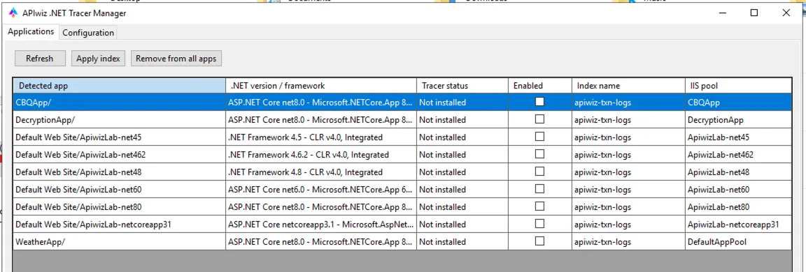

The APIwiz Windows .NET Tracer Manager captures API traffic from IIS-hosted .NET applications on Windows Server. You install it as an MSI package; it detects eligible applications, instruments them, and sends captured traffic to APIwiz.

### Compatibility

The tracer supports the following environments. Support outside this range isn't guaranteed.

### Installing the tracer

Install the tracer MSI on the Windows Server that hosts your .NET applications, and then open the Tracer Manager to view the detected applications.

**Prerequisites:** You have administrator access to a supported Windows Server.

Do the following:

1. Download the [tracer MSI package](https://drive.google.com/file/d/1hAFgzQHx_-Jb1amwSwT7sLfS0nRHWEiB/view?usp=sharing).
1. Run the MSI as an administrator.
1. Open **APIwiz .NET Tracer Manager**.
  

The **Applications** tab lists the .NET applications that the tracer detects on the server, with the following details:

## Disabling or uninstalling the tracer

Disable tracing for one application from the Tracer Manager, or uninstall the tracer from the server.

### Disabling the tracer for an application

In **APIwiz .NET Tracer Manager**, on the **Applications** tab, clear the **Enabled** check box for the application.

The tracer stops tracing the application. The watchdog service preserves this setting and doesn't re-enable the application.

### Uninstalling the tracer

In Windows, open **Add or Remove Programs**, and uninstall **APIwiz .NET Tracer Manager**.

The tracer is removed from the server.

## How the tracer instruments applications

After installation, tracer version 1.6.0 instruments applications automatically in the following stages. You can share this section with application owners and reference it in deployment documentation.

### Discovery and eligibility checks

The tracer discovers eligible IIS-hosted applications that match the supported frameworks. For more information, see [Compatibility](#bookmark-beadeedd-346b-483c-93d4-ae6a046875e7).

Before it makes changes, the tracer checks configuration accessibility, write permissions, collector settings, and the application's existing startup response. It skips and reports applications that don't pass these checks.

### Tracer configuration file

The tracer creates or updates a uniquely named JSON configuration file for each application, in the following default directory:

```text
C:\Program Files\APIwiz\DotNetTracer\apps\
```

The file contains collector credentials. Its filesystem permissions let the application's IIS application pool identity read it, while Administrators and SYSTEM keep administrative access.

The file contains the following core settings:

The file also contains the following capture and delivery settings:

### Application-specific instrumentation settings

The tracer applies settings based on the application framework:

- **ASP.NET Framework:** The tracer deploys the managed agent DLL, `Apiwiz.Classic.Agent.dll`, to the application's `bin` directory. It adds or updates the four common settings in `appSettings`. Inline settings are updated in `web.config`; if the application uses `configSource`, the tracer updates the referenced external settings file instead.
- **ASP.NET Core and modern .NET:** The tracer deploys the managed agent files to the shared APIwiz installation directory. It adds or updates the four common settings and two Core-only settings as application-specific environment variables under `aspNetCore/environmentVariables` in `web.config`.

### Application pool restarts

The tracer coordinates updates by application pool. After the initial checks, it stops the affected running pool, applies the configuration updates to the eligible applications in that pool, and starts the pool once.

Each successful group of updates causes one controlled restart, which temporarily restarts the applications in that pool.

### Startup verification and recovery

After activation, the tracer checks configuration validity and compares each application's startup response with its earlier response.

If it detects a startup regression, the tracer restores the previous configuration and instrumentation state for the affected pool group, restarts the pool, and verifies recovery.

If a configuration file, including an external settings file, can't be safely updated, the tracer skips the application and keeps no partial changes. It also leaves unsupported configuration layouts unchanged and reports them.

**Note:** These checks verify startup behavior only. They don't replace application-specific functional testing.

### Watchdog service

The MSI installs **APIwiz .NET Tracer Watchdog** \(`APIwizDotNetTracerWatchdog`\) as an automatically starting Windows service. The service scans for applications when it starts and approximately every 60 seconds, to discover new eligible applications and repair missing instrumentation.

The service preserves existing application-specific settings and applications that you disable in the Tracer Manager. Windows starts the service automatically after a server reboot; version 1.6.0 doesn't create a scheduled task.

### Failure reporting

The tracer combines the failures in an instrumentation batch into one error event and sends it to the configured APIwiz collector. The event includes the server, the affected applications, the failure reasons, and the recovery results.

The event status 500 describes the instrumentation failure; when the collector accepts the event, it returns HTTP 200. Normal application traffic continues to use its existing application indexes, and collector unavailability doesn't block application recovery.