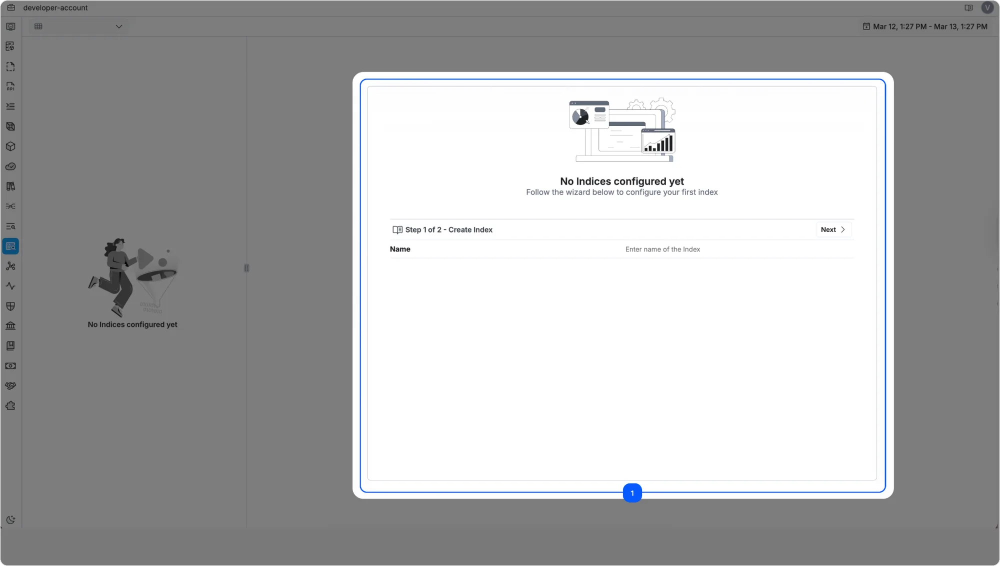

An index is a structured data container for application logs. It stores parsed, structured log entries generated from application traffic, enabling:

- Efficient search and filtering
- Log correlation using trace ID
- Time-based analysis
- Status and resource-level monitoring

Before you can ingest and analyze logs, you must configure an index that defines how incoming log data is structured, mapped, and stored in the system.

## Create your first index

When you open the Application Logs module for the first time and no index exists, the system automatically displays the **Create Index** setup wizard. This ensures that log ingestion can't proceed without a defined structure.

To create your first index, follow these steps:

1. Go to the **Application Logs** module. The **Create Index** wizard opens automatically, displaying **Step 1 of 2 – Create Index** with the message *"No Indices configured yet."*
  
1. In the **Name** field, enter a name for the index. This name identifies the index when you query and manage logs.
1. Select **Next** in the top-right corner of the panel.

The system moves to **Step 2** of the configuration process.

## Create an additional index

If you configured at least one index, you can create additional indexes from the **Index** view.

To create an index:

1. Select **Manage** \> **Create your index**. 
  
1. Enter the following details:
  Team configuration is managed in **Settings**. See [Teams](/get-started/settings/teams/).
1. Select **Save**.

The system stores the new index configuration, ensuring it can correctly interpret incoming log data for analysis and monitoring based on the defined index schema.