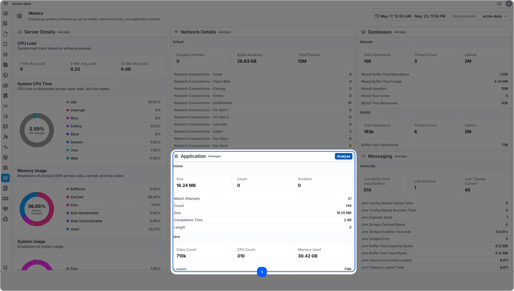
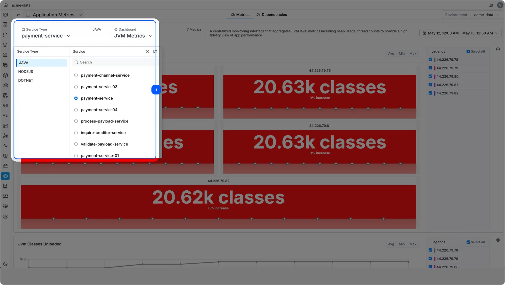
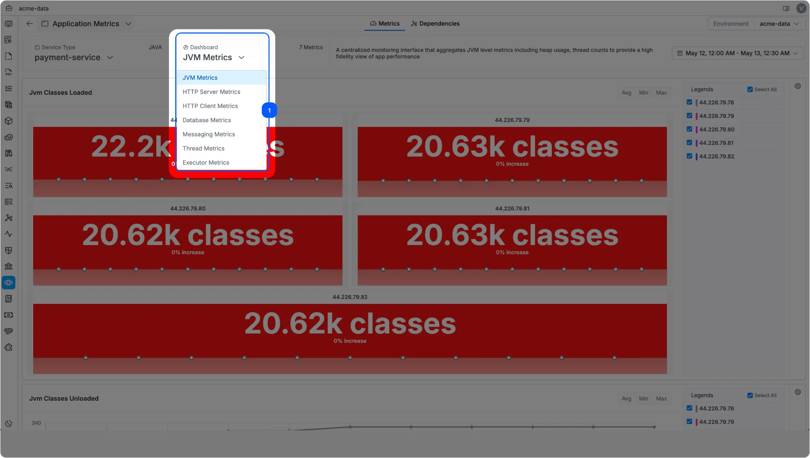
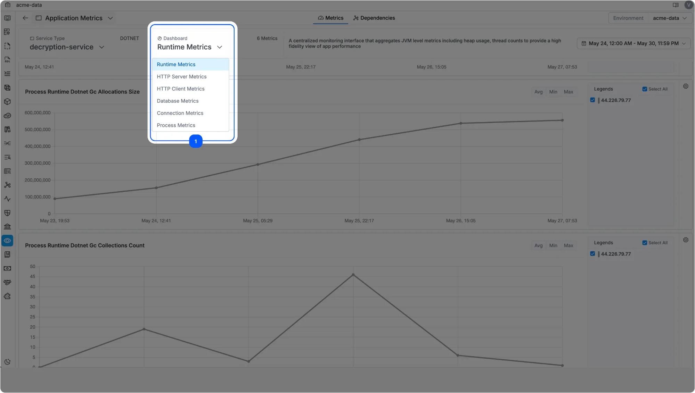
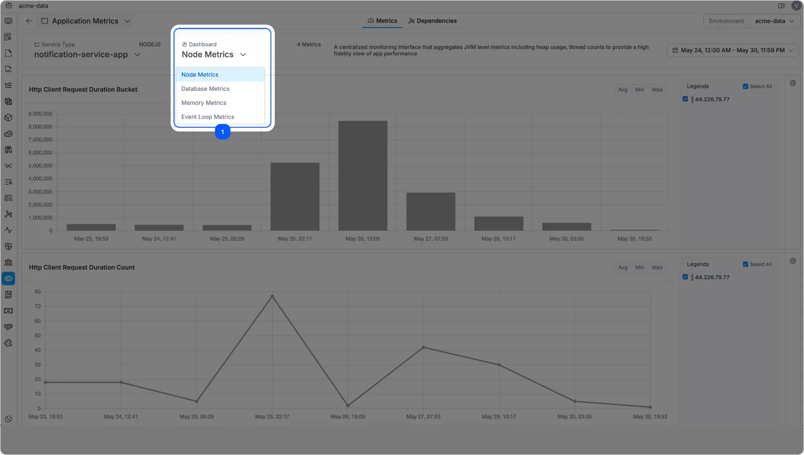
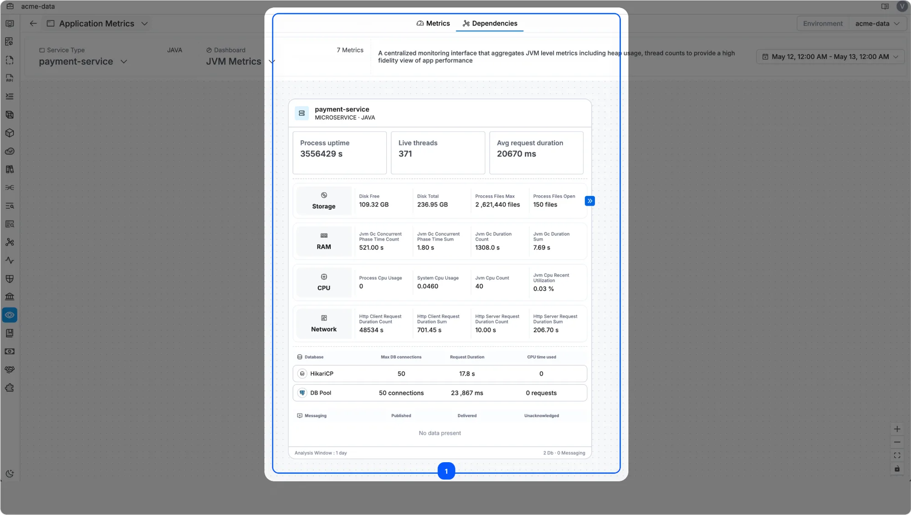

Application metrics provide visibility into the performance, health, and runtime behavior of your applications. Use the dashboard to monitor request processing, response times, resource utilization, and overall application performance.

The Observability module collects application metrics from supported application frameworks and displays them in a centralized dashboard. These metrics help you understand how applications consume resources, process workloads, and respond to user requests.

Use application metrics to:

- Monitor application health, availability, and runtime behavior.
- Track request throughput, response times, and transaction trends.
- Monitor CPU, memory, and thread utilization across multiple instances.
- Identify performance bottlenecks, slowdowns, and resource constraints.
- Troubleshoot application-related issues before they affect users.

### Prerequisites

Before you monitor application metrics, attach the appropriate language agent to your application code. The following language agents are supported:

- Java
- .NET
- Node.js

### Supported runtimes

After you configure application metrics collection, the **Application Metrics** dashboard displays application performance, runtime behavior, and performance data across your applications.

The Observability module supports the following application runtimes:

- .NET
- Java
- Node.js

The available metrics vary depending on the selected application runtime and service type. For example:

- Java applications provide JVM-related metrics such as heap memory usage, garbage collection activity, thread counts, and class loading statistics.
- .NET applications provide CLR runtime metrics such as exception counts, memory usage, garbage collection metrics, and process-level performance statistics.
- Node.js applications provide runtime-specific metrics such as event loop activity, heap utilization, garbage collection behavior, and active handles.

### Analyze application metrics

To view detailed application metrics, follow these steps:

1. Go to the **Application Metrics** dashboard.
1. Select **Analyze**.

The detailed metrics view displays:

- Average metric values
- Duration-based metrics
- Memory utilization statistics
- Runtime utilization details
- Application-specific performance metrics
- Process-level resource consumption
- Runtime health indicators

The available metrics depend on the selected application service type and runtime environment.

### Filter by service type

Filter applications by service type to view language-specific metrics and dashboards.

To filter applications by service type, follow these steps:

1. Go to **Observability** \> **Metrics** \> **Application Metrics**.
1. Select the **Service Type** filter.
  
1. Select the required service type: **Java**, **Node.js**, or **.NET**.
1. Select the required application service from the list.

The dashboard loads the runtime metrics and performance statistics for the selected application.

## Java application metrics

Select **Java** from the **Service Type** dropdown, then select the required Java application service to view Java-specific metrics and dashboards.

### Use predefined dashboards

Java application metrics are organized into the following predefined dashboards:

- JVM Metrics
- HTTP Server Metrics
- HTTP Client Metrics
- Database Metrics
- Messaging Metrics
- Thread Metrics
- Executor Metrics

To switch between dashboards, follow these steps:

1. In the left navigation pane, go to **Observability** \> **Metrics** \> **Application Metrics** \> **Java**.
1. Select the **Dashboard** filter.
  
1. Select the required dashboard category.

### JVM metrics

Use JVM metrics to monitor application performance, analyze memory utilization, track garbage collection activity, and identify runtime issues. These metrics help you maintain application stability, optimize resource utilization, and ensure efficient JVM operations.

JVM metrics are available in the following categories:

- **Class loading metrics**: Monitor loaded and unloaded classes to understand application lifecycle behavior, class-loading activity, and runtime performance.
- **CPU metrics**: Track JVM CPU utilization and CPU time consumption to evaluate processing workloads and identify CPU-intensive operations.
- **Garbage collection metrics**: Monitor garbage collection duration, execution times, and overall GC overhead to assess memory management efficiency and detect memory pressure.
- **Memory metrics**: Track committed memory, memory limits, and memory usage to evaluate memory consumption patterns and resource allocation.
- **Thread metrics**: Monitor active thread counts to understand application concurrency, workload distribution, and thread utilization.

Use JVM metrics to:

- Monitor JVM performance and application health.
- Analyze memory utilization and garbage collection activity.
- Identify CPU-intensive workloads and resource bottlenecks.
- Evaluate thread utilization and application concurrency.
- Troubleshoot runtime issues and performance degradation.
- Support capacity planning and resource optimization.
- Maintain the reliability and scalability of Java-based applications.

Select **JVM Metrics** from the **Dashboard** filter dropdown.

The following table lists all available JVM metrics, their graph types, and descriptions:

### HTTP Server metrics

Use HTTP Server metrics to monitor request performance, analyze latency, track request volumes, and identify application responsiveness issues.

HTTP Server metrics are available in the following categories:

- **Request duration distribution metrics**: Monitor request duration buckets to analyze how HTTP requests are distributed across different latency ranges.
- **Request volume metrics**: Track the total number of HTTP requests processed to understand traffic patterns and server demand.
- **Request latency metrics**: Monitor maximum, minimum, and cumulative request durations to evaluate application responsiveness.
- **Performance trend metrics**: Analyze request duration trends over time to detect performance degradation and latency spikes.

Use HTTP Server metrics to:

- Monitor HTTP server performance and availability.
- Analyze request latency and application responsiveness.
- Track request volumes and traffic patterns.
- Identify slow-performing endpoints and performance bottlenecks.
- Detect latency spikes and performance degradation.
- Support capacity planning and performance optimization.

Select **HTTP Server Metrics** from the **Dashboard** filter dropdown.

The following table lists all available **HTTP Server Metrics**, their graph types, and descriptions:

### Messaging metrics

Use Messaging metrics to monitor queue activity, analyze message flow, track processing efficiency, and identify messaging issues.

Messaging metrics are available in the following categories:

- **Queue metrics**: Monitor the number of messages waiting in queues to evaluate queue utilization, message backlog, and processing efficiency.
- **Message flow metrics**: Track message accumulation and consumption patterns to understand workload distribution and processing behavior.
- **Processing performance metrics**: Identify delays in message handling and detect situations where message production exceeds consumption capacity.
- **Messaging health metrics**: Monitor queue growth trends to assess the overall health and stability of messaging systems.

Use Messaging metrics to:

- Monitor messaging system health and availability.
- Track queue utilization and message backlog trends.
- Analyze message flow and workload distribution.
- Identify consumer bottlenecks and processing delays.
- Detect imbalances between message production and consumption.
- Support capacity planning and infrastructure optimization.

Select **Messaging Metrics** from the **Dashboard** filter dropdown.

The following table lists all available **Messaging Metrics**, their graph types, and descriptions:

### Thread metrics

Use Thread metrics to monitor thread activity, analyze concurrency levels, track thread utilization, and identify application responsiveness issues.

Thread metrics are available in the following categories:

- **Daemon thread metrics** – Monitor daemon threads that perform background tasks, such as garbage collection, monitoring, and internal JVM operations.
- **Live thread metrics** – Track the number of active threads currently running in the JVM to evaluate application workload and concurrency levels.
- **Peak thread metrics** – Monitor the highest number of live threads observed during a selected period to identify workload spikes and concurrency surges.
- **Thread lifecycle metrics** – Track the total number of threads started by the JVM to analyze thread creation patterns and long-term workload trends.

Use Thread metrics to:

- Monitor thread activity and JVM health.
- Analyze concurrency levels and thread utilization.
- Track thread creation patterns and workload trends.
- Identify thread growth and resource-intensive operations.
- Detect thread-related performance bottlenecks.
- Optimize thread management and application responsiveness.
- Support capacity planning and performance optimization.

Select **Thread Metrics** from the **Dashboard** filter dropdown.

The following table lists all available\*\* Thread Metrics\*\*, their graph types, and descriptions:

### Executor metrics

Use Executor metrics to monitor thread pool activity, analyze task execution performance, track queue utilization, and identify workload processing issues.

Executor metrics are available in the following categories:

- **Task execution metrics** – Monitor active and completed tasks to evaluate processing activity, task throughput, and execution efficiency.
- **Thread pool metrics** – Track executor pool size to understand thread allocation, resource utilization, and executor capacity.
- **Queue utilization metrics** – Monitor queued tasks and remaining queue capacity to assess workload distribution and identify potential processing delays.
- **Workload management metrics** – Analyze executor activity and queue behavior to detect workload spikes, resource contention, and task-processing bottlenecks.

Use Executor metrics to:

- Monitor executor performance and thread pool activity.
- Analyze task execution efficiency and throughput.
- Track queue utilization and workload distribution.
- Identify task-processing delays and execution bottlenecks.
- Detect workload spikes and resource contention.
- Optimize thread pool configuration and resource allocation.
- Support capacity planning and performance optimization.

Select **Executor Metrics** from the **Dashboard** filter dropdown.

The following table lists all available **Executor Metrics**, their graph types, and descriptions:

## .NET application metrics

Select **.NET** from the **Service Type** dropdown, then select the required .NET application service to view .NET-specific metrics and dashboards.

### Use predefined dashboards

.NET application metrics are organized into the following predefined dashboards:

- Runtime Metrics
- HTTP Server Metrics
- HTTP Client Metrics
- Database Metrics
- Connection Metrics
- Process Metrics

To switch between dashboards, follow these steps:

1. In the left navigation pane, go to **Observability** \> **Metrics** \> **Application Metrics** \> **.NET**.
1. Select the **Dashboard** filter.
  
1. Select the required dashboard category.

### Runtime metrics

Use Runtime metrics to monitor application execution, analyze memory management, track garbage collection activity, and identify runtime performance issues.

.NET Runtime metrics are available in the following categories:

- **Assembly metrics** – Monitor the number of assemblies loaded by the .NET runtime to understand application composition and runtime behavior.
- **Exception metrics** – Track runtime exceptions to identify application errors, stability issues, and abnormal execution patterns.
- **Garbage collection metrics** – Monitor memory allocations, object sizes, garbage collection frequency, and duration to evaluate memory management efficiency.
- **JIT compilation metrics** – Track compilation time, compiled code size, and compiled method counts to analyze runtime compilation activity and startup behavior.
- **Thread pool metrics** – Monitor thread pool threads, queue lengths, and completed work items to evaluate task processing efficiency and workload distribution.
- **Synchronization metrics** – Track monitor lock contention events to identify thread synchronization bottlenecks and concurrency issues.
- **Timer metrics** – Monitor active runtime timers to understand scheduled task activity and timer resource utilization.

Use Runtime metrics to:

- Monitor .NET runtime performance and application health.
- Analyze memory usage and garbage collection activity.
- Track runtime exceptions and application stability.
- Evaluate thread pool performance and workload distribution.
- Identify thread synchronization bottlenecks and concurrency issues.
- Analyze JIT compilation activity and application startup behavior.
- Support capacity planning and performance optimization.

Select **Runtime Metrics** from the **Dashboard** filter dropdown.

The following table lists all available **.NET Runtime Metrics**, their graph types, and descriptions:

### HTTP Server metrics

Use HTTP Server metrics in .NET to monitor request performance, analyze response latency, track request volumes, and identify application responsiveness issues.

HTTP Server metrics are available in the following categories:

- **Request activity metrics** – Monitor active HTTP requests to understand current server workload and request concurrency.
- **Request volume metrics** – Track the total number of HTTP requests processed to analyze traffic patterns and application usage.
- **Request duration metrics** – Monitor minimum, maximum, and cumulative request durations to evaluate application responsiveness.
- **Request latency distribution metrics** – Analyze request duration buckets to understand response-time distribution and identify slow-performing requests.
- **Performance trend metrics** – Track request-processing behavior over time to detect workload spikes and performance degradation.

Select **HTTP Server Metrics** from the **Dashboard** filter dropdown.

The following table lists all available **HTTP Server Metrics**, their graph types, and descriptions:

### HTTP Client metrics

Use HTTP Client metrics in .NET to monitor outbound request performance, analyze response latency, track request volumes, and identify communication issues with external services.

HTTP Client metrics are available in the following categories:

- **Request activity metrics**: Monitor active outgoing HTTP requests to understand client-side workload and communication activity with external services.
- **Request volume metrics**: Track the total number of outbound HTTP requests to analyze traffic patterns and dependency interactions.
- **Request duration metrics**: Monitor minimum, maximum, and cumulative request durations to evaluate communication performance and identify latency issues.
- **Request latency distribution metrics**: Analyze request duration buckets to understand response-time distribution and identify slow external service calls.
- **Dependency performance metrics**: Track the responsiveness of downstream services and external APIs to identify performance bottlenecks.
- **Communication trend metrics**: Monitor request-processing trends over time to evaluate application behavior and external dependency health.

Select **HTTP Client Metrics** from the **Dashboard** filter dropdown.

The following table lists all available **HTTP Client metrics**, their graph types, and descriptions:

### Connection metrics

Use Connection metrics in .NET to monitor client connection activity, analyze connection duration patterns, track connection volumes, and identify server connectivity issues.

Connection metrics are available in the following categories:

- **Connection activity metrics** – Monitor active and queued connections to understand current server load and processing capacity.
- **Connection duration metrics** – Track minimum, maximum, and cumulative connection durations to evaluate connection behavior.
- **Connection distribution metrics** – Analyze connection duration buckets to understand connection lifetime patterns and detect abnormal trends.
- **Connection volume metrics** – Monitor the total number of connections established over time to evaluate traffic patterns and server utilization.
- **Connection performance metrics** – Track queued connections and connection durations to identify processing delays and resource constraints.

Select **Connection Metrics** from the **Dashboard** filter dropdown.

The following table lists all available **Connection Metrics**, their graph types, and descriptions:

### Process metrics

Use Process metrics in .NET to monitor CPU utilization, analyze memory consumption, track thread activity, and identify resource-related performance issues.

Process metrics are available in the following categories:

- **CPU metrics** – Monitor available CPU cores and CPU time consumption to understand processing capacity and workload distribution.
- **Memory metrics** – Track physical memory usage and virtual memory allocation to evaluate memory consumption patterns and application memory footprint.
- **Thread metrics** – Monitor the number of active threads within the process to understand concurrency levels and thread utilization.
- **Resource utilization metrics** – Analyze CPU, memory, and thread activity together to identify performance bottlenecks and resource constraints.

Select **Process Metrics** from the **Dashboard** filter dropdown.

The following table lists all available **Process Metrics**, their graph types, and descriptions:

## Node.js application metrics

Select **Node.js** from the **Service Type** dropdown, then select the required Node.js application service to view Node.js-specific metrics and dashboards.

### Use predefined dashboards

Node.js application metrics are organized into the following predefined dashboards:

- Node Metrics
- Database Metrics
- Memory Metrics
- Event Loop Metrics

To switch between dashboards, follow these steps:

1. In the left navigation pane, go to **Observability** \> **Metrics** \> **Application Metrics** \> **Node.js**.
1. Select the **Dashboard** filter.
  
1. Select the required dashboard category.

### Node metrics

Use Node metrics to monitor HTTP communication performance, analyze request latency, track request volumes, and identify application responsiveness issues.

Node metrics are available in the following categories:

- **HTTP client metrics**: Monitor outbound HTTP requests, request volumes, latency distribution, and response times to evaluate the performance of external service calls.
- **HTTP server metrics**:Track inbound HTTP request activity, request-processing durations, and traffic patterns to assess application responsiveness.
- **Latency distribution metrics**: Analyze request duration buckets for both client and server requests to understand response-time distribution.
- **Request volume metrics**: Monitor the number of inbound and outbound requests processed over time to evaluate workload trends.
- **Performance metrics**: Track minimum, maximum, and cumulative request durations to identify latency spikes and bottlenecks.

Select **Node Metrics** from the **Dashboard** filter dropdown.

The following table lists all available **Node Metrics**, their graph types, and descriptions:

### Memory metrics

Use Memory metrics in Node.js to monitor JavaScript runtime memory utilization, analyze garbage collection activity, track heap usage, and identify memory-related performance issues.

Memory metrics are available in the following categories:

- **Garbage collection metrics** – Monitor garbage collection frequency, duration, and execution patterns to evaluate memory cleanup efficiency.
- **GC latency distribution metrics** – Analyze garbage collection duration buckets to understand how GC execution times are distributed.
- **Heap utilization metrics** – Track heap memory usage to monitor consumption patterns, detect abnormal growth, and identify potential memory leaks.
- **Heap capacity metrics** – Monitor configured heap memory limits to understand available memory capacity and overall utilization.
- **Memory performance metrics** – Evaluate the relationship between memory consumption and garbage collection activity to identify resource constraints.

Select **Memory Metrics** from the **Dashboard** filter dropdown.

The following table lists all available **Memory Metrics**, their graph types, and descriptions:

### Event Loop metrics

Use Event Loop metrics in Node.js to monitor event loop performance, measure application responsiveness, track workload intensity, and identify latency-related performance issues.

Event Loop metrics are available in the following categories:

- **Event Loop Delay metrics** – Monitor minimum, maximum, average, and percentile-based event loop delays to evaluate application responsiveness and identify blocking operations.
- **Latency Distribution metrics** – Track P50, P90, and P99 event loop delay values to understand typical, high-load, and worst-case latency scenarios.
- **Performance Variability metrics** – Monitor event loop delay standard deviation to assess latency consistency and identify performance fluctuations.
- **Event Loop Utilization metrics** – Track the percentage of time the event loop is actively processing tasks to evaluate workload intensity.
- **Responsiveness metrics** – Analyze delay trends and utilization patterns to detect performance degradation and potential scalability issues.

Select **Event Loop Metrics** from the **Dashboard** filter dropdown.

The following table lists all available **Event Loop Metrics**, their graph types, and descriptions:

## Application metrics dependencies

The **Application Metrics Dependencies** view displays a visual representation of the relationships between application metric categories and their associated metrics. Use this view to understand how application metrics are connected and to analyze the metrics that contribute to overall application performance.

Use the Application Metrics Dependencies view to:

- Understand relationships between application metric categories and individual metrics.
- Explore metrics associated with specific application components.
- Identify dependencies between runtime, infrastructure, database, and messaging metrics.
- Investigate performance issues by examining related metrics.

### View application metric dependencies

To view application metric dependencies, follow these steps:

1. Open the **Application Metrics** dashboard.
1. Select the **Dependencies** tab.
  

The dependency view displays the selected application and its associated metric categories. Each category contains related metrics that contribute to the overall performance of the application.

The following metric categories are available:

### View dependent metrics

To view dependent metrics for a category, follow these steps:

1. In the dependency view, point to the metric category you want to explore.
1. Select the blue arrow that appears next to the category.

The associated metrics and metric values for the selected category are displayed.

### View detailed metrics

The detailed metrics panel displays all metrics, statistics, and performance data associated with a selected metric category.

To view detailed metrics, follow these steps:

1. In the dependency view, select **View More** in the metric category card.

The detailed metrics panel opens and displays all metrics and performance data for the selected category.

For example, selecting **View More** in the **RAM** category displays detailed JVM memory, class loading, buffer, and garbage collection metrics.

Use the detailed metrics view to:

- Analyze metric values and performance trends.
- Investigate resource utilization and runtime behavior.
- Identify potential performance bottlenecks.
- Troubleshoot application performance issues using detailed metric data.