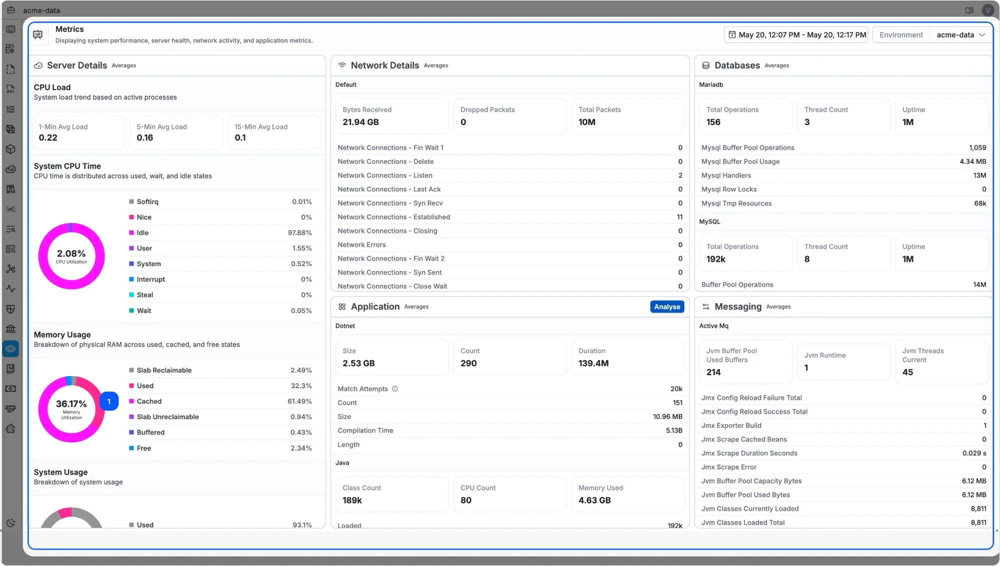

The Observability module organizes metrics into the following five primary categories:

- Servers
- Networks
- Applications
- Databases
- Messaging systems

## Server metrics

Server metrics monitor the health, performance, and resource utilization of infrastructure components. The Observability module supports monitoring for the following infrastructure types:

- Virtual machines \(VMs\)
- Host machines
- Kubernetes clusters

The available metrics vary based on the infrastructure component you monitor. For example:

- Virtual machines and host machines provide metrics such as CPU utilization, memory usage, disk activity, system load, and network traffic.
- Kubernetes environments provide cluster-specific metrics, including node health, pod activity, container resource consumption, and workload performance.

### What you can monitor

Use server metrics to monitor the following:

- CPU utilization
- Memory utilization
- Disk usage and activity
- System load
- Network traffic
- Node health
- Container resource consumption
- Infrastructure availability

Use server metrics to identify resource bottlenecks, monitor infrastructure performance, troubleshoot system issues, and maintain overall platform stability.

## Network metrics

Network metrics monitor communication and transport activity across systems and network infrastructure. These metrics track the following:

- Network input/output \(I/O\)
- Packet loss
- Packet transport errors
- Network throughput
- Data transmission rates
- Communication health

### What you can monitor

Use network metrics to monitor the following:

- Network utilization
- Data transfer performance
- Packet delivery reliability
- Communication latency
- Connection stability
- Network availability

Use network metrics to identify network bottlenecks, troubleshoot connectivity issues, detect communication failures, and ensure reliable data transmission across distributed environments.

## Application metrics

Application metrics monitor code-level performance for supported application frameworks. The Observability module supports the following application runtimes:

- .NET
- Java
- Node.js

The available metrics depend on the application runtime. For example:

- Java applications display JVM memory usage and Garbage Collection \(GC\) metrics.
- Node.js applications display runtime-specific metrics, such as event loop activity.

### What you can monitor

Use application metrics to monitor application performance, memory consumption, request handling, runtime behavior, and application health.

## Database metrics

Database metrics monitor internal database activity, resource utilization, and operational performance. The Observability module supports monitoring for various database platforms, including relational and NoSQL databases. The available metrics vary based on the database technology you monitor. For example:

- Relational databases provide metrics such as active connections, query activity, transaction rates, and backend process utilization.
- NoSQL databases provide metrics related to data operations, storage utilization, replication activity, and database health.

### What you can monitor

Use database metrics to monitor the following:

- Active backend processes
- Database operations
- Query activity
- Connection usage
- Transaction performance
- Storage utilization
- Replication status
- Database health

Use database metrics to identify performance bottlenecks, monitor query execution behavior, troubleshoot connection issues, detect resource-intensive operations, and maintain optimal database performance.

## Messaging metrics

Messaging metrics monitor the health, performance, and operational activity of messaging platforms and message broker systems. The Observability module supports the following messaging platforms:

- ActiveMQ
- Kafka
- RabbitMQ

The available metrics vary based on the messaging platform you monitor. For example:

- **ActiveMQ** provides JVM and broker-level metrics, including memory usage, thread activity, connection statistics, and message processing metrics.
- **Kafka** provides cluster and partition-level metrics, such as broker availability, partition offsets, replication status, and topic activity.
- **RabbitMQ** provides queue and consumer metrics, including queue depth, message throughput, consumer utilization, connection activity, and broker resource consumption.

### What you can monitor

Use messaging metrics to monitor the following:

- Broker health and availability
- Message throughput
- Queue activity
- Consumer performance
- Connection utilization
- Replication status
- Resource consumption
- JVM performance \(where applicable\)
- Message processing efficiency

Use messaging metrics to identify processing bottlenecks, detect message backlogs, monitor broker performance, troubleshoot communication issues, and ensure reliable message delivery across your messaging infrastructure.