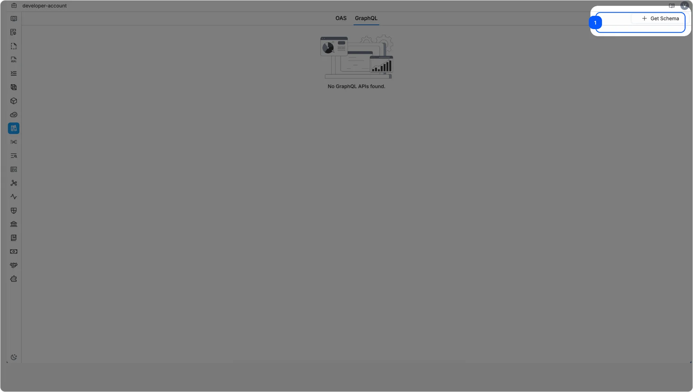

When you select the **GraphQL** tab, the Catalog displays all published GraphQL APIs available in the selected environment.

Each GraphQL API appears as a catalog card that includes:

- Catalog name
- Description
- Associated category or schema

Use these cards to quickly review and access the available GraphQL APIs.

If no GraphQL APIs are published, the catalog displays a blank state message indicating that no GraphQL APIs were found.

### Why add a GraphQL schema

Adding a GraphQL schema establishes a centralized, version-controlled source of truth within the API Catalog. It helps you:

- Discover available queries, mutations, and types.
- Maintain consistency and governance across services.
- Reuse APIs across teams.
- Integrate with downstream development tools.
- Provide clear, reliable API documentation for consumers.

By maintaining GraphQL schemas in the catalog, you can manage, scale, and govern your APIs more effectively throughout their lifecycle.

## Add a GraphQL schema

If no GraphQL schemas exist, add one using the **\+ Get Schema** option.

To add a schema, follow these steps:

1. Select the **GraphQL** tab.
1. In the upper-right corner, select **\+ Get Schema**. The **Schema Details** panel opens on the right side of the screen.
  
1. Enter the required information:

1. Select **Save**.

A confirmation message appears, and the new GraphQL schema appears in the Catalog.

## Manage GraphQL schemas

Each GraphQL catalog entry includes a **More options** \(⋮\) menu, where you can edit or delete the schema.

To manage a GraphQL schema, follow these steps:

1. Next to the GraphQL entry, select the **More options** \(⋮\) icon.
  
1. Select an action: