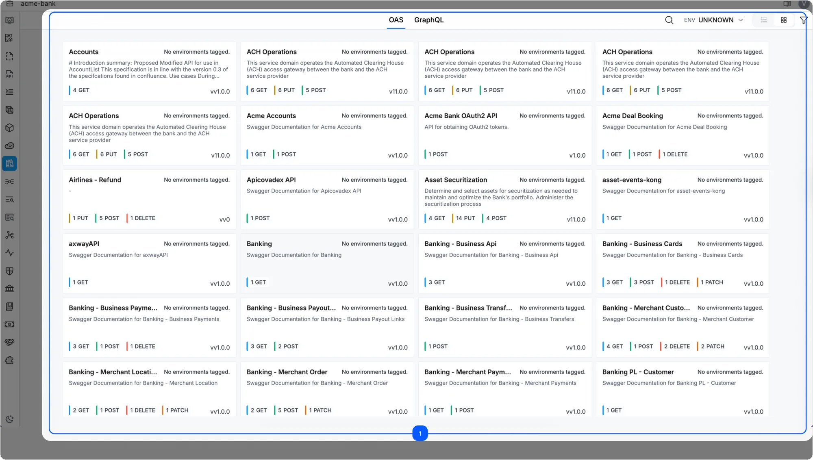
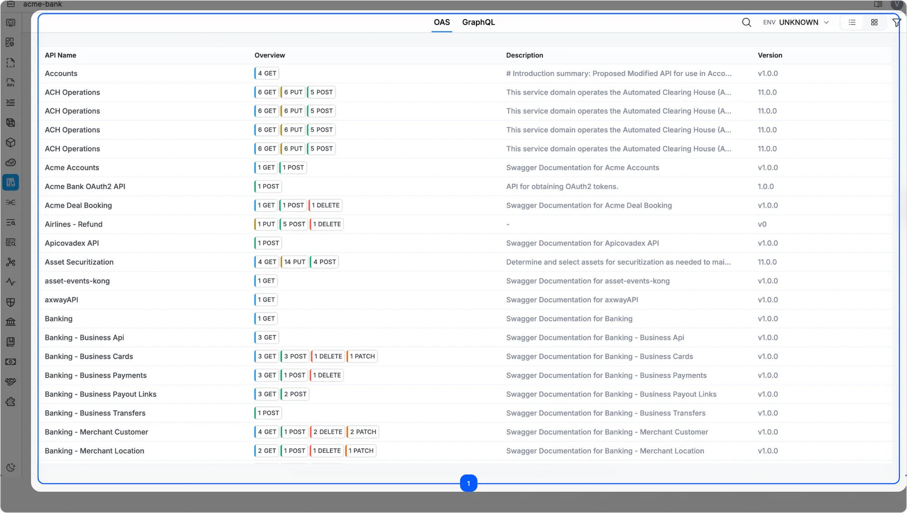
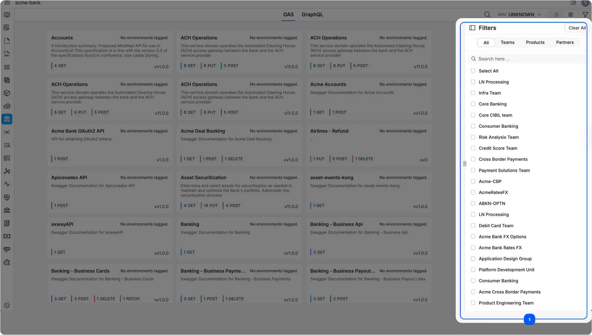

When you open the API Catalog, the OAS \(OpenAPI Specification\) view appears by default. This view lists all published OpenAPI specifications in the catalog.

The Catalog module supports two specification types:

Use the **OAS** and **GraphQL** tabs at the top of the page to switch between views.

### Explore published specifications

The Catalog area displays all available API specifications for the selected specification type. Each catalog card represents a published API and includes:

- API name
- Short description
- Available HTTP methods
- API version

Use these cards to quickly identify and explore the APIs in the catalog.

### Search for a specification

Use the **Search** field in the upper-right corner of the page to find a specific API specification.

To search for a specification, follow these steps:

1. In the **Search** field, enter the API name or a related keyword. The catalog filters the results as you type.
1. Select the API you want from the filtered results.

This helps you quickly locate specific APIs in large catalogs.

### Filter by environment

Use the **Environment** selector next to the **Search** field to filter API specifications by deployment environment, such as DEV, UAT, or PROD. This helps you quickly identify which APIs are available for testing, development, or production use.

#### Prerequisites

- Environments are configured in the **Environment Map** card, under **APIwiz Integration** in the **Connectors** module.
  ### To learn how to configure environments, see

  Environment Map

To filter APIs by environment, follow these steps:

1. In the top-right corner of the catalog, locate the **Environment** selector.
1. Select the dropdown menu.
1. Select the environment you want from the list.

The catalog refreshes to display only the specifications mapped to the selected environment.

#### Why use environment filtering

Environment filtering helps you:

- Identify APIs available in a specific deployment stage.
- Validate APIs before promoting them to production.
- Reduce clutter by displaying only relevant APIs.
- Switch quickly between development, testing, and production environments.

### Change the display format

The Catalog lets you switch between **List View** and **Card View**, depending on how you prefer to browse APIs. The display format options appear next to the **Environment** selector, in the top-right corner of the page.

#### List View

List View displays API specifications in a table, with the following columns:

- API Name
- Overview \(HTTP methods\)
- Description
- Version
  

Use this view to compare multiple APIs and review detailed information in a single table.

#### Card View

Card View displays API specifications as individual cards. Each card includes:

- API name
- Tagged environment
- Short description
- Available HTTP methods
- API version
  

Use this view for quick browsing and visual navigation through the catalog.

To switch the display format, follow these steps:

1. In the top-right corner of the page, locate the **Display Format** icons.
1. Select the **List View** icon to display specifications in a table, or select the **Card View** icon to display specifications as cards.

The catalog updates immediately to reflect the selected view.

### Filter the OAS Catalog

Use the **Filter** option, next to the **Display Format** icons, to narrow the list of API specifications by organizational category:

To filter API specifications, follow these steps:

1. Select the **Filter** icon in the top-right corner of the page.
1. In the **Filters** panel, select a category: **Teams**, **Products**, or **Partners**.
  
1. Select one or more options from the list.

The catalog updates to display only the APIs that match the selected filters.

### Clear filters

To remove applied filters and view all available specifications, follow these steps:

1. Open the **Filters** panel.
1. Select **Clear All** in the upper-right corner.

The catalog resets to display the complete list of specifications.