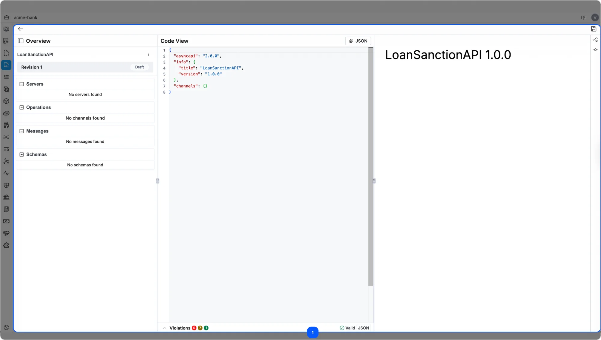

In the **General Information** section, select **Edit**. The AsyncAPI Editor interface opens.

The editor is divided into four primary sections:

- [Overview panel](#overview-panel)
- [Code view](#code-view)
- [Violations Summary](#violations-summary)
- [Preview panel](#preview-panel)

# Overview panel

The overview panel on the left displays a hierarchical view of the AsyncAPI specification, helping you navigate and manage its core elements.

#### Specification overview

#### AsyncAPI components

# Code view

The code view in the center provides a structured editor to view and modify the AsyncAPI specification directly.

#### Editing the specification

- The built-in editor displays the AsyncAPI definition.
- By default, the specification opens in JSON format.
- Use the format toggle in the top-right corner to switch between JSON and YAML.

#### Editor capabilities

- Supports direct editing of the AsyncAPI specification.
- Applies syntax highlighting for JSON and YAML to improve readability and reduce syntax errors.

#### AsyncAPI data representation

AsyncAPI specifications are defined in JSON or YAML format and include the following elements:

# Violations Summary

The **Violations Summary** panel displays validation results for the AsyncAPI specification.

# Preview

The right panel provides a rendered, documentation-style view of the AsyncAPI specification, allowing you to understand the API without reviewing the raw JSON or YAML.

**API overview**

#### AsyncAPI components

The preview panel displays the following components when they are defined:

# Save the AsyncAPI

In the top-right corner of the editor, select **Save** to store your changes.