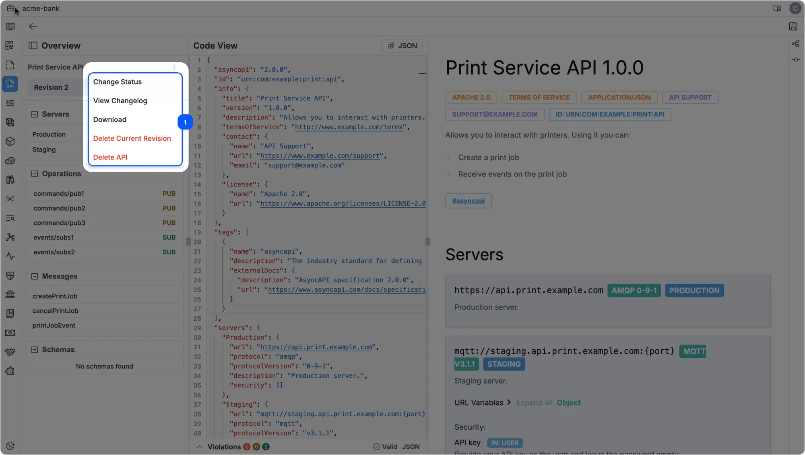
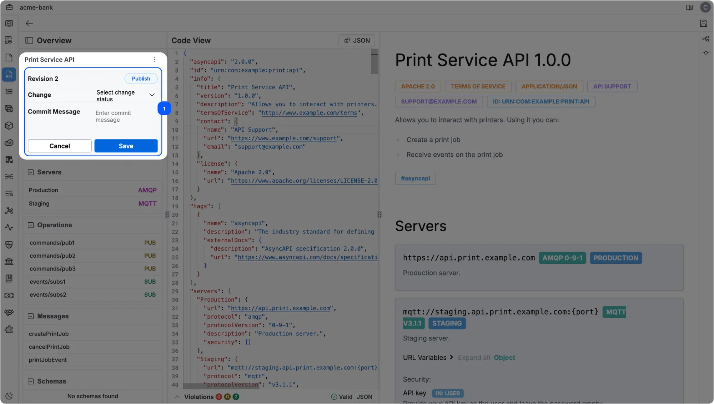
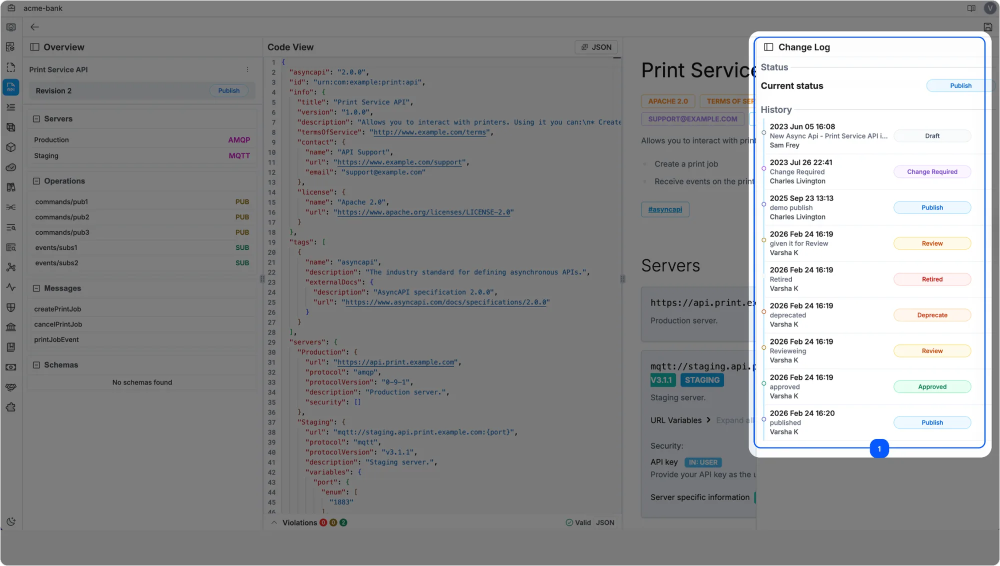

To access management options for an AsyncAPI, select the three-dot menu next to the AsyncAPI name.

The following options are available:

- [Change status](#change-status)
- [View changelog](#view-the-changelog)
- [Download](#download-an-asyncapi)
- [Delete current revision](#delete-the-current-revision)
- [Delete API](#delete-an-asyncapi)

# Change status

To update the lifecycle status of an AsyncAPI, follow these steps:

1. Select **Change Status**. A dialog box opens.
  
1. In the dropdown, select the new status.
1. In the commit message field, enter a description of the change.
1. Select **Save** to apply the update.

# View the changelog

Select **Changelog**. The **Change Log** panel opens on the right side of the screen.

The panel displays the history of all status updates, including the following:

# Download an AsyncAPI

Select **Download** to download the AsyncAPI definition as a .json file.

# Delete the current revision

Select **Delete Current Revision** to permanently delete the currently selected revision of the AsyncAPI.

# Delete an AsyncAPI

Select **Delete API** to permanently delete the entire AsyncAPI, including all its revisions.