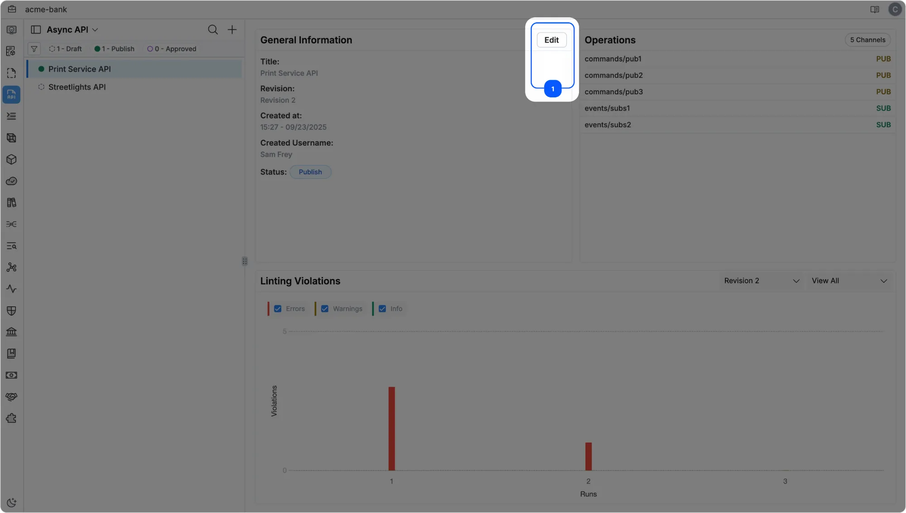
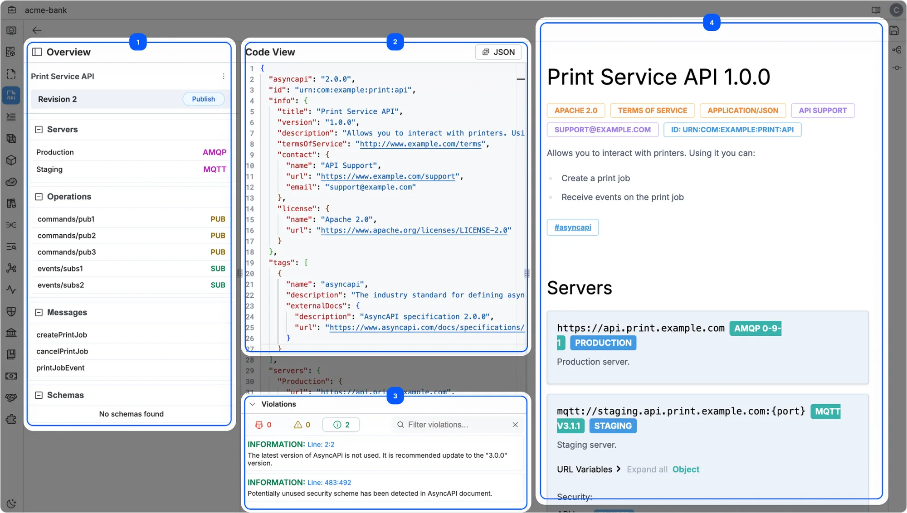

To modify an AsyncAPI, follow these steps:

1. From the AsyncAPI list, select the AsyncAPI you want to modify.
1. Next to **General Information**, select **Edit**. The AsyncAPI opens in the editor.
  
1. In the **Code View**, update the specification as required.
  