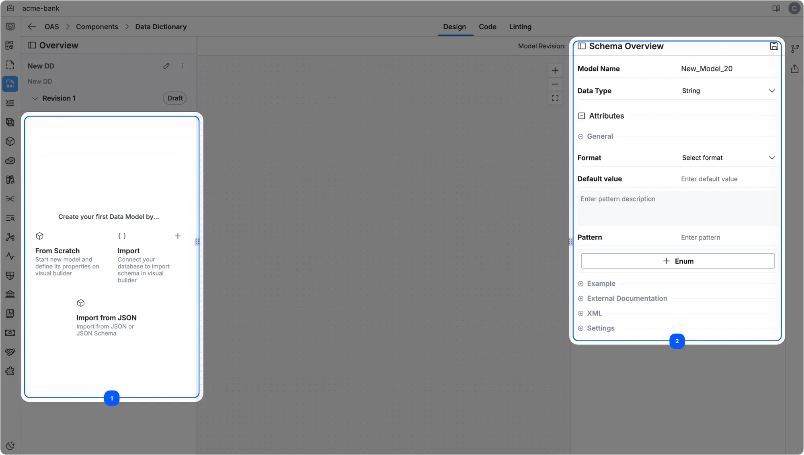
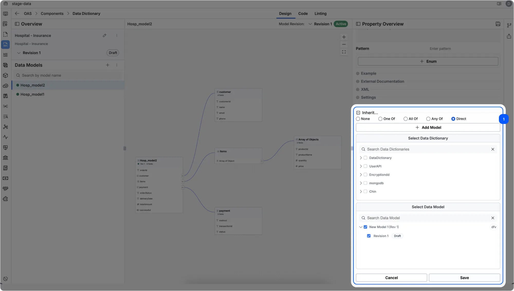
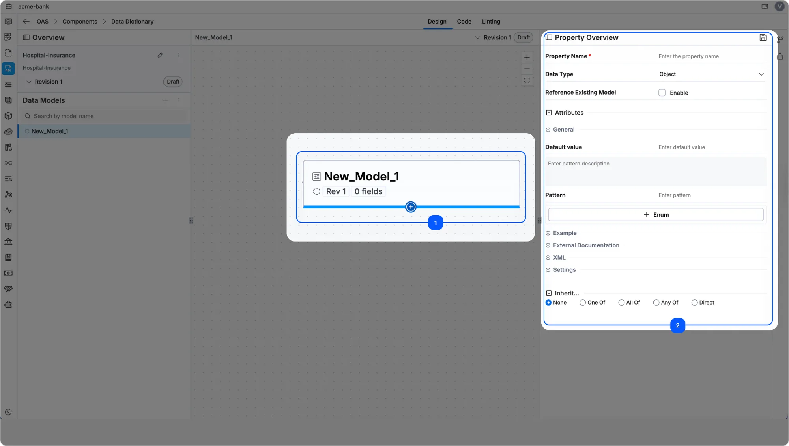
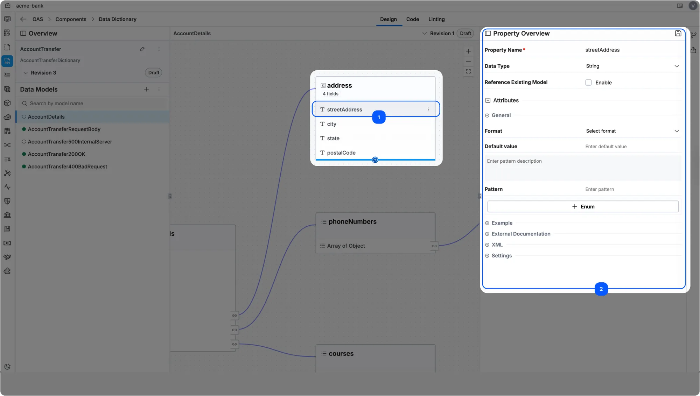

The **Data Dictionary** in OAS displays all the data models and their structures used in the API. Use the Data Dictionary to view, design, and manage the models that define request and response payloads.

After you [create a Data Dictionary](https://docs.apiwiz.io/guides?guideId=6a22b872070047a3a81f4972&groupId=Working+with+OAS&pageId=6a27bf11070047a3a81f543d#9e9c45d6-095c-44ad-973b-3715ba23bd29) from **Global Components**, the system redirects you to the **Design** page.

In the left panel, the **Overview** section displays the following information:

The main panel allows you to design the data models within the Data Dictionary.

# Creating a data model

You can create a data model using one of the following methods, available from the **Overview** panel:

## Create a data model from scratch

To create a new data model from scratch, do the following:

1. In the **Overview** panel, select **From Scratch** if no data models exist, or select **\+** next to **Data Models** if models already exist. The **Schema Overview** form opens in the right pane.
  
1. Configure the following fields:
  - **Model Name**: Enter a meaningful name for the data model. The default name is New\_Model\_XX. For example, CustomerResponse or PaymentDetailsResponse.
  - **Data Type**: Select the data type for the model.
1. Select **Save** \(floppy disk icon\) in the top-right corner.

The system saves the model and it appears in the **Data Models** list.

### Data type configuration

The available attributes update based on the data type you select. Configure the following options for each data type.

#### String

Defines validation rules and constraints for string values.

#### Boolean

Allows only true or false values. Typically used for flags or toggle-based fields.

#### Integer

Defines numeric validation options for whole numbers.

#### Number

Supports decimal and floating-point values. Useful for measurements, pricing, and calculated values.

#### Array

Represents a list of values. Commonly used for collections of related data.

#### Object

Represents a structured data model with properties. Used to model complex data structures.

#### Double

Supports high-precision decimal values. Used for precision-sensitive numeric values.

### Additional attributes

The following attribute sections are available for all data types.

**Example**

Enter a sample value for documentation and testing. Use this value in the **Try Out** section to validate API functionality. For example, "customerId": "CUST001".

**External Documentation**

Add links to reference documentation for the model, such as a URL pointing to business rules or API guidelines.

**XML**

Defines how the property is represented in XML. Select **\+** to add values and the trash icon to delete them.

**Settings**

Defines additional schema constraints and behaviors.

### Inheritance

Use the **Inheritance** option to import one model into another and define how the models relate.

The following inheritance options are available:

To add a model using inheritance, do the following:

1. Select the required inheritance type.
1. Select **\+ Add Model**. Two panels appear: **Select Data Dictionary** and **Select Data Model**.
  
1. In the **Select Data Dictionary** panel, select the checkboxes for the Data Dictionaries that contain the models you want to import.
1. In the **Select Data Model** panel, select the required data models.
1. Select **Save**.

The selected models are inherited into the current model according to the chosen inheritance type.

## Add a property to a data model

To add a property to a data model, the model must use the **Object** data type. Do the following:

1. On the design canvas, select the data model and select **\+**. The **Property Overview** panel opens in the right pane.
  
1. Define the property details, such as the property name, data type, and attributes.
1. Select **Save**.

## Edit a property on an individual field

To edit a property on an individual field, do the following:

1. On the design canvas, hover over the required data field.
1. Select the **More Options** menu \(**⋮**\) and select **Edit**. The **Property Overview** panel opens in the right pane.
  
1. Add or update the property details for the selected field.
1. Select **Save**.