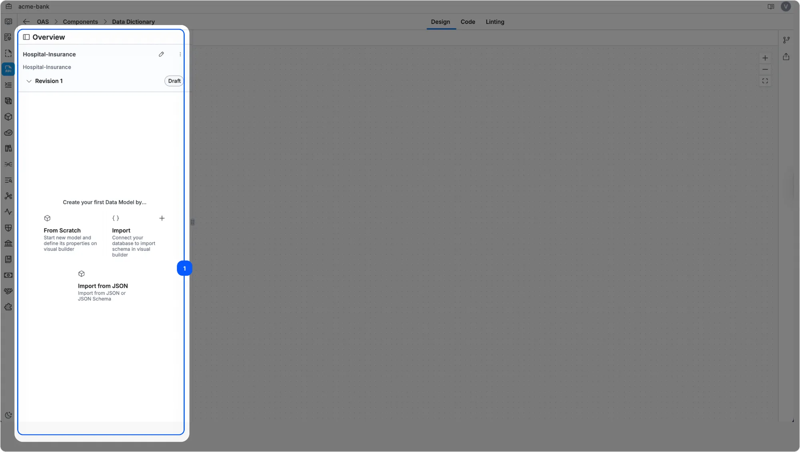
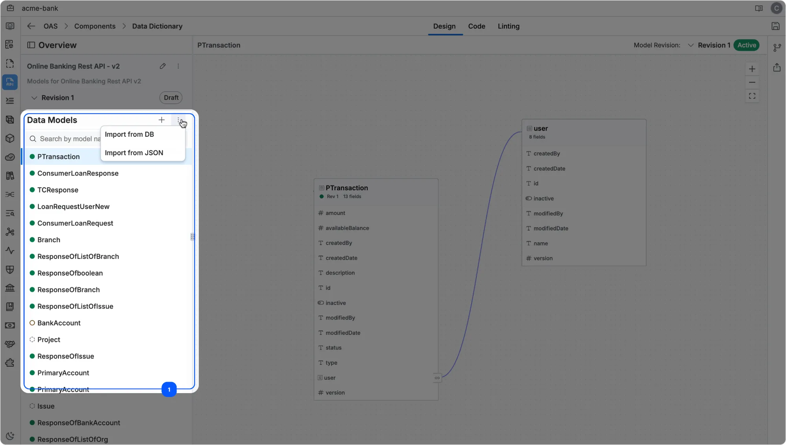
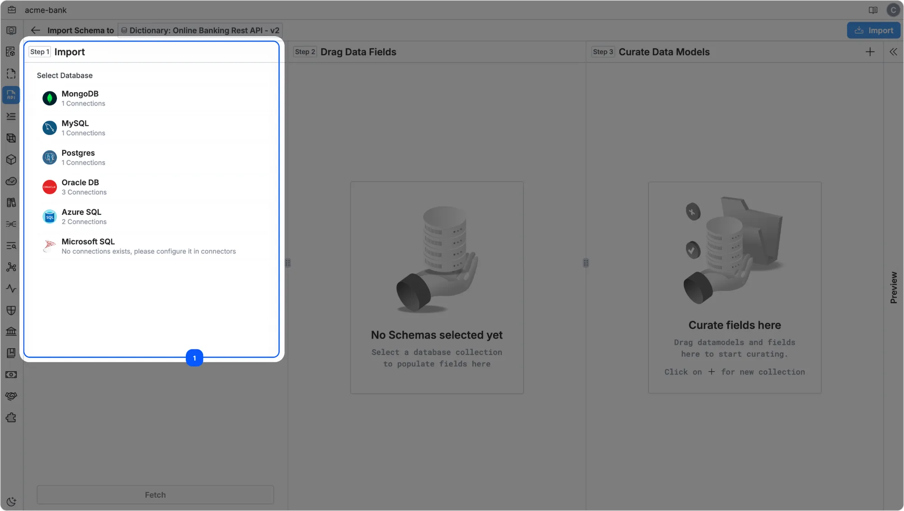
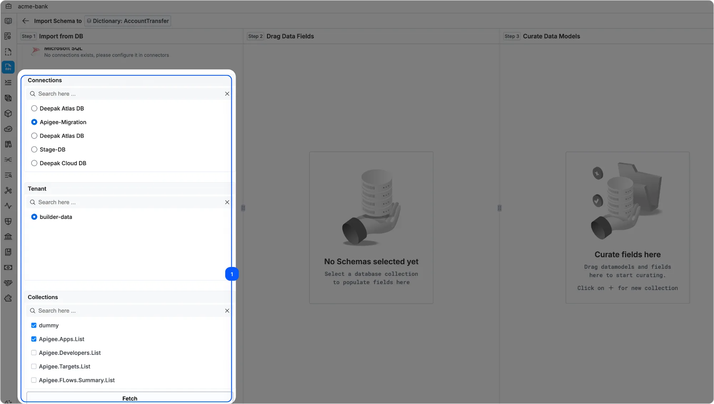
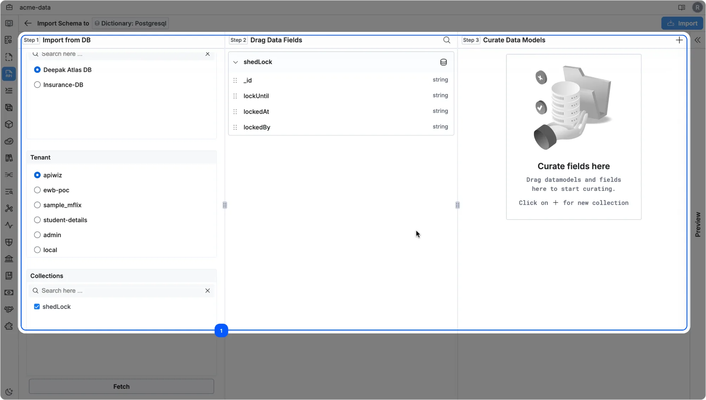
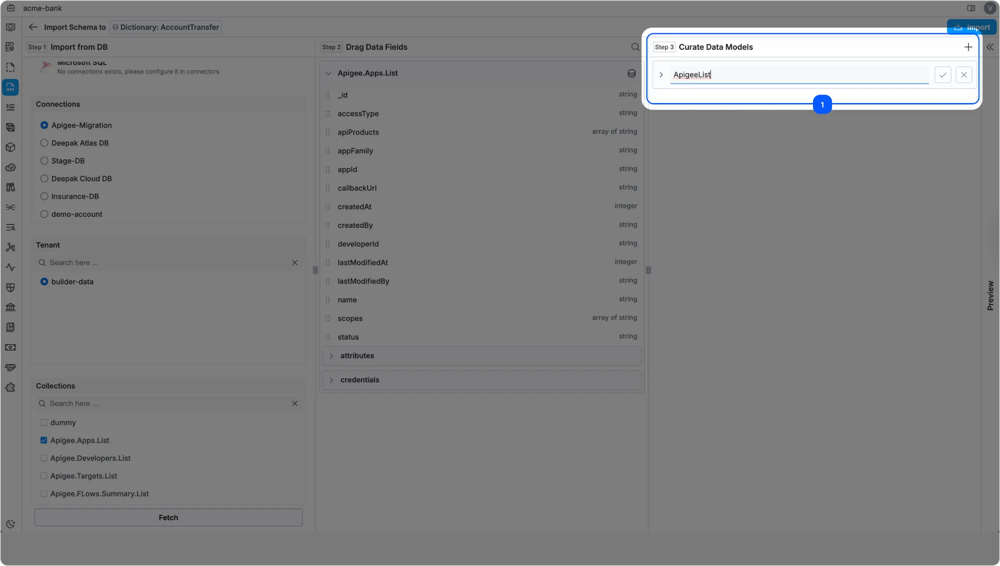
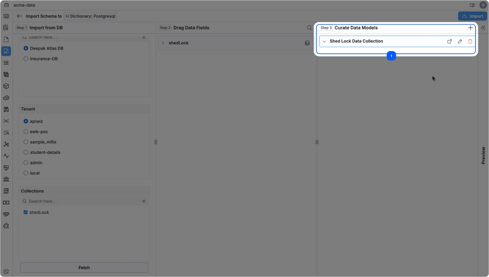

Use the **Import from DB** option to create data models by importing schemas directly from a connected database, instead of building them from scratch.

Before importing, ensure that the [Database Integration setup](https://docs.apiwiz.io/guides?guideId=6a3e41fcd0dd14afc277b20f&groupId=Connectors&pageId=6a4f69da17bd7511541fe6e2) is completed in the **Connectors** module. This setup establishes the connection required for retrieving data from the database.

### Import a data model from a database

To import a data model from a database, do the following:

1. In the **Overview** panel, select **Import from DB** if no data models exist.
  
1. \(optional\) If data models already exist, select the **More Options** menu \(**⋮**\) next to **\+** in the **Data Models** section and select **Import from DB**.
  
1. Select the database you want to import from. For example, select **MongoDB**.
  
1. From the list of available connections, select the required connection.
  
1. From the list of available tenants, select the required tenant.
1. From the list of collections for the selected tenant, select the required collection and select **Fetch**.
  
1. Select the **Collection** dropdown to view the list of available data fields.
1. To curate the data models, select **\+** to add a new collection. Enter the data model name and select the check mark \(**✓**\) to confirm.
  
1. Drag the required data fields into the newly created data model to define its structure.
  
1. Each data model displays the following action icons next to the model name:

1. In the **Compact View** panel, review the data model linked to the object. Use the **Link** icon to link or unlink the data model from the object as required. Use **Move to Parent** to navigate from a child node to its parent node.

1. Select **Import**.

The system redirects you to the design canvas. The imported data model appears in the **Data Models** list in the **Overview** panel. Select the data model to open it in the **Design** panel, where you can view and modify its structure and manage properties.

Once the data is imported, follow the same process used for creating a data model from scratch.