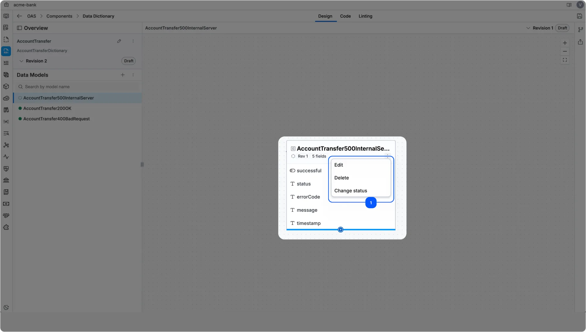
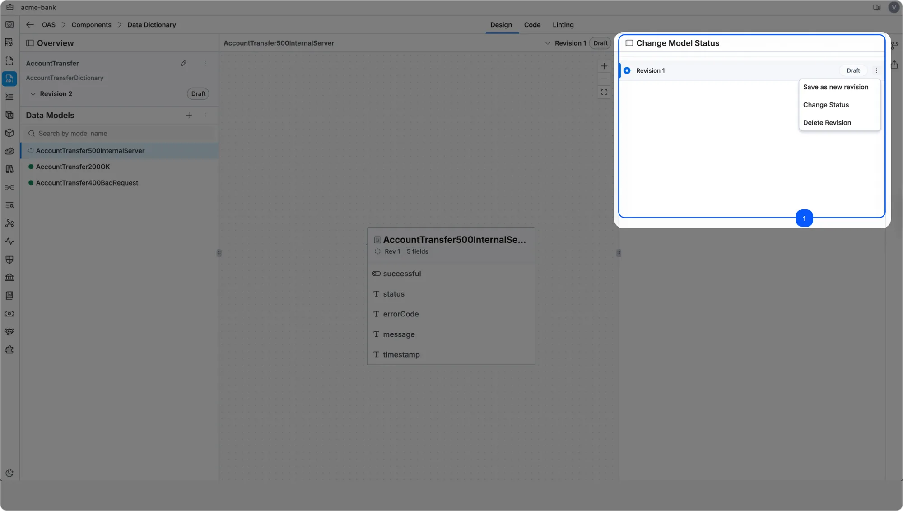
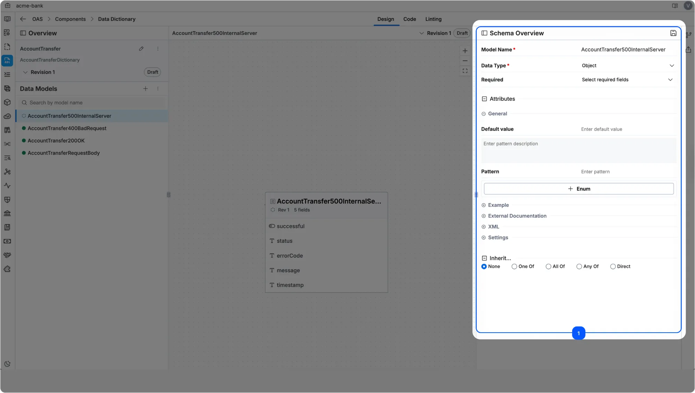

To access management options for a data model, hover over the model name on the design canvas and select the **More Options** menu \(**⋮**\).

The following options are available:

# Changing data model status

To change the status of a data model, do the following:

1. On the design canvas, hover over the required data model name.
1. Select the **More Options** menu \(**⋮**\) next to the revision number.
  

The following options are available:

# Change the model revision status

To change the status of a model revision, do the following:

1. On the design canvas, hover over the required data model and select the **More Options** menu \(**⋮**\).
1. Select **Change Status**.
1. Select one of the following statuses:

1. Select **Save** to apply the change, or **Cancel** to discard it.

A confirmation message appears at the bottom of the screen when the status is updated successfully.

# Save the model as a new revision

To save a model as a new revision, do the following:

1. On the design canvas, hover over the required data model and select the **More Options** menu \(**⋮**\).
1. Select **Save as New Revision**.

The system creates a new revision of the model while preserving the existing revision. A confirmation message appears at the bottom of the screen when the new revision is created successfully.

# Delete a model revision

To delete a model revision, do the following:

1. On the design canvas, hover over the required data model and select the **More Options** menu \(**⋮**\).
1. Select **Delete Revision**.

A confirmation dialog appears. Confirm the action to delete the revision.

# Edit a data model

To edit a data model, do the following:

1. On the design canvas, hover over the required data model and select the **More Options** menu \(**⋮**\).
1. Select **Edit**.

The system opens the **Schema Overview** panel, where you can update the data model details.

# Delete a data model

To delete a data model, do the following:

1. On the design canvas, hover over the required data model and select the **More Options** menu \(**⋮**\).
1. Select **Delete**.

A confirmation message appears at the bottom of the screen and the system removes the model from the Data Dictionary.

# Delete a property

To delete a property from a data model, do the following:

1. On the design canvas, hover over the required data field in the schema.
1. Select the **More Options** menu \(**⋮**\) and select **Delete**.

A confirmation message appears at the bottom of the screen, and the system removes the field from the model.

# Save the Data Dictionary

After creating and managing data models, select **Save** \(floppy disk icon\) in the top-right corner to save the current revision of the Data Dictionary.

After updating data model statuses to **Active** or **Deprecated**, you can update the status of the Data Dictionary.