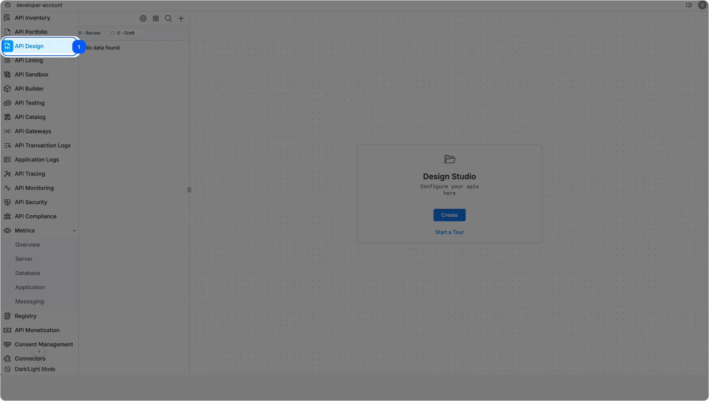
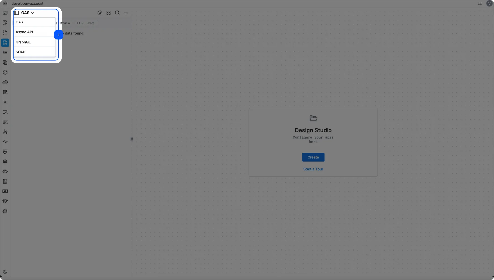

API Design Studio is the dedicated workspace in the APIWiz platform where you can design, view, and manage your API specifications. This topic explains how to access Design Studio and select an API type to begin working.

### Prerequisites

Before you use Design Studio, make sure the following requirements are met:

- You have a basic understanding of REST API concepts and the specification type you plan to work with: OpenAPI Specification \(OAS\), AsyncAPI, GraphQL, or SOAP.
- You have the information required to define your API, such as endpoints, request and response structures, parameters, and authentication details, based on the specification type you're creating.
- You have the appropriate permissions to create, edit, review, and publish API specifications in your workspace.
- If you're creating a GraphQL schema, you have the schema definition and its deployed endpoint URL available.
- If you're creating a Data Dictionary–based specification, you have access to the relevant Data Dictionary and its data models.

### Access the API Design module

To access Design Studio, follow these steps:

1. Log in to the **APIWiz** platform.
1. On the left pane, hover over the vertical navigation bar to expand the available modules.
1. Select **API Design**.
  

The Design Studio dashboard appears.

In the top-left corner of the dashboard, select the **API Type** dropdown and select the API type you want to use. 

Design Studio supports the following API types:

- OAS
- AsyncAPI
- GraphQL
- SOAP API

The dashboard updates and displays the workspace for the selected API type.