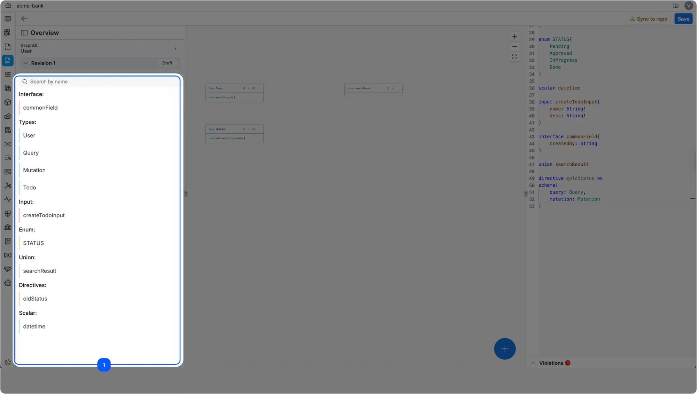
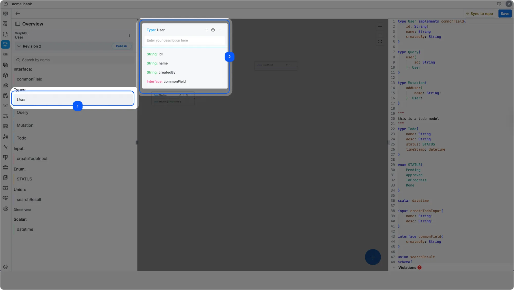

After you create schema components, they appear in the left panel under the selected revision.

- Use the **Search by name** field below the revision dropdown to locate schema elements quickly.
- Below the search bar, the **Schema Types** section displays the core components of the schema, including Interface, Types, Input, Enum, Union, Directives, and Scalar.

This panel provides a structured view of all defined schema elements for easy navigation and management.

When you select a schema component from the list, a configuration panel appears at the top. From this panel, you can view the details of the selected component and perform operations such as editing its fields, updating descriptions, or modifying its configuration.

>

After you perform all required operations and save the GraphQL schema, update its status. Updating the status ensures that the latest changes are properly versioned and made available based on the selected lifecycle stage. For more information, see Changing the GraphQL status.