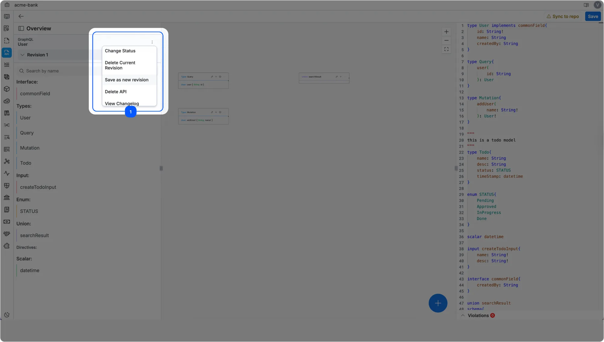
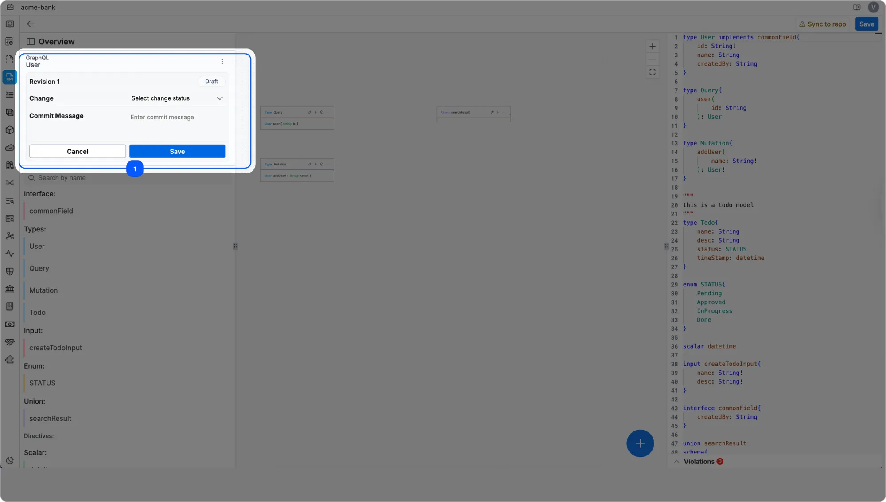

From the GraphQL navigation panel on the left, select the **More options** \(three-dot\) menu next to the schema name to access the following actions:

- Change Status
- Save as New Revision
- Delete Current Revision
- Delete API
- View Changelog
- Download
  

### Change the GraphQL status

To update the schema status, follow these steps:

1. Select the **More options** \(⋮\) menu next to the schema name.
1. Select **Change Status**.
  
1. In the **Change** dropdown, select the required status.

1. In the **Commit Message**, enter a description of the update.
1. Select **Save** to apply the changes, or **Cancel** to discard them.

The commit message helps track modifications and maintain version history as part of schema lifecycle management. Changing the status supports proper governance and version control across the schema lifecycle.

### Delete the current revision

To delete the currently active revision of the schema, follow these steps:

1. Select the **More options** \(⋮\) menu next to the schema name.
1. Select **Delete Current Revision**.
1. In the confirmation dialog, select **Ok** to proceed, or **Cancel** to stop the action.

After deletion, a confirmation message appears at the bottom of the screen.

### Delete the API

To delete the GraphQL API and all its revisions, follow these steps:

1. Select the **More options** \(⋮\) menu next to the API name.
1. Select **Delete API**.
1. In the confirmation dialog, select **Ok** to proceed, or **Cancel** to stop the action.

After deletion, a confirmation message appears at the bottom of the screen.

### View the changelog

To view the history of changes made to the GraphQL schema, follow these steps:

1. Select the **More options** \(⋮\) menu next to the schema name.
1. Select **View Changelog**.

The **Changelog** panel opens on the right side of the screen and displays the following:

This feature helps you track schema lifecycle changes and maintain version governance.

### Download the schema

To download the GraphQL schema, follow these steps:

1. Select the **More options** \(⋮\) menu next to the schema name.
1. Select **Download**.

The schema downloads in .graphql format.

Downloading the schema lets you do the following:

- Store the schema locally.
- Share it with others.
- Import it into another environment.
- Maintain an offline backup of the schema definition.