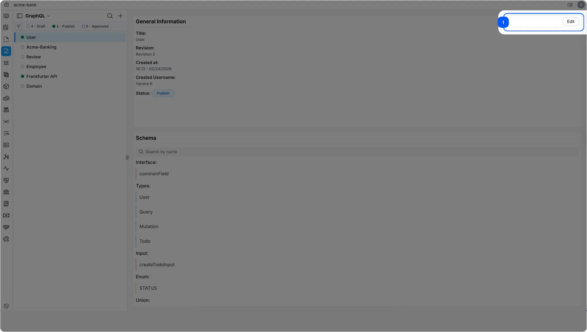
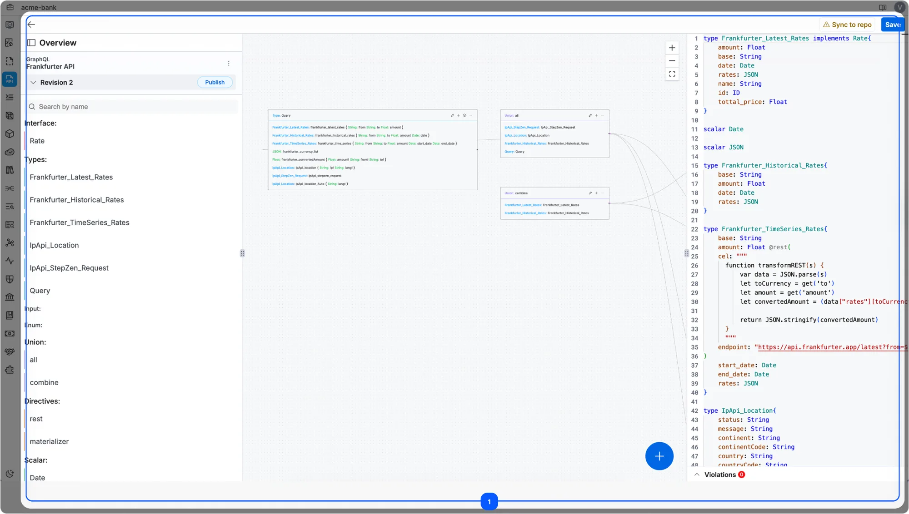

To modify a GraphQL schema, follow these steps:

1. From the GraphQL list, select the schema you want to modify.
1. Next to **General Information**, select **Edit**.
  
1. The GraphQL Editor opens.
  
1. Update the specification using one of the following methods: