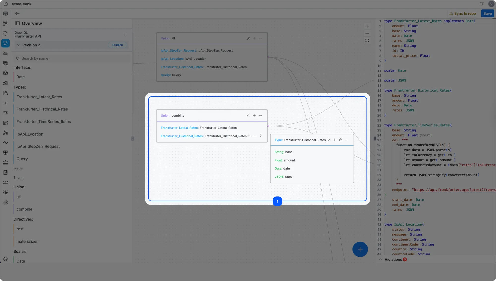
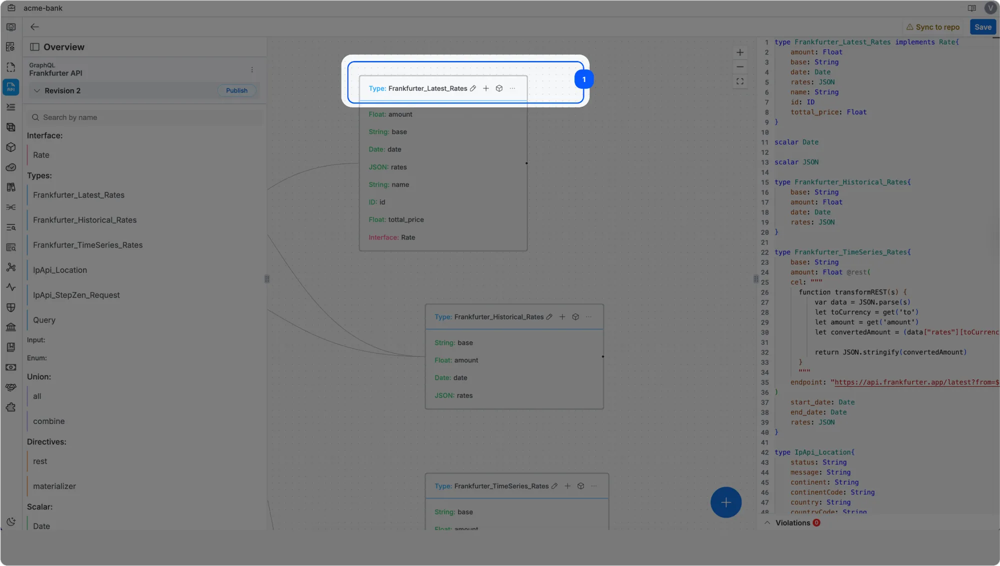

You can navigate the GraphQL schema directly from the Relation View by interacting with nodes and fields.

- Select a node to view its associated fields and relationships.
- Select a field to reveal its sub-fields within the schema structure.
- Select the expand \(**\>**\) icon next to a field to drill down and view nested fields or related types.



This interactive navigation helps you explore schema relationships, understand data structures, and move between connected schema components.

### Node management options



### Managing operation types

Select the **Cube** icon to open the **Operations** panel. Use this panel to define and manage the root operation types of your GraphQL schema.

### Additional node options

Select the three-dot \(**⋯**\) menu on a node to access the following advanced management options.

### Delete a node

Removes the selected node from the schema and design canvas. Use this option when a type or operation is no longer required.

### Extend a node

Extends an existing type definition without modifying the original structure. Use this option to do the following:

- Add fields to a type.
- Separate schema logic across multiple files.
- Enhance reusable types.

**Example:**

```graphql

extend type User {
  phoneNumber: String
}

```

### Duplicate a node

Creates a copy of the selected node. Use this option to do the following:

- Create similar types with minor variations.
- Save time when designing repetitive structures.
- Prototype new schema versions.