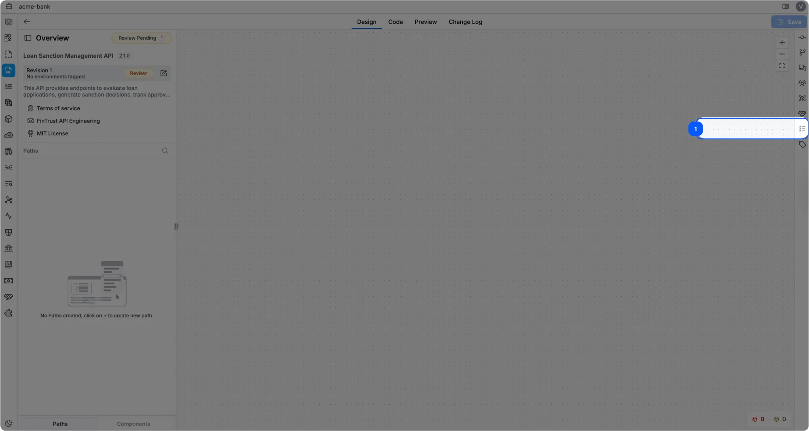
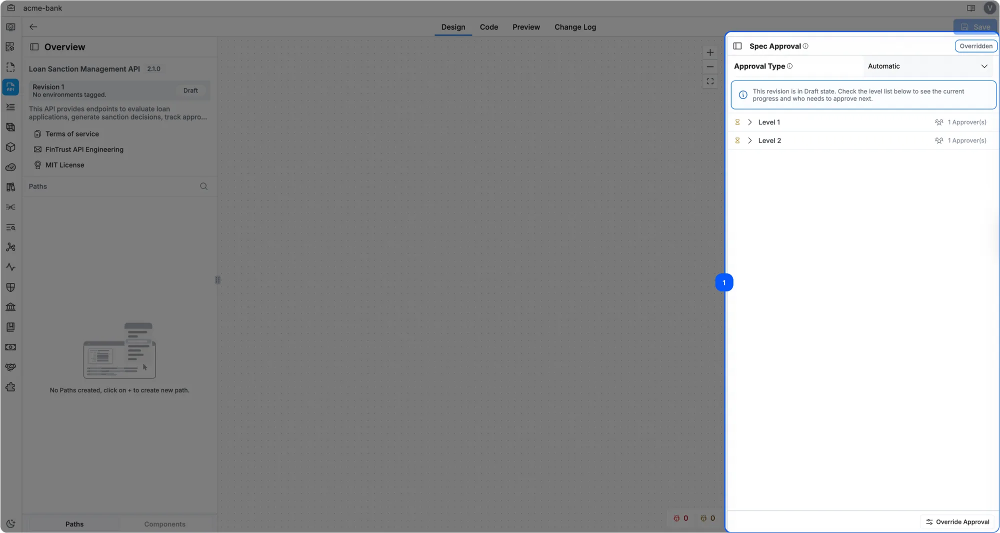

The **Approval Flow** section allows you to review the approval status of the current OAS revision and track its progress through the configured approval levels. Use this section to monitor which levels have been completed, which are pending, and who is responsible for each approval.

To open the approval flow, select the **Approval Settings** icon in the right panel. The **Spec Approval** form opens in the right pane.

# No approval levels assigned

When no approval levels are configured for the selected revision, the **Spec Approval** panel displays the following message: No levels found, Create using approval settings.

To configure approval levels, go to **Approval Settings** in the dashboard and add the required approval rules.

# Approval levels enabled

When approval levels are configured, the **Spec Approval** panel displays the following information:

- **Approval Type**: Indicates how the approval workflow is handled, either **Automatic** or **Manual**, as determined by the configuration.
- **Level List**: Displays all configured approval levels, such as Level 1 and Level 2, that apply to the approval workflow for all OAS.
- **Approver Count**: Displays the number of approvers assigned to each approval level. For example, 2 approvers for Level 1 and 2 approvers for Level 2.

## Override approval

Use the **Override Approval** option to skip a specific approval level for a particular revision. This option is available at the bottom-right of the **Spec Approval** panel.

When you enable override approval, the following applies:

- The overridden approval level is skipped in the approval lifecycle.
- You can enable or disable specific approval levels based on the requirements of that particular revision.

After you save the changes, the assigned approvers receive an approval request. Approvers can then approve or reject the revision to progress it through its lifecycle.