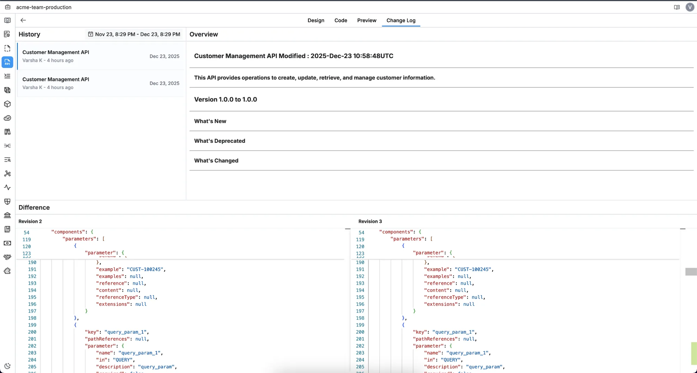

The **Changelog** tab provides a detailed record of all modifications made to the selected OAS. It includes the history of updates, a summary of changes between revisions, and a side-by-side comparison across different environments.

The **Changelog** tab becomes available when a new revision is published and a previous revision already exists.

The **Changelog** tab is organized into the following sections:

**History**

Displays a list of all changes made to the OAS, including the user who made each change and the timestamp. To filter the history by a specific time period, select a date range from the calendar bar next to the **History** tab.

**Overview**

Summarizes the changes made between two revisions. It highlights what is new, what is deprecated, and what has changed in the OAS.

**Difference**

Displays the previous revision and the current revision side by side, allowing you to identify changes between versions. Changes are highlighted using the following color indicators: