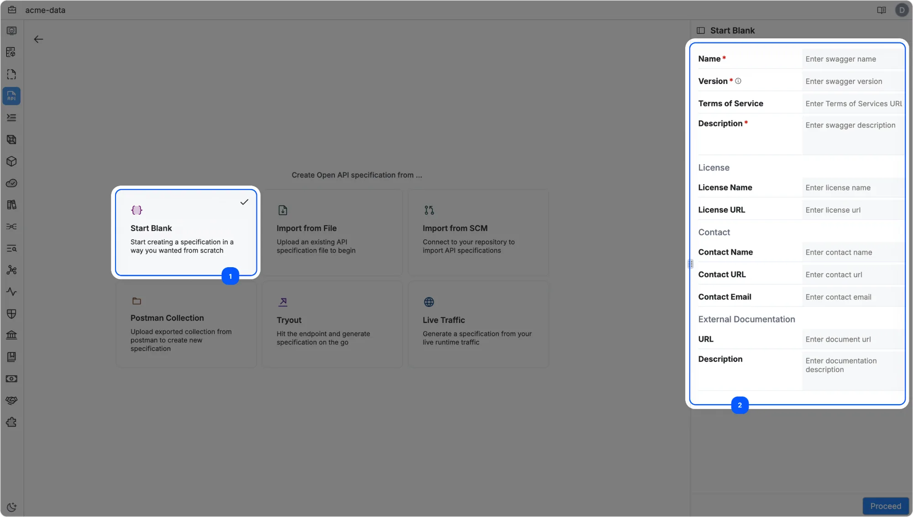

An OpenAPI Specification \(OAS\) defines the structure, endpoints, and behavior of your API in a standardized format. Use the OAS Studio to create and manage your API specifications from a single location.

You can create a new OAS using six methods, including starting from scratch, importing an existing file, connecting to a source control repository, or generating a specification from live traffic. Each method opens a configuration panel that guides you through the setup process.

The left pane displays all available OAS specifications. If no specifications exist, the pane remains blank.

### Prerequisites

Before creating a new OAS, ensure you have the following:

You can create a new OpenAPI Specification \(OAS\) in APIwiz Design Studio using six different methods.

Select **Add** \(\+\) in the left panel, or select **Create** in the main panel.

>

The **OAS Creation** page appears, which displays six methods for creating a new OpenAPI Specification \(OAS\).

Select a method card to open its configuration panel and configure the required settings.

## Start Blank

Use the **Start Blank** method to create an OAS from scratch.

### Create a blank OAS

To create a new OAS using Start Blank:

1. Select the **Start Blank** card. The **Start Blank** configuration panel opens in the right pane.
  
1. Enter the following details:
  - **Name**: Enter the name of your OAS. For example, Customer Management API.
  - **Version**: Enter the version of your OAS. For example, 2.1.0.
  - **Terms of Service**: Enter the URL to the terms of service for the API. For example, [https://example-company.com/terms](https://example-company.com/terms).
  - **Description**: Enter a summary of the API. For example, This API enables clients to create, update, and manage customer records.
1. In the **License** section, enter the following details:
  - **License Name**: Enter the name of the license used for the API.
  - **License URL**: Enter the URL that points to the full license text.
1. In the **Contact** section, enter the following details:
  - **Contact Name**: Enter the name of the contact person or organization for the API.
  - **Contact URL**: Enter the URL for the contact person or organization.
  - **Contact Email**: Enter the email address of the contact person or organization.
1. In the **External Documentation** section, enter the following details:
  - **URL**: Enter the URL that points to external documentation for the API.
  - **Description**: Enter a brief description of the external documentation.
1. Select **Proceed**.

The system saves the details and redirects you to the **Design** page, where you can design your OAS.

The top panel in the **Design** module includes four toggle tabs that let you switch between different views of your API specification.

- Design
- Code
- Preview
- Change Log