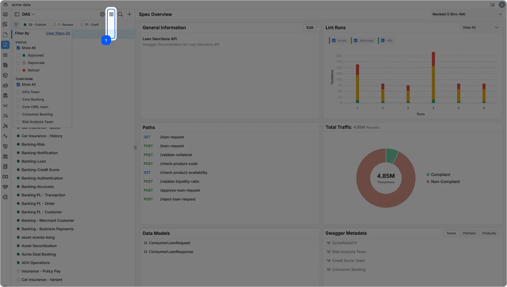
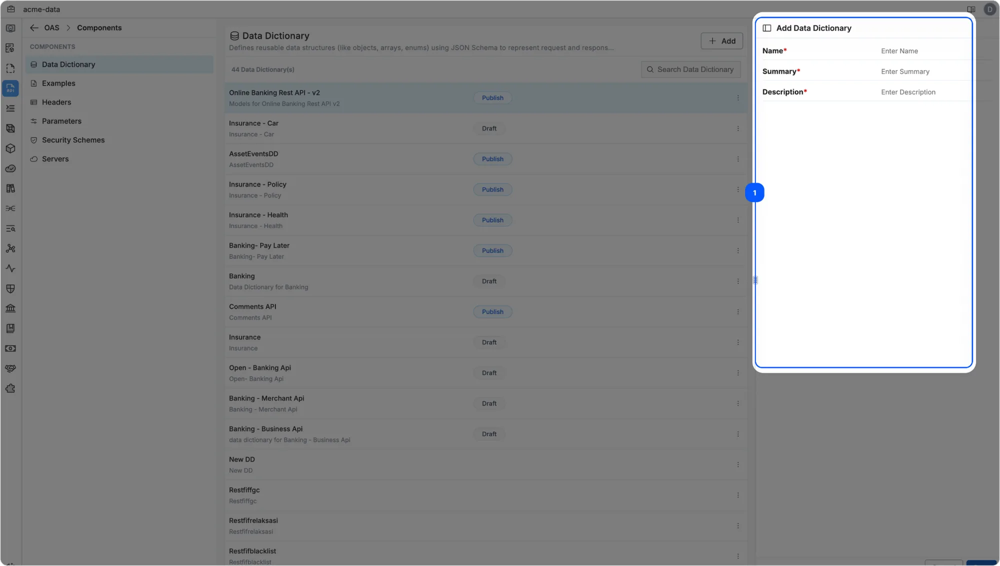
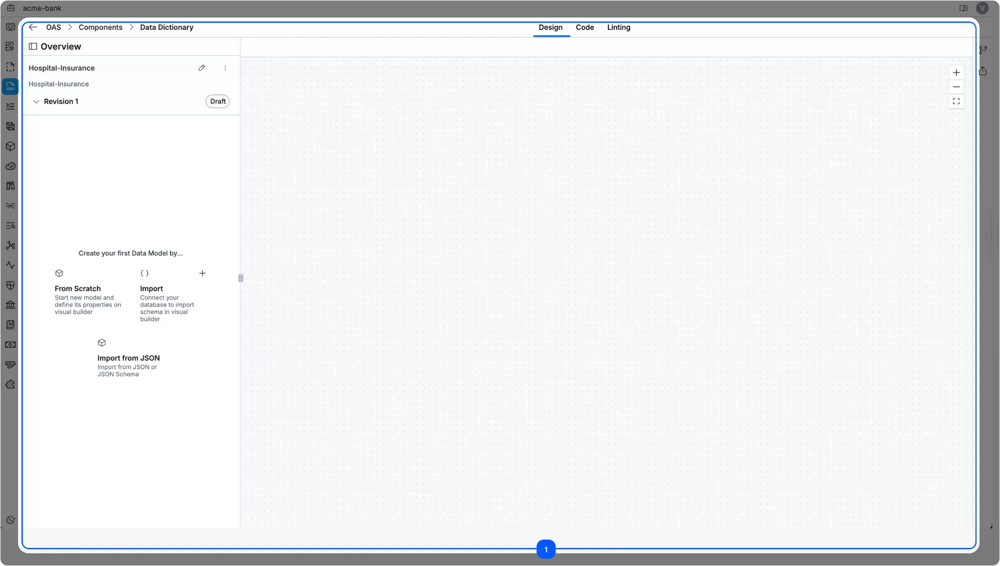

Global components are reusable elements defined at the platform level and available across all OAS definitions created in Design Studio. Defining a component once allows you to reference it multiple times throughout your API definitions, keeping your specifications clean, consistent, and maintainable.

# Benefits

Using global components provides the following benefits:

- **Promotes reusability**: Define an element once and reference it across multiple OAS definitions without rewriting it.
- **Maintains consistency**: A single shared definition ensures that all OAS definitions use the same data structures, headers, and security schemes.
- **Reduces duplication**: A modular approach eliminates redundant definitions and simplifies long-term maintenance of your API specifications.

# Available components

Design Studio provides the following global components:

- **Data Dictionary**: Create reusable data structures such as objects, arrays, and enums using JSON Schema.
- **Examples**: Store reusable example request and response payloads for use across multiple API definitions.
- **Headers**: Define reusable HTTP header specifications that apply consistently across endpoints.
- **Parameters** Define reusable query, path, form, and header parameters.
- **Security Schemes**: Specify reusable authentication and authorization methods such as API keys, OAuth 2.0, or JWT.
- **Servers**: Manage reusable server details such as base URLs for different environments, for example, development, staging, or production.

>

# Access the Components

The Components panel is the central location where you can view, create, and manage all global components available across your OAS definitions in Design Studio.

To access the Components, follow these steps:

1. On the left pane, select the **Components** icon next to the **Approval Settings** icon in the OAS panel.
  
1. The **Components** panel opens and displays all available global components.

Select the component type you want to view or manage from the list.

## Data Dictionary

The **Data Dictionary** section in the **Components** panel is where you define and manage reusable data schemas. You can reference these schemas across multiple API specifications to maintain consistency and reduce redundancy.

### View the data dictionary list

The center pane displays all data dictionary entries created in the system. Each entry represents a reusable data schema for API requests or responses. If no data dictionaries have been created, the panel is blank.


Each row displays the data dictionary name and its current lifecycle status

The following statuses are available:

To locate a specific entry, use the search bar in the top-right corner of the list.

To create a new data dictionary entry, select **\+Add**.

To edit or delete an entry, hover over it and select the three-dot menu \(**⋮**\), then select **Edit** or **Delete**.

Selecting a data dictionary entry loads its details in the **Overview** section.

### View the data dictionary overview

The right pane displays a summary of the dictionary models and validation results for the selected entry.

The overview is organized into the following sections:

**Revision: **Use the **Revision** dropdown in the top-right corner of the overview pane to view details for a specific revision. The models overview, linting results, and models list update based on the revision you select.

**Models overview: **Displays the total number of data models in the selected dictionary, organized by the following statuses:

- **Active**: The number of active data models.
- **Deprecated**: The number of deprecated data models.
- **Draft**: The number of data models in draft status.

**Linting results: **Displays the results of automated schema validation checks performed on the data dictionary. Use linting results to ensure your models follow best practices and organizational standards.

The following severity levels categorize linting results:

The linting results also include a visual representation of validation results over time. Use the following dropdowns to filter the results:

- **Ruleset**: Select the ruleset used for linting. You can create custom rulesets using the APIwiz Linting module.
- **View All**: View all linting runs.

>

**Models list: **Displays the names and current statuses of all models in the selected dictionary for quick reference.

### View models

The **Models** panel displays the status of all data models within the selected data dictionary. Each model is tagged with a status label to indicate its current lifecycle stage.

The following statuses are available:

### Creating a data dictionary

Use the **Data Dictionary** section to create reusable data schemas that you can reference across multiple API specifications.

To create a new data dictionary entry:

1. In the **Data Dictionary** list, select **\+ Add**. The **Add Data Dictionary** form opens in the right pane.
  
1. Enter the following details:
  - **Name**: Enter a unique name for the data dictionary entry. The name identifies the data structure and is used to reference it across API specifications. For example, PetDetails.
  - **Summary**: Enter a brief description of the purpose of the data dictionary entry. For example, Defines standard terms that describe pet information used across the Petstore system.
  - **Description**: Enter a detailed description of the data dictionary entry, including its context, usage, and application in API requests or responses.
1. Select **Save**.



### Editing a data dictionary

To edit a data dictionary entry:

1. In the **Data Dictionary** list, hover over the entry you want to edit.
1. Select the three-dot menu \(**⋮**\) next to the entry.
1. Select **Edit**.

### Deleting a data dictionary

To delete a data dictionary entry:

1. In the **Data Dictionary** list, hover over the entry you want to delete.
1. Select the three-dot menu \(**⋮**\) next to the entry.
1. Select **Delete**. A confirmation dialog appears.
1. Confirm the deletion.

## Examples

The **Examples** section lets you create and manage reusable example values for request bodies and responses. These examples help users understand API behavior by providing practical data representations.

### View the examples list

To view all existing examples, select **Examples** from the **Components** panel. The center pane displays all available examples. If no examples have been created, the panel is blank.


Each row displays the Example Name.

To locate a specific example, use the **search bar** at the top of the list.

Selecting an example loads its details into the **Edit Example** panel.

To create a new example, select **\+Add**.

### Create an example

To create a new example:

1. In the **Examples** list, select **\+Add**. The **Create Example** form opens in the right pane.
  
1. Enter the following details:
  - **Example Name**: Enter a unique name for the example. For example, CustomerExample or OrderResponseExample.
  - **Example Summary**: Enter a brief description of the example's purpose. For example, Demonstrates a successful customer profile response.
  - **Description**: Enter a detailed explanation of the example's context and usage. For example, Shows a standard API response with customer details like ID, name, and email.
  - **External Value**: Toggle this option to specify how you provide the example data.
    - **Disabled**: Enter the example data manually in the **Value** field.
    - **Enabled**: Enter a URL to reference the example from an external source.
  - **Value**: Enter the actual example data in JSON, XML, or another supported format. For example:

  ```text
  {\
  "customerId": "12345",\
  "name": "John Doe",\
  "email": "john.doe@example.com"\
  }
  ```
1. Select **Save**.

## Response headers

The **Headers** section lets you create and manage reusable response headers that you can share across different API endpoints. Headers carry metadata, authentication details, or contextual data required for API execution.

### View the headers list

To view all existing headers, select **Headers** from the **Components** panel. The center pane displays all available headers. If no headers have been created, the panel is blank.


Each row displays the header name and description.

To locate a specific header, use the search bar at the top of the list.

Selecting a header loads its details into the **Edit Headers** form.

To create a new header, select **\+ Add**.

### Create a header

To create a new header:

1. In the **Headers** list, select **\+Add**. The **Create Headers** form opens in the right pane.
  
1. Enter the following details:
  - **Name**: Enter a unique name for the header. For example, `Authorization`.
  - **Description**: Enter a brief description of the header. For example, `Used to pass the access token for authentication.`
1. Select the applicable checkbox options:

1. In **Example**, enter a representative sample value for the header.

1. In the **Schema** section, define the data type of the header.
  - **Description**: Enter details about the schema definition. For example, `Defines the schema for the Authorization header.`
  - **Schema Type**: Select the data type for the header value, such as `string` for Authorization. The available fields update based on the schema type you select. For more information, see the General section in Configuring Data Models.
  - **Example**: Enter an additional example value.
1. Select the applicable schema-level checkbox options:

1. In the **Enums** section, define a fixed set of allowed values for the header. Select **\+** to add a value and the trash icon to delete a value. For example, `Content-Type` can only accept:
  - `application/json`
  - `application/xml`
  - `text/plain`
1. In the **XML** section, define how the header property is represented in XML. Select **\+** to add a value and the trash icon to delete a value. Enter the following details:
  - **Name**: Enter the XML element or attribute name. For example, `customerId`.
  - **Namespace**: Enter the XML namespace URI, if required. For example, `http://example.com/schema`.
  - **Prefix**: Enter the XML prefix to associate with the element name. For example, `ex:customerId`.
  - **Attribute**: Select this option to represent the property as an XML attribute instead of an XML element.
1. In the **External Documentation** section, add references for additional context or guidance.
  - **Documentation Description**: Enter a short description of the documentation. For example, `Detailed header usage documentation.`
  - **Documentation URL**: Enter a valid documentation URL. For example, `https://developer.example.com/docs/headers/auth`.
1. Select **Save**.

## Parameters

The **Parameters** section lets you create and manage reusable parameters that you can share across multiple API operations. Parameters specify inputs such as query strings, path variables, headers, or cookies in API requests.

### View the parameters list

To view all existing parameters, select **Parameters** from the **Components** panel. The center panel displays all available parameters. If no parameters have been created, the panel is blank.


Each row displays the parameter name, description, and parameter type, which indicates the location where the parameter is used in the API request.

To locate a specific parameter, use the search bar at the top of the list.

Selecting a parameter loads its details into the **Edit Parameter** form.

To create a new parameter, select **\+ Add**.

### Create a parameter

To create a new parameter:

1. In the **Parameters** list, select **\+ Add**. The **Create Parameter** form opens in the right pane.
  
1. Enter the following details:**Name**: Enter a unique name for the parameter. For example, `customerPlan`.**Description:** Enter a brief description of the parameter. For example, `Unique identifier of the customer.`**Location**: Select where the parameter is passed in the API request.

1. Select the applicable checkbox options:

1. In **Example**, enter a sample value for the parameter. For example, `customerId=98765`.
1. In the **Schema** section, define the data type of the parameter.
  - **Description**: Enter details about the schema definition. For example, `Schema for the customerId parameter.`
  - **Schema Type**: Select the data type for the parameter, such as `string`, `integer`, or `boolean`. The available fields update based on the schema type you select. For more information, see the General section in Configuring Data Models.
  - **Example**: Enter a representative sample value for the parameter.
1. Select the applicable schema-level checkbox options:

1. In the **Enums** section, define a fixed set of allowed values for the parameter. Select **\+** to add a value and the trash icon to delete a value. For example, the `customerPlan` parameter accepts only `enterprise` or `business` as valid values.

1. In the **External Documentation** section, add references for additional context or guidance.
  - **Documentation Description**: Enter a short description of the documentation. For example, `Detailed parameter usage guide.`
  - **Documentation URL**: Enter a valid link to the documentation. For example, `https://developer.example.com/docs/parameters/customerId`.
1. Select **Save**.

## Security schemes

Security schemes define reusable authentication and authorization methods that ensure secure access control across multiple API operations. They specify how clients authenticate when making requests.

Supported security scheme types include:

- API Key
- HTTP Basic or Bearer
- OAuth 2.0
- OpenID Connect

### View existing security schemes

To access security schemes, select **Security Schemes** from the **Components** section. The center panel displays all existing security schemes. If no security schemes have been created, the panel is blank.


Each row displays the security scheme's name, description, and type, which indicates the type of authentication mechanism used.

Use the **Search** bar at the top of the panel to locate a specific security scheme. Select any security scheme from the list to load its details into the **Edit Security Scheme** form.

### Create a security scheme

To create a new security scheme, do the following:

1. In the upper-right area of the center panel, select **\+ Add**. The **Create Security Scheme** form opens on the right side of the screen.
  
1. Enter the following details:

\*  Indicates a required field.

1. Configure the additional fields based on the selected type. See the following sections for details.
1. Select **Save**.

### Security scheme types

### API Key

Use **API Key** to pass an API key in a specific location such as a header or query parameter.

When you select **API Key**, the following fields appear:

### HTTP

Use **HTTP** to authenticate using standard HTTP authentication schemes such as Basic or Bearer.

When you select **HTTP**, the following field appears:

If you select **Bearer**, the following additional field appears:

### OAuth 2.0

Use **OAuth 2.0** to implement OAuth 2.0 authorization flows. You can enable one or more flows depending on your API's authentication requirements.

### Implicit Flow

Use this flow when the client directly receives the access token from the authorization endpoint.

### Password Flow

Use this flow when trusted applications exchange a username and password for an access token.

### Client Credentials Flow

Use this flow when server-to-server communication is required without user involvement.

### Authorization Code Flow

Use this flow when applications need to obtain an authorization code before exchanging it for an access token.

\*  Indicates a required field.

## Servers

The **Servers** section specifies the base URLs where the API receives requests. It supports variables that allow the same API definition to work across different environments, such as production, staging, or development.

### View existing servers

To access servers, select **Servers** from the **Components** section. The center panel displays all existing servers, including their name, description, and the number of configured variables. If no servers have been created, the panel is blank.


Use the **Search** bar at the top of the panel to locate a specific server. Select any server from the list to load its details into the **Edit Server** form.

### Create a server

To create a new server, do the following:

1. In the upper-right area of the center panel, select **\+ Add**. The **Create Server** form opens on the right side of the screen.
  
1. Enter the following details:

\*  Indicates a required field.

### Configure variables

Use the **Variables** section to define dynamic parts of the server URL. Variables make the server configuration reusable and flexible across different environments.

To add a variable, do the following:

1. Select **\+ Add** next to the **Variable** label. A new variable panel appears.
1. Enter the following details for each variable:
  To configure Enum values, select the **\+** icon next to **Enum** to add one or more allowed values for the variable.

  You can add multiple enum values as needed.
1. To remove a variable, select the **Delete** \(trash\) icon next to the variable.
1. Repeat to add additional variables if required.
1. Select **Save**.

## Manage global components

Components are reusable elements such as headers, parameters, security schemes, and servers that can be defined globally and referenced across multiple OAS specifications. Use the **Components** panel to create, edit, update the status, and delete components as required.

### Edit a component

The **Edit** form opens when you select an existing component such as a header, parameter, security scheme, or server. It displays all available fields and configuration options, allowing you to modify the component as required.

### Revisions

A revision dropdown is available in the upper-right corner of the form. Use it to view and select any existing revision of the component. Multiple revisions can be created, and each appears in the dropdown for easy access.

### Save a component

After editing, save the component using one of the following options:

### Delete a component

If a component is no longer required, you can delete it from the component list.

To delete a component, do the following:

1. Hover over the component in the list.
1. Select the **Delete** \(trash\) icon that appears next to the component.

To delete a specific revision of a component, do the following:

1. Open the component to view the **Edit** form.
1. In the upper-right corner of the form, select the **Delete** \(trash\) icon to remove the current revision.

### Change the status of a component

To update the lifecycle state of a component revision, do the following:

1. In the **Edit** form, select the **pencil** icon to modify the status.
1. Select the required status from the available options:

1. Select the **tick** icon to confirm the update, or select the **cross** icon to cancel the change.