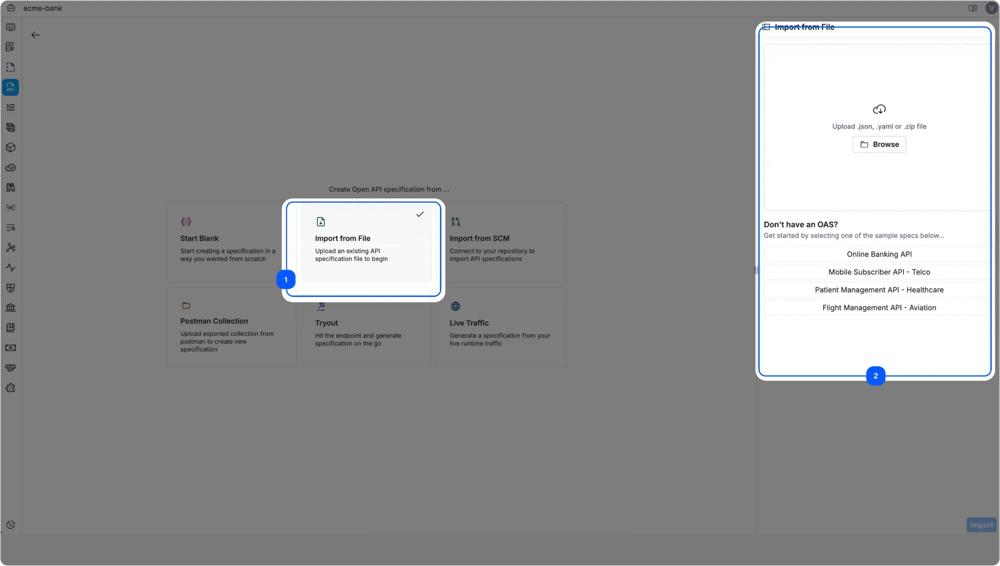

Use the **Import from File** method to create an OAS by uploading an existing JSON or YAML specification file from your local system.

To import an OAS from a file, do the following:

1. Select the **Import from File** card. The **Import from File** configuration panel opens in the right pane.
  
1. Select **Browse** and upload a Swagger or OpenAPI specification file from your computer. The file must be in Swagger 2.0 or OpenAPI 3.0 format.

1. Select **Import**. If the import is successful, a success message appears in the bottom-right corner. The system redirects you to the **Design** page, where you can design the OAS.

**Don't have an existing OAS?**

If you do not have an existing specification file, you can select one of the predefined sample specifications listed under the **Don't have an OAS?** section, then select **Import**.