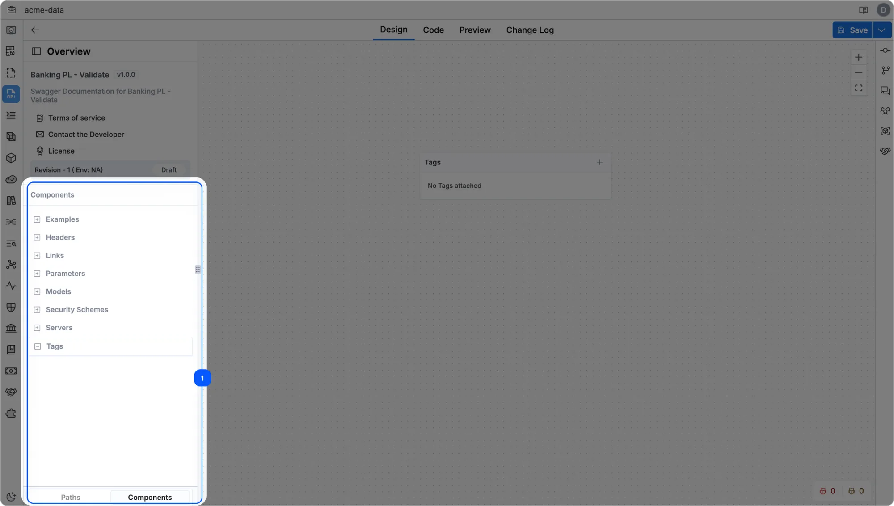
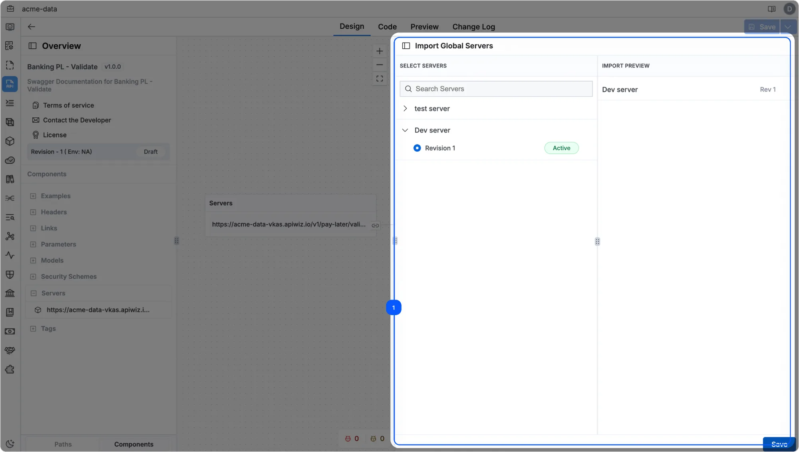
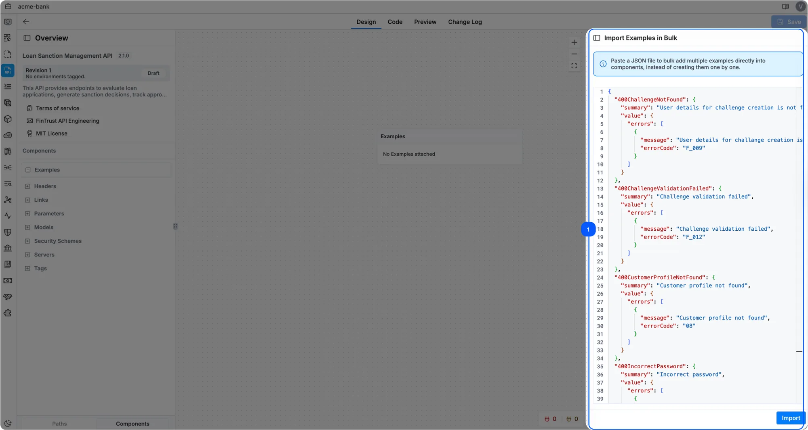
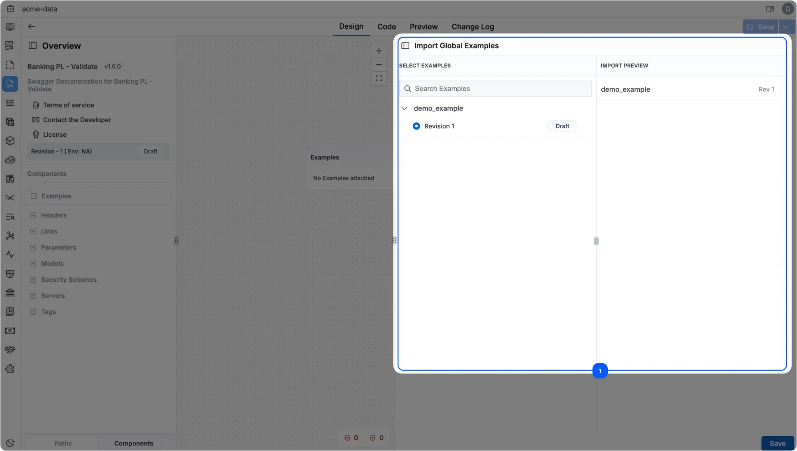
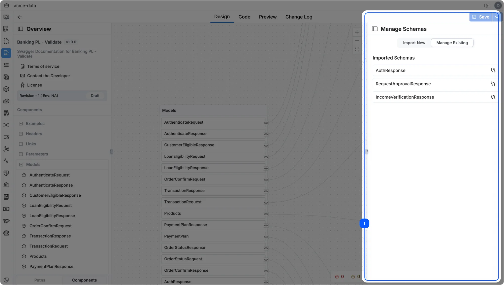
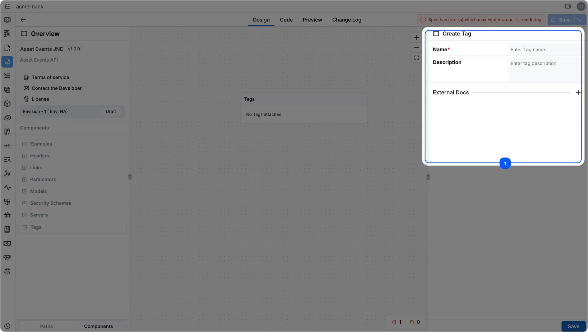

Local components are elements you create and use within a single OAS. Unlike global components, local components are not available outside the OAS in which they are defined.

The **Components** tab at the bottom of the **Overview** panel displays all local components available across the paths and operations within the current OAS. You can create new components directly or import them from the global library.

The **Components** tab includes the following categories:

# Servers

A server defines the base URL and environment for API execution, such as production, staging, or development. Servers are local to the OAS in which they are created and cannot be reused across other OAS specifications.

## Create a server

To create a new server:

1. In the **Servers** node on the design canvas, select **\+**. The **Create Server** form opens in the right pane.
  
1. Enter the following details:
  - **Name**: Enter a unique name for the server. For example, ProdApiwiz.
  - **Description**: Enter a brief description of the server. For example, Production server for Apiwiz APIs.
  - **Scheme**: Select the protocol scheme for the server, such as http:// or https://.
  - **Server Host**: Select the server host address from the dropdown. The available host addresses are preconfigured in the **Environment Map** under **APIwiz Integration** in the **Connector** module.

  - **Base Path**: Enter the base path for API requests. This value identifies the API and is used for routing requests. For example, /prodapiwiz.
  - **Hide from Portal**: Select this checkbox to hide the server from the API portal.
1. In the **Variables** section, define dynamic parts of the server URL, if required. Select **\+ Add** to add a variable. Enter the following details for each variable:
  - **Variable Name**: Enter the name of the variable to be referenced in the server URL. For example, version.
  - **Variable Default**: Enter the default value for the variable. This value is used when no other value is provided. For example, v1.
  - **Variable Description**: Enter a description of the variable's purpose. For example, Defines the API version used in the server path.
1. To remove a variable, select the trash icon next to it.
1. In the **Enums** section, define a fixed set of allowed values for the server, if required. Select **\+** to add a value and the trash icon to delete a value. For example, Content-Type can only accept:application/jsonapplication/xmltext/plain
1. Select **Save**.

The system saves the server and displays a success message.

## Import global servers

To import a server from the global library into the current OAS:

1. In the **Servers** node on the design canvas, select the **Import** icon \(a small box with an inward arrow\) to import servers created globally into the current OAS design.
1. The **Import Global Servers** panel opens in the right pane.
  
1. Use the search bar to locate the server you want to import.
1. Select the server from the list.
1. If multiple revisions exist, select the required revision.
1. Repeat the steps to select additional servers, if required. The selected servers appear in the **Import Preview** section. To remove a server from the selection, select **×** next to it.
1. Select **Save**.

The system imports the selected servers and displays a success message. The imported servers appear on the design canvas and are connected to the **Servers** section.

You can also attach a sandbox server to the OAS.

# Examples

An example defines sample request or response data within the current OAS. Examples are local to the OAS in which they are created and cannot be reused across other OAS specifications.

You can configure examples in the following ways:

- Create a new example directly within the current OAS.
- Import examples from the global library.

## Create an example

To create a new example:

1. In the **Examples** node on the design canvas, select **\+**. The **Create Example** form opens in the right pane.
  
1. Enter the following details:
  - **Example Name**: Enter a unique name for the example. For example, CustomerExample or OrderResponseExample.
  - **Example Summary**: Enter a brief description of the example's purpose. For example, Demonstrates a successful customer profile response.
  - **Description**: Enter a detailed explanation of the example's context and usage. For example, shows a standard API response with customer details such as ID, name, and email.
  - **External Value**: Toggle this option to specify how you provide the example data.
    - **Disabled**: Enter the example data manually in the **Value** field.
    - **Enabled**: Enter a URL to reference the example from an external source.**Value**: Enter the actual example data.
1. Select **Save**.

The system saves the example, displays a success message, and the new example appears in the **Examples** node on the design canvas.

## Import examples

Select the **Import** icon \(a small box with an inward arrow\). The system displays the following two import options.

### Import multiple examples

Use this option to import several global examples at once by pasting a JSON file that contains multiple example definitions.

To import multiple examples, do the following:

1. Select **Import Multiple Examples**. The **Import Examples in Bulk** panel opens in the right pane.
  
1. Paste a JSON file containing the examples you want to import.
1. Select **Import**.

The system imports all examples from the JSON file and displays them in the **Examples** node on the design canvas.

### Import a global example

Use this option to import individual examples created in the global **Components** panel. This helps maintain consistency and reduces duplication across API specifications.

To import a global example, do the following:

1. Select **Import Global Example**. The **Import Global Examples** panel opens in the right pane.
  
1. Use the search bar to locate the example you want to import.
1. Select the example from the list. You can select multiple examples if required.
1. If multiple revisions exist, select the required revision. The selected examples appear in the **Import Preview** section. To remove an example from the selection, select **×** next to it.
1. Select **Save**.

The system imports the selected examples, displays a success message, and adds them to the **Examples** node on the design canvas.

# Headers

A header defines a response header within the current OAS. Headers are local to the OAS in which they are created and cannot be reused across other OAS specifications.

You can configure headers in the following ways:

- Create a new header directly within the current OAS.
- Import headers from the global library.

## Create a header

To create a new header, do the following:

1. In the **Headers** node on the design canvas, select **\+**. The **Create Header** form opens in the right pane.
1. Enter the following details:
  - **Name**: Enter a unique name for the header. For example, Authorization.
  - **Description**: Enter a brief description of the header. For example, Used to pass the access token for authentication.
1. Select the applicable header-level checkbox options:

1. In **Example**, enter a representative value for the header. For example, eyJhbGciOiJIUzI1NiIsInR5cCI6IkpXVCJ9…
1. In the **Schema** section, define the data type of the header:
  - **Description**: Enter details about the schema definition. For example, Defines the schema for the Authorization header.
  - **Schema Type**: Select the data type for the header value, such as string, integer, or boolean.
  - **Default Value**: Enter a fallback value. For example, application/json for Content-Type.
  - **Example**: Enter an additional example value. For example, application/xml.
1. Select the applicable schema-level checkbox options:

1. In the **Enums** section, define a fixed set of allowed values for the header, if required. Select **\+** to add a value and the trash icon to delete a value. For example, Content-Type can only accept: application/jsonapplication/xmltext/plain
1. In the **XML** section, define how the header property is represented in XML, if required. Enter the following details:
  - **Name**: Enter the XML element or attribute name. For example, customerId.
  - **Namespace**: Enter the XML namespace URI, if required. For example, [http://example.com/schema](http://example.com/schema).
  - **Prefix**: Enter the XML prefix to associate with the element name. For example, ex:customerId.
  - **Attribute**: Select this option to represent the property as an XML attribute instead of an XML element.
1. In the **External Documentation** section, add references for additional context or guidance, if required:
  - **Documentation Description**: Enter a short description. For example, Detailed header usage documentation.
  - **Documentation URL**: Enter a valid link. For example, [https://developer.example.com/docs/headers/auth](https://developer.example.com/docs/headers/auth).
1. Select **Save**.

The system saves the header and displays a success message.

## Import global headers

To import a header from the global library into the current OAS, do the following:

1. In the **Headers** node on the design canvas, select the **Import** icon \(a small box with an inward arrow\). The **Import Global Headers** panel opens in the right pane.
1. Use the search bar to locate the header you want to import.
1. Select the header from the list. You can select multiple headers if required.
1. If multiple revisions exist, select the required revision. The selected headers appear in the **Import Preview** section. To remove a header from the selection, select **×** next to it.
1. Select **Save**.

The system imports the selected headers, displays a success message, and the headers appear in the **Headers** node on the design canvas.

# Links

A link defines a possible relationship between a response and another operation at design time. It does not guarantee that the caller can successfully invoke the linked operation. Instead, it describes how responses are related and provides a way to navigate from one operation to another.

## Create a link

To create a new link, do the following:

1. In the **Links** node on the design canvas, select **\+**. The **Create Link** form opens in the right pane.
1. Enter the following details:
  - **Link Name**: Enter a unique name for the link. For example, BookingToPaymentLink.
  - **Description**: Enter a brief description of the link's purpose. For example, Establishes a relationship between the booking operation and the payment operation.
  - **Operation Type**: Select the type of operation. For example, Operation Id.
  - **Operation Id**: Select the target operation that this link should reference.
  - **Request Body**: Enter a literal value or expression to use as the request body when calling the target operation.
1. If you want to attach a specific server configuration to this link, enable the **Server** toggle and define the server details such as URL, variables, or custom configurations.
1. In the **Parameters** section, enter the following details:
  - **Parameter Key**: Enter the parameter name.
  - **Target**: Select the target location for the parameter.
  - **Source**: Select the source of the value.
  - **Pointer**: Enter a pointer for referencing data within the source.
1. Select **Save**.

The system saves the link and displays a success message.

# Parameters

Parameters define request inputs such as query, path, header, or cookie values within the current OAS. Parameters are local to the OAS in which they are created and cannot be reused across other OAS specifications.

You can configure parameters in the following ways:

- Create a new parameter directly within the current OAS.
- Import parameters from the global library.

## Create a parameter

To create a new parameter, do the following:

1. In the **Parameters** node on the design canvas, select **\+**. The **Create Parameter** form opens in the right pane.
1. Enter the following details:
  - **Name**: Enter a unique name for the parameter. For example, customerId.
  - **Description**: Enter a brief description of the parameter. For example, Unique identifier of the customer.
  - **Location**: Select where the parameter is passed in the API request.
1. Select the applicable checkbox options:

1. Select the applicable checkbox options:

1. In **Example**, enter a sample value for the parameter. For example, 98422e80.
1. In the **Schema** section, define the data type of the parameter:
  - **Description**: Enter details about the schema definition. For example, Schema for the customerId parameter.
  - **Schema Type**: Select the data type for the parameter, such as string, integer, or boolean.
  - **Default Value**: Enter a value to use if the client does not provide one. For example, active.
  - **Example**: Enter an additional representative value. For example, pending.
1. Select the applicable schema-level checkbox options:

1. In the **Enums** section, define a fixed set of allowed values for the parameter, if required. Select **\+** to add a value and the trash icon to delete a value. For example, the status parameter can only accept: active, inactive, pending
1. In the **External Documentation** section, add references for additional context or guidance, if required:
  - **Documentation Description**: Enter a short description. For example, Detailed parameter usage guide.
  - **Documentation URL**: Enter a valid link. For example, [https://developer.example.com/docs/parameters/customerId](https://developer.example.com/docs/parameters/customerId).
1. Select **Save**.

The system saves the parameter and displays a success message.

## Import global parameters

To import a parameter from the global library into the current OAS, do the following:

1. In the **Parameters** node on the design canvas, select the **Import** icon \(a small box with an inward arrow\). The **Import Global Parameters** panel opens in the right pane.
1. Use the search bar to locate the parameter you want to import.
1. Select the parameter from the list. You can select multiple parameters if required.
1. If multiple revisions exist, select the required revision. The selected parameters appear in the **Import Preview** section. To remove a parameter from the selection, select **×** next to it.
1. Select **Save**.

The system imports the selected parameters, displays a success message, and the parameters appear in the **Parameters** node on the design canvas.

# Models

Models define the structure of request and response bodies, such as objects, arrays, and their properties, within the current OAS. Models are local to the OAS in which they are created and cannot be reused across other OAS specifications.

You can configure models in the following ways:

- Create a new model directly within the current OAS.
- Import models from the global library.

## Create a model

To create a new model, do the following:

1. In the **Schema** node on the design canvas, select **\+**. The **Schema Overview** form opens in the right pane.

1. Select the **Save** icon in the top-right corner.

The system saves the model, and it appears in the **Data Models** list.

## Import global models

To import a model from the global library into the current OAS, do the following:

1. In the **Models** node on the design canvas, select the **Import** icon \(a small box with an inward arrow\). The **Manage Schemas** panel opens in the right pane.
1. Select **Import New**.
  
1. Enter the following details:
  - **Dictionary Name**: Select the required dictionary from the dropdown. You can also search by name to locate the dictionary more quickly.
  - **Dictionary Revision**: Select the corresponding dictionary revision.
1. The list of available schemas for the selected dictionary and revision appears.
1. Select the schemas you want to import.
1. Select **Save**.

The system imports the selected schemas, displays a confirmation message, and the schemas appear in the **Models** node on the design canvas.

## Manage existing models

To view all previously imported schemas, do the following:

1. In the **Models** node on the design canvas, select the **Import** icon. The **Manage Schemas** panel opens in the right pane.
1. Select **Manage Existing**. The system displays a list of all imported schemas.
  
1. In the Manage Existing tab, select the **Compare Model Revisions** icon next to the schema you want to compare. The **Compare Model Revisions** panel opens at the bottom of the design canvas.
1. Review the two sections displayed side by side:
  - **Left section**: Displays the current revision of the selected schema.
  - **Right section**: Displays the previously saved revision of the schema.
1. Both sections display the JSON schema of the model. Use these sections to compare schema elements such as property names \(for example, `id`, `name`, `position`, and `salary`\) and data types \(for example, `string`, `integer`, and `number`\).
1. In the **Revision** dropdown in the top-right corner, select the previous revision you want to compare against the current one.
1. If you want to apply updates from a previous revision to the current schema, select **Sync Changes**.

# Security schemes

A security scheme defines authentication and authorization methods, such as API keys, OAuth2, or HTTP authentication, within the current OAS. Security schemes are local to the OAS in which they are created and cannot be reused across other OAS specifications.

You can configure security schemes in the following ways:

- Create a new security scheme directly within the current OAS.
- Import security schemes from the global library.

## Create a security scheme

To create a new security scheme, do the following:

1. In the **Security Schemes** node on the design canvas, select **\+**. The **Create Security Scheme** form opens in the right pane.
1. Enter the following details:
  - **Name**: Enter a unique name for the security scheme. For example, OAuth2Scheme.
  - **Description**: Enter a brief description of the security scheme. For example, OAuth2 scheme for secure user authentication.
  - **Type**: Select the type of security scheme from the dropdown.
1. Select **Save**.

The security scheme is created, and a success message appears. The scheme is available within the current OAS.

## Import a global security scheme

To import a global security scheme into the current OAS, do the following:

1. In the **Components** panel, create the required security scheme globally.
1. On the Design canvas, select the **Import** icon \(a small box with an inward arrow\). The **Import Global Security Schemes** panel opens on the right side of the Design canvas.
  
1. In the search box, enter the name or keyword of the required security scheme.
1. Select the required security scheme from the list.
1. If multiple revisions exist, select the required revision. The selected security scheme and its revision details appear in the **Import Preview** section.
1. Select **Save**.

The global security scheme is imported into the current OAS design, and a success message appears. The imported scheme appears on the Design canvas and is connected to the **Security Schemes** section.

# Tags

Tags group related APIs to make them easier to organize, discover, and manage. Proper tagging improves API readability and helps users quickly identify related operations.

## Create a tag

To create a tag, do the following:

1. On the Design canvas, select **\+ Add** in the **Tags** node. The **Create Tag** form opens on the right side of the screen.
  
1. Enter the following details:

1. To add external documentation, enter the following details under **External Docs**:

1. Select **Save**.

The tag is created, and a success message appears. The tag is available within the current OAS.