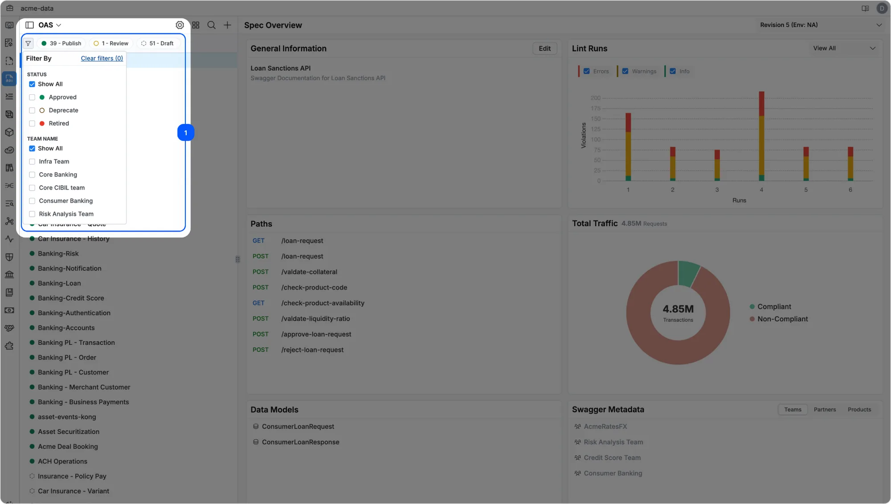
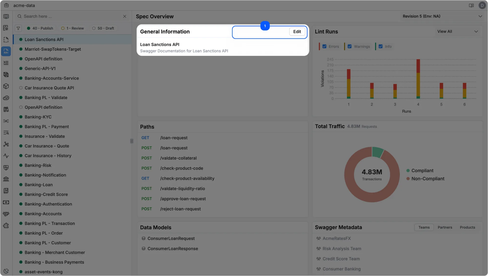
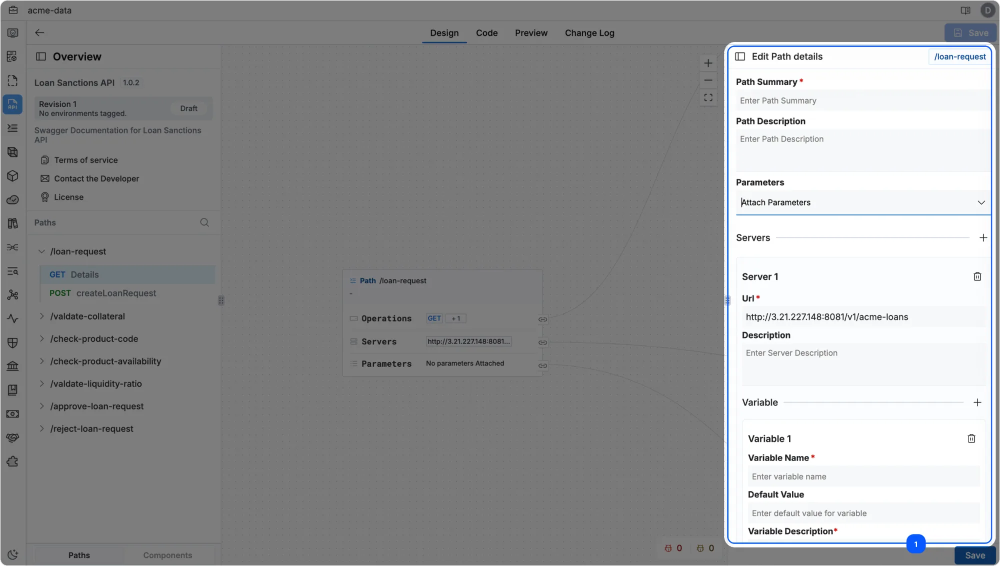
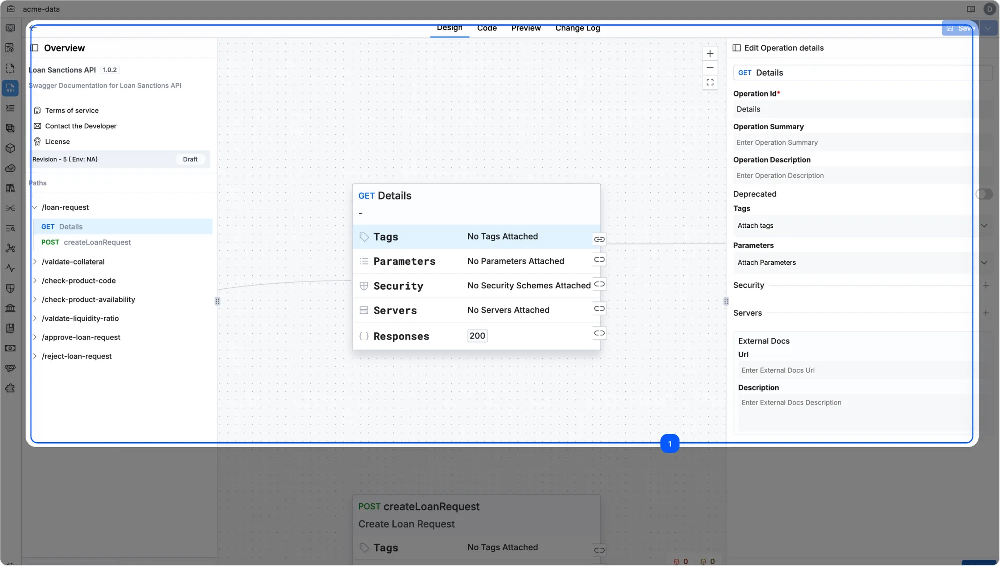
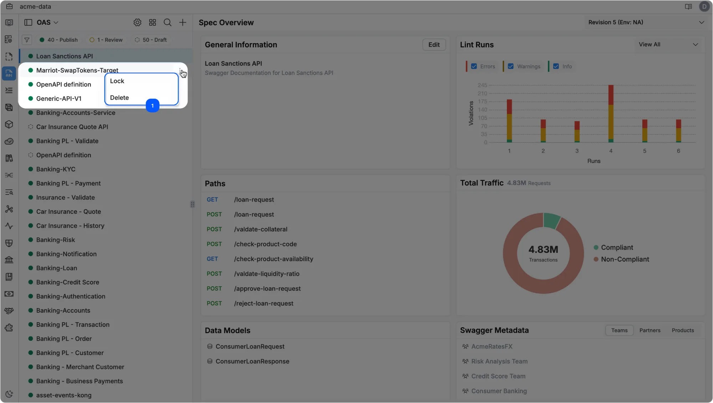

The OAS Spec Navigation panel provides tools to locate, organize, and manage OpenAPI Specifications \(OAS\). You can filter the specification list by status or team ownership, edit specification details, and lock or delete individual specifications to control their lifecycle.

### Filtering OAS specifications

Filters help you locate specific OAS entries without scrolling through the full list. Two filtering methods are available: quick status filters and advanced filters.

#### Quick status filters

Quick status filters appear outside the **Filter** icon in the Spec Overview panel and refine the list by lifecycle status.

#### Advanced filters

Select the **Filter** icon \(funnel icon\) in the upper-left corner of the OAS Spec Navigation panel to open the **Filter by** panel, and narrow the list by status and team ownership.

Select **Clear filters \(0\)** to reset all applied filters.

### Editing an OAS

Editing an OAS means modifying an existing specification — adding or updating paths, components, and other specification details. Editing is available only while the OAS is in the **Draft** state. To update a published OAS, create a new revision instead. See [Save as new revision](https://docs.google.com/document/d/1ywN11VyddX8YWg8WumrXLZeinS6zyUUlkQNa7UVFbHs/edit?tab=t.e8v93aczzeek#heading=h.7gb44v8zs91r).

To open an OAS for editing, select it from the left panel, then select **Edit** next to the title in the **General information** section. This redirects you to the **Design** page.

#### Editing path details

Select the **Edit** \(pencil\) icon next to a path to open the **Edit path details** form, where you update or add configuration details for that path.

#### Editing operation details

Select the **Edit** \(pencil\) icon next to an operation \(for example, `GET getFlights`\) to open the **Edit operation details** panel and configure the operation.

Select **Save** to apply your changes.

#### Impact of changing the resource path and operation ID

Compliance tracking is path-specific. Changing a resource path creates a new compliance entry for the updated path; the entry for the original path is retained with its historical data. This means multiple compliance records can accumulate for the same API functionality over time.

### Locking and deleting an OAS

Each OAS entry has a menu for locking a specification against further edits or removing it from the system.

Point to any OAS entry and select the three-dot menu \(⋮\) next to the OAS name.

#### Locking an OAS

Select **Lock** to prevent further edits. Once locked, the same menu displays **Unlock to edit**.

#### Deleting an OAS

Select **Delete** to permanently remove the OAS. You cannot delete an OAS in the **Published** state.

Deleting an OAS affects associated modules as follows.

Local components referenced inside the deleted Swagger are deleted with it. Global components are unaffected.