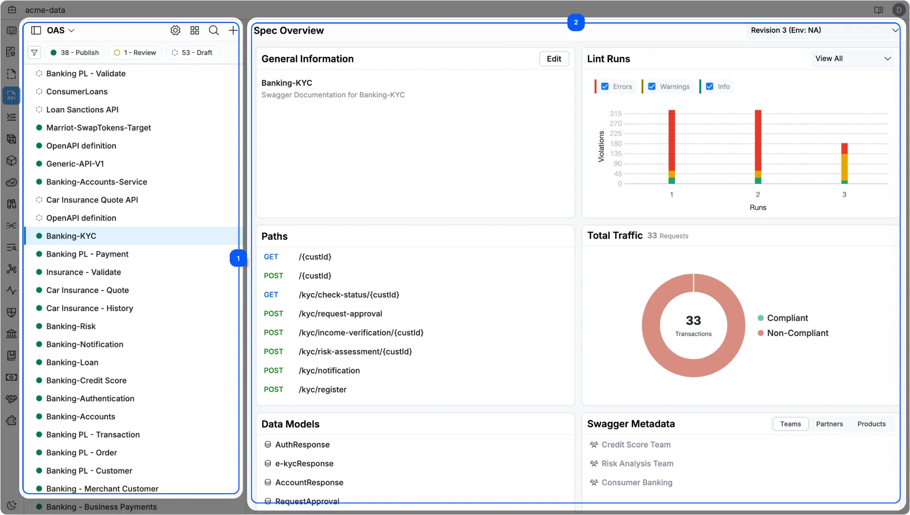
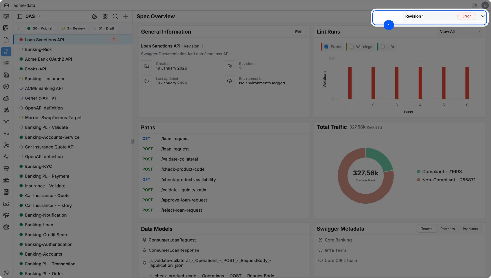

After you create an OAS, the Design Studio dashboard shows its specification details, revision history, compliance status, and ownership metadata in one place.

### Left panel

The left panel lists all OAS specifications you've created. Browse the list directly, or narrow it using filters.

### Spec Overview panel

The **Spec Overview** panel consolidates everything you need to know about a selected specification. Use the **Revision** dropdown to switch between revisions.

If the OAS contains errors, an error icon appears next to the **Revision** dropdown, indicating the OAS was saved with errors.

#### General information

Shows the title and description of the OAS. Select **Edit** to update these details. For more information, see [Editing an OAS](#).

#### Lint runs

Shows the results of linting tests run against the OAS, including error, warning, and informational message counts. Filter results by revision or ruleset to isolate specific findings.

The global ruleset runs automatically whenever the API design or linting rules change. Custom rulesets require a manual trigger. For more information, see [API linting](#).

#### Paths

Lists the resource paths configured in the OAS, along with the HTTP methods each path supports.

#### Total traffic

Shows total requests made to the OAS resource paths, broken down by compliance status.

For more information, see [API compliance](#).

#### Data models

Lists the data models used in the OAS. Data models define:

- Properties and fields of a model
- Data types \(string, integer, boolean, and so on\)
- Required and optional properties
- Constraints on property values

For more information, see Data Models in Local Components.

#### Swagger metadata

Shows organizational context for the OAS, across three tabs.