# Sync to Repository

The **Sync to Repo** feature connects your OpenAPI Specification \(OAS\) to an external source code repository. Use this feature to enable version control, track revisions, and collaborate within your existing DevOps workflow.

The following repository providers are supported:

- [GitHub](https://github.com)
- [GitLab](https://gitlab.com)
- [Bitbucket](https://bitbucket.org)
- [Azure Repos](https://azure.microsoft.com/en-us/products/devops/repos)
- [AWS CodeCommit](https://aws.amazon.com/codecommit)

## Prerequisites

Before you configure **Sync to Repo**, ensure the following requirements are met:

To sync your OAS to an external repository, follow these steps:

1. In the right panel of the Design Studio, select **Sync to Repo** \(connected-node icon\).
  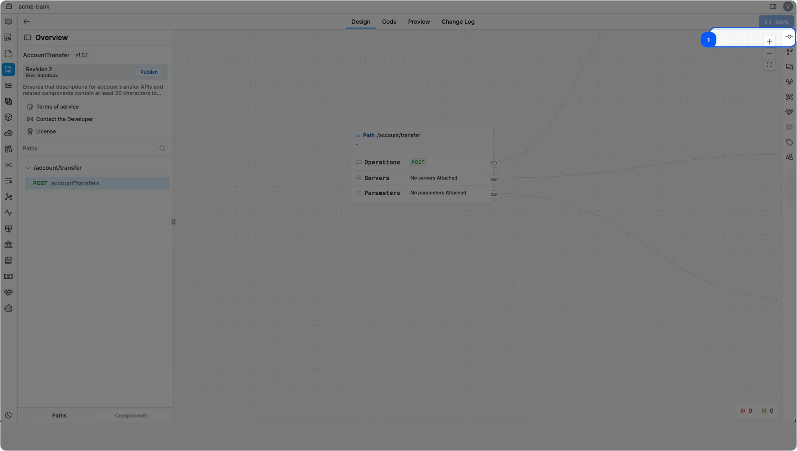
1. The **Sync to Repo** panel opens on the right side of the design canvas.
  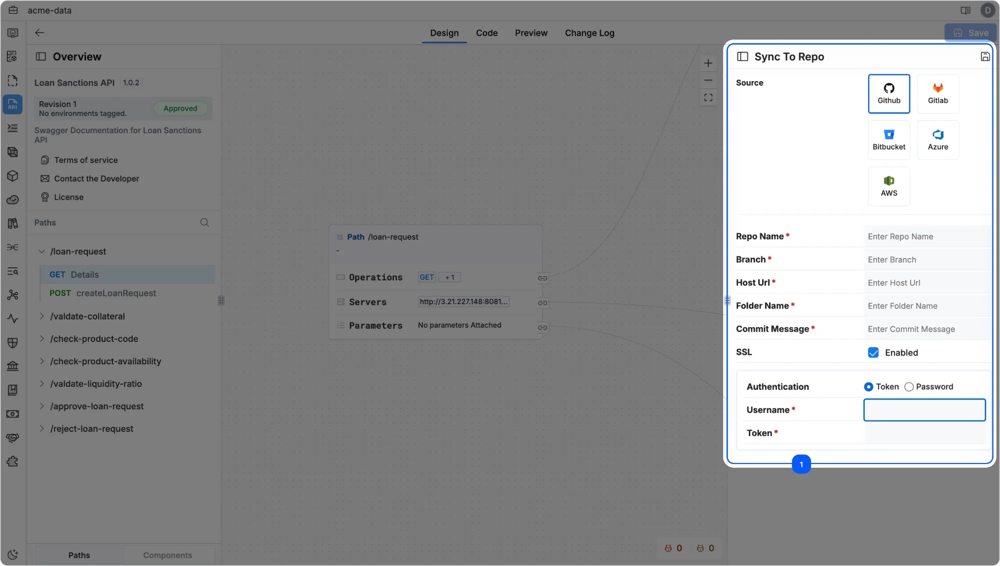
1. Enter the following details:
  - **Source**: Select the repository provider. The following providers are available:

  - **Repo Name**: Enter the repository name where the OAS will be stored. For example, `banking-merchant-api-repo`.
  - **Username**: Enter the username of your repository account. For example, `api-admin-user`.
  - **Branch**: Specify the branch where the OAS will be committed. For example, `main` or `develop`.
  - **Host URL**: Enter the Git server URL of your repository. For example, `https://github.com/apiwiz/banking-merchant-api-repo.git`.
  - **Folder Name**: Enter the folder path inside the repository where the OAS will be stored. For example, `api-specs/v1`.
  - **Commit Message**: Enter a commit message describing the change being pushed to the repository. For example, `Updated LocationResponseArray model`.
  - **References**: Select how references are exported.

  - **SSL**: Select this checkbox to enable SSL for secure communication with the repository server.
  - In the **Authentication** section, select an authentication method and enter the required credentials.
    - **Token authentication \(recommended\):** Token authentication is available for GitHub, GitLab, and Bitbucket.
      ***Refer to the following documentation to generate a personal access token for your repository platform:***

      **GitHub**: [Managing your personal access token](https://docs.github.com/en/authentication/keeping-your-account-and-data-secure/managing-your-personal-access-tokens)

      **GitLab**: [Personal access token](https://docs.gitlab.com/ee/user/profile/personal_access_tokens.html)

      **Bitbucket**: [Create a repository access token](https://support.atlassian.com/bitbucket-cloud/docs/create-a-repository-access-token/)
    - **Password authentication: **Password authentication is available for all supported providers and is the only authentication method available for Azure Repos and AWS CodeCommit.
1. Select **Save** \(floppy disk icon\) at the top of the **Source Control** panel.
1. Once saved, the changes are committed and appear under the **Commit** section on the repository page.

# Commit history

The **Commit History** panel displays a chronological record of all revisions and status changes made to an OpenAPI Specification \(OAS\). Use this panel to track changes, review lifecycle progress, and maintain version control across your team.

To open the **Commit History** panel, follow these steps:

1. In the right panel of the Design Studio, select **Commit History** \(branching tree icon\).
  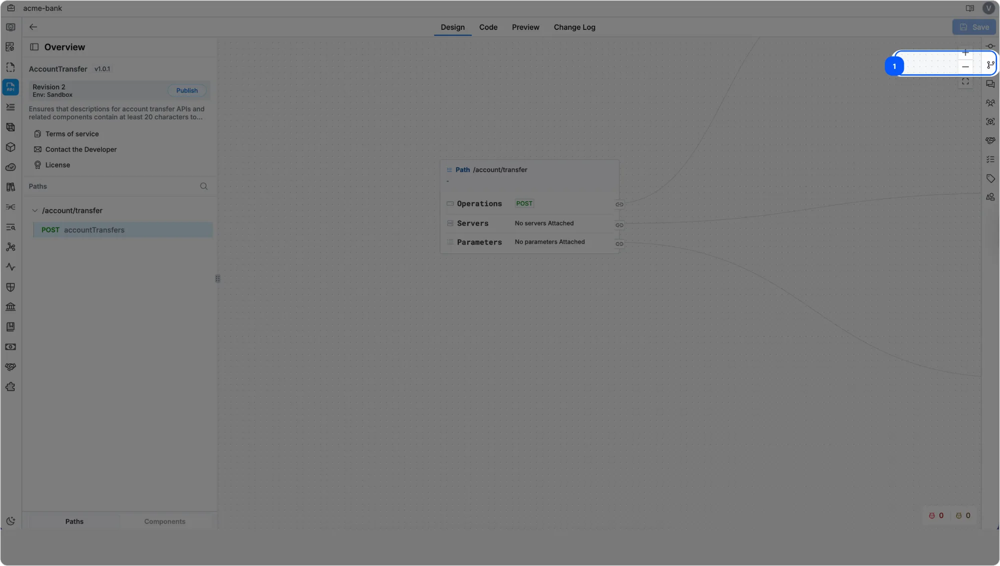
1. The **Commit History** panel opens on the right side of the design canvas.
  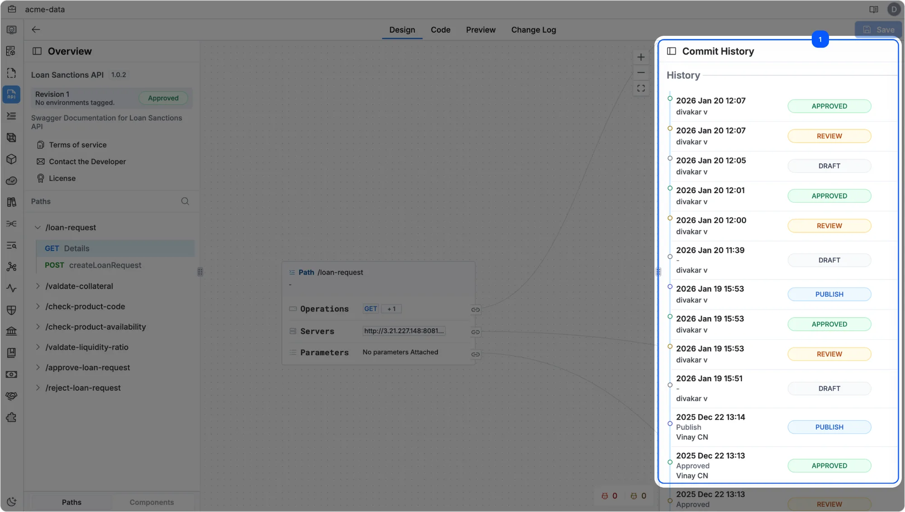

The **History** section displays the status change history of the selected OAS revision in chronological order.

Each entry includes the following details:

The **Status** field indicates the current lifecycle state of the OAS revision.

# Swagger reviews

The **Swagger Reviews** feature enables collaborative review of an API specification by allowing reviewers and authors to exchange feedback directly within the OAS Design canvas. Use this feature to add, reply to, and delete comments, while notifying stakeholders through email alerts. This streamlines the review process, improves communication, and maintains a clear history of discussions for each revision.

To open the **Comments** panel, follow these steps:

1. In the right panel of the Design Studio, select **Comments** \(speech bubble icon\).
  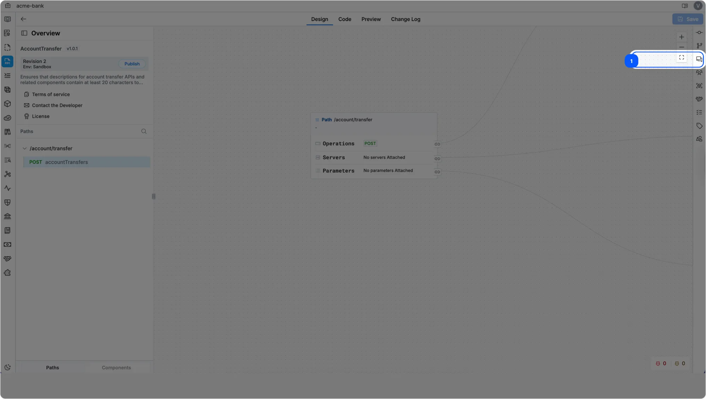
1. The **Comments** panel opens on the right side of the design canvas, displaying existing comments and an option to add new ones.
  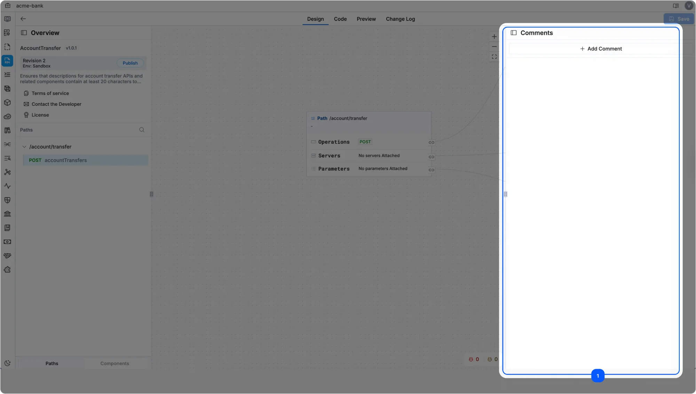

## Add a comment

To add a comment to the OAS, follow these steps:

1. In the **Comments** panel, select **\+ Add Comment**.
  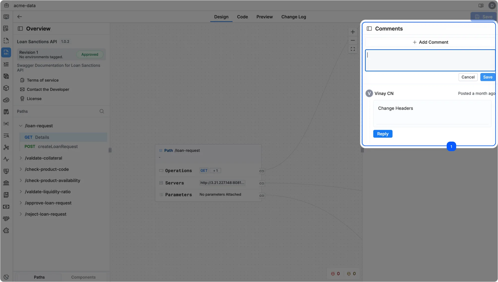
1. In the text field, enter your feedback, question, or suggestion.
1. Select **Save** to add the comment, or select **Cancel** to discard it.

The comment is saved and appears in the **Comments** panel. The OAS developer receives an email notification with the comment details.

### Reply to a comment

To reply to an existing comment, follow these steps:

1. In the **Comments** panel, select **Reply** below the comment you want to respond to.
  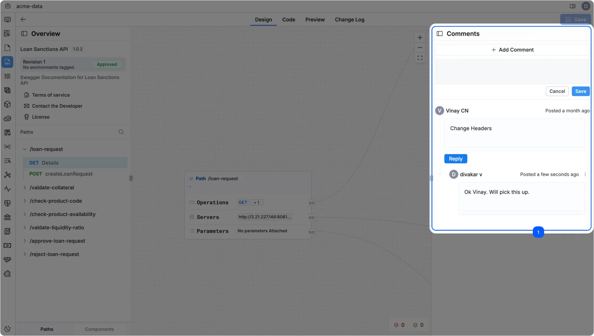
1. In the text field, enter your response.
1. Select **Save** to post the reply, or select **Cancel** to discard it.

The reply is nested under the original comment, keeping the discussion organized and easy to follow. The relevant user receives an email notification.

### Track comments

Each comment entry in the **Comments** panel includes the following details:

- **Reviewer name**: The name of the user who added the comment.
- **Timestamp**: The date and time when the comment was posted.
- **Comment text**: The feedback, question, or suggestion entered by the reviewer.

### Delete a comment

To permanently remove a comment from the **Comments** panel, follow these steps:

1. In the **Comments** panel, select **More Options** \(⋮\) next to the comment you want to delete.
  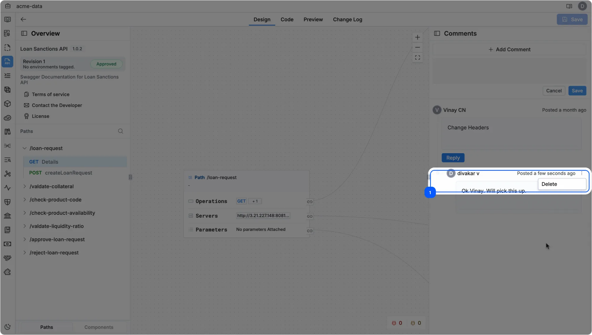
1. Select **Delete**.

The comment is permanently removed. A confirmation message appears.

# Associate teams 

The **Associated Teams** feature lets you link an OAS with one or more organizational teams. This establishes ownership, ensures accountability, and promotes collaborative development and review of the specification.

We recommend associating the appropriate teams at the time of creating the OAS.

To associate teams with an OAS, follow these steps:

1. On the right side of the design canvas, select the **Teams** icon.
  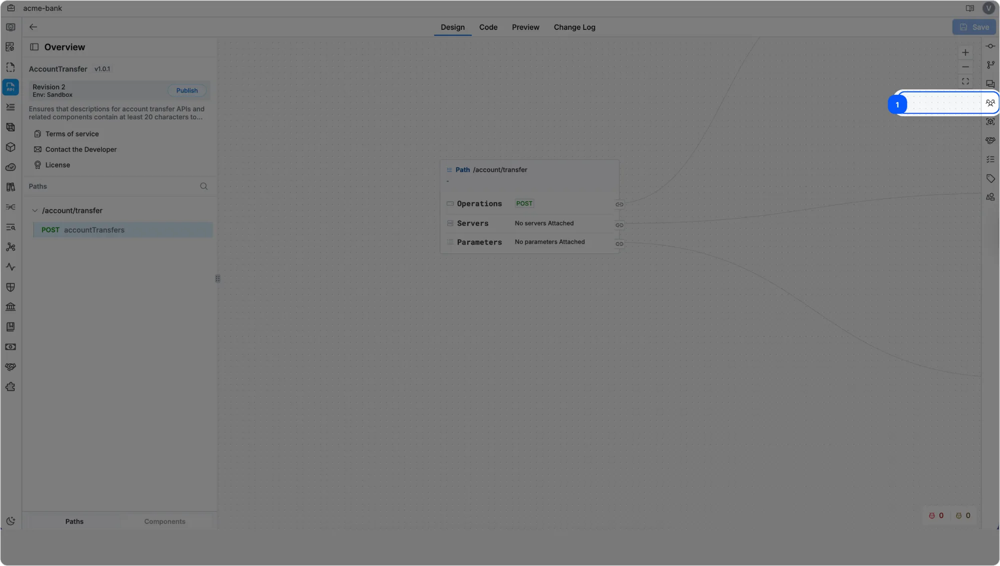
1. The **Associate Teams** panel opens on the right side of the screen.
  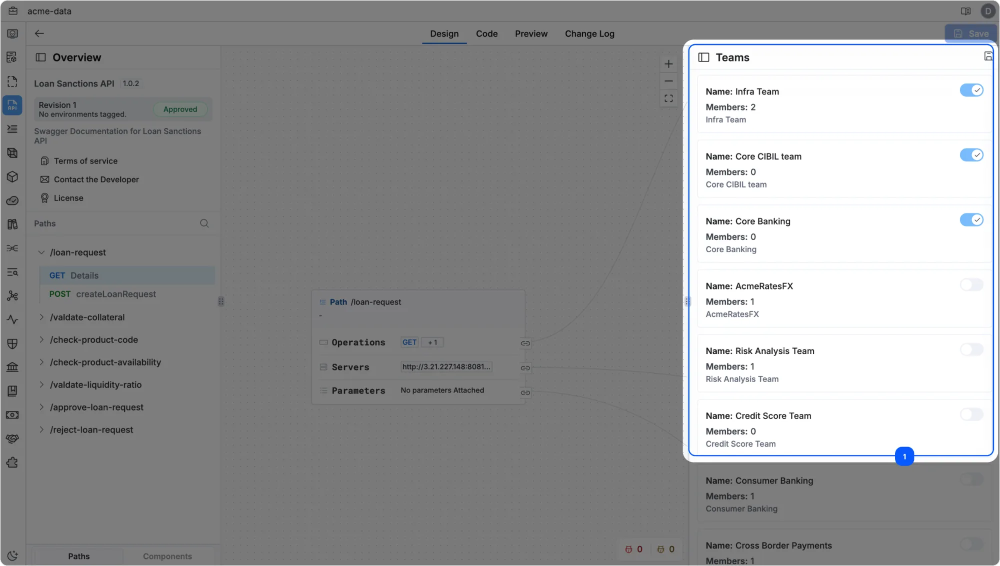
1. In the panel, locate the team you want to associate. Each entry displays the following details:

1. Enable the toggle for each team you want to associate with the OAS.
1. In the top-right corner of the **Associate Teams** panel, select the **Save** icon to apply the changes.

Alternatively, you can associate teams by navigating to **Settings** \> **OAS** \> **Configure OAS** and selecting the required teams from there.

# Associated products

The **Associate Products** feature lets you link an OAS with one or more business products in your organization. Associating products establishes clear alignment between APIs and the business capabilities or services they represent. This ensures traceability, simplifies management, and supports product-level governance.

We recommend associating the appropriate products at the time of creating the OAS.

## Associate products with an OAS

To associate products with an OAS, follow these steps:

1. On the right side of the design canvas, select the **Associate Products** icon.
  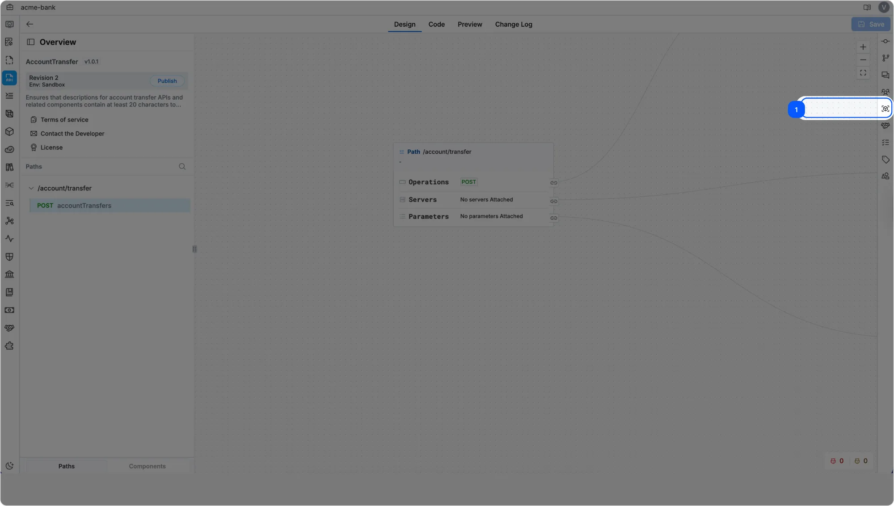
1. The **Associate Products** panel opens on the right side of the screen.
  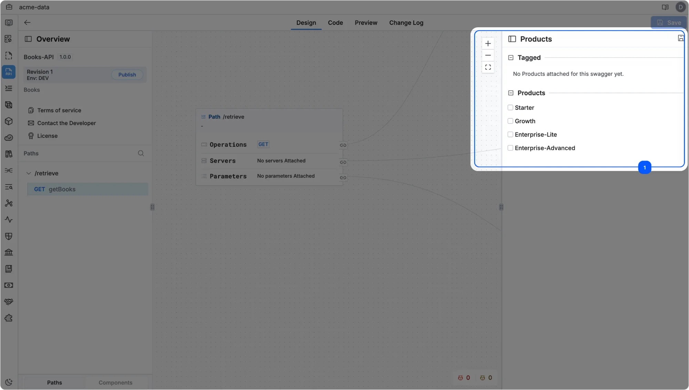
1. In the panel, locate the product you want to associate. The panel displays the following:

1. Select the checkbox for each product you want to associate with the OAS.
1. In the top-right corner of the **Associate Products** panel, select the **Save** icon to confirm the association and update the OAS metadata.

# Associated partners

The **Associate Partners** feature lets you link an OAS with specific business partners. Associating partners ensures clear visibility of the external or internal stakeholders involved in using or collaborating on the API. It also supports partner-specific governance, accountability, and tracking.

We recommend associating the appropriate partners before publishing the OAS.

## Understanding partner-based visibility

In the Developer Portal, every user is associated with a specific partner, either internal or external. API visibility is determined based on the partner tagged to the OAS. Users can only access APIs mapped to their associated partner. This prevents unauthorized API discovery and ensures APIs are exposed only to the intended audience.

The following table describes how visibility works:

To associate partners with an OAS, follow these steps:

1. On the right side of the design canvas, select the **Associate Partners** icon.
  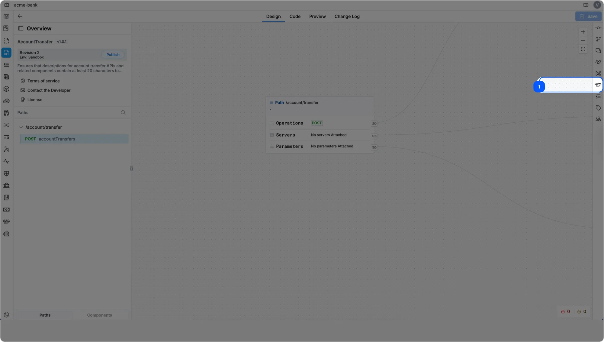
1. The **Associate Partners** panel opens on the right side of the screen.
  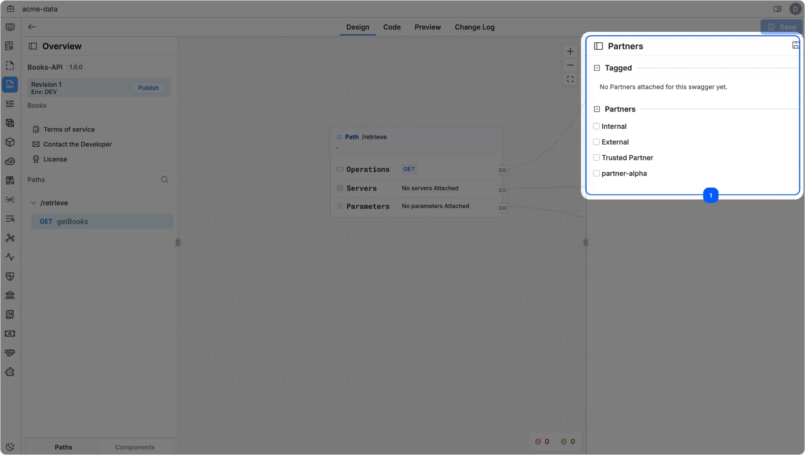
1. In the panel, locate the partner you want to associate. The panel displays the following:

1. Select the checkbox for each partner you want to associate with the OAS.
1. In the top-right corner of the **Associate Partners** panel, select the **Save** icon to confirm your changes.

### Impact of removing a partner

Removing a partner from an OAS directly affects its visibility in the Developer Portal. Access is revoked immediately after the partner association is removed, with no transitional delay.

When a partner is removed from an OAS, the following occurs:

- The API is instantly hidden from all users associated with that partner.
- Users from the removed partner group can no longer discover or consume the API.
- The API remains visible only to partners that are still tagged.

The following table describes the impact on end users:

Removing a partner ensures strict access control by preventing unintended API exposure, maintaining partner-based segregation, and enforcing secure API lifecycle governance.

# Compare changes

The **Compare Changes** feature lets you view and analyze the differences between two revisions of an OAS. This helps reviewers and developers track modifications, validate updates, and ensure consistency across revisions.

## Compare two OAS revisions

To compare two revisions of an OAS, follow these steps:

1. On the right side of the design canvas, select the **Compare Changes** icon.
  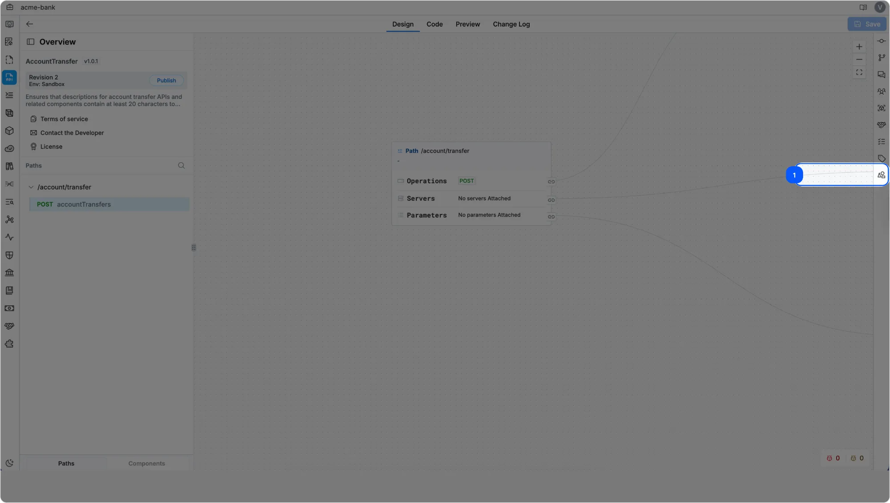
1. The **Compare Revisions** panel opens at the bottom of the screen.
  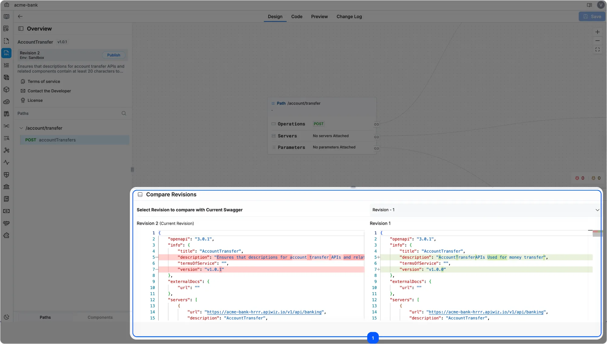
1. In the **Previous Revision** dropdown, select the revision you want to compare against the current revision.

The panel displays the two revisions side by side for review.

## Compare Revisions panel

The panel displays the following two sections: