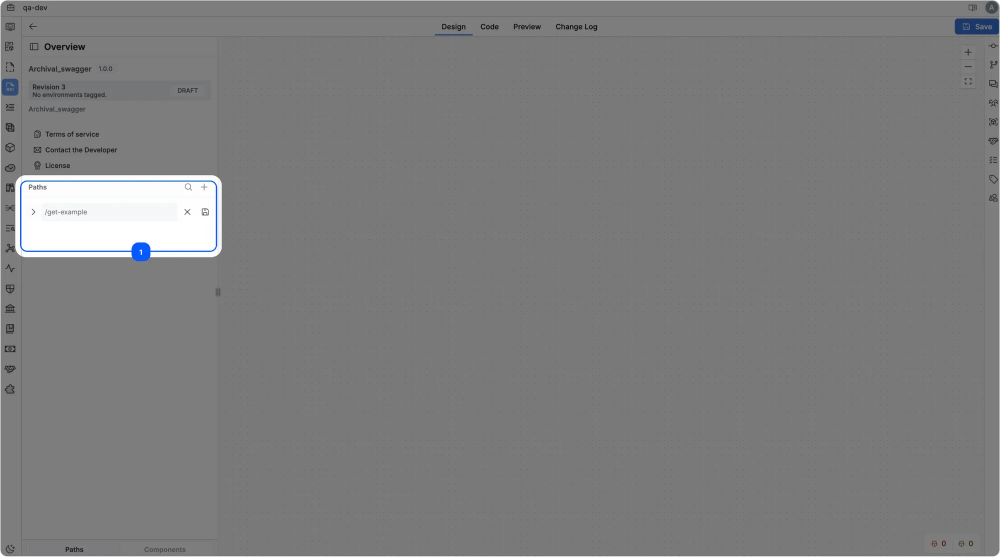
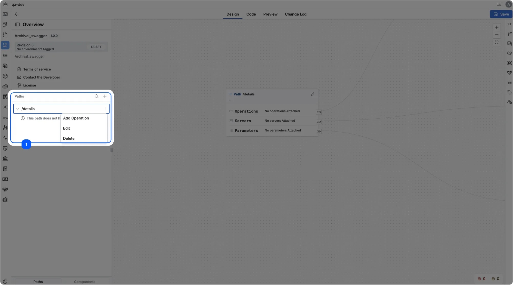

The **Paths** tab, located at the bottom of the **Overview** panel, lists all resource paths and their operations. Each resource path represents an API endpoint and may include parameters, servers, security configurations, and responses.

When you select a path in the **Paths** tab, the **Design** panel highlights the associated details, including connected operations, request and response structures, and related configurations.

A resource path can contain multiple operations. Each operation corresponds to one HTTP method, such as GET, POST, PUT, or DELETE, and defines what action can be performed on that endpoint.

# Create a resource path

Because the base path is configured in the **Server** section, you only need to define the remaining path segments as the resource path.

**Example endpoint breakdown:**

To create a resource path, follow these steps:

1. In the **Paths** tab, select **\+**.
1. In the text field, enter the resource path.
1. Select **Save** \(floppy disk icon\) to save the new path, or select **Cancel** \(cross icon\) to discard the action.
  

The new path appears in the **Paths** tab alongside existing paths. Select **More Options** \(⋮\) next to the path to access the following options:

- **Add Operation**: Adds an HTTP method to the path.
- **Edit**: Modifies the resource path.
- **Delete**: Removes the resource path.

## Add an operation to a path

An operation defines the HTTP method and behavior for a resource path. Each path supports one operation per HTTP method. For example, a path can have one GET and one POST operation, but cannot have two GET operations.

To add an operation to a resource path, follow these steps:

1. In the **Paths** tab, select **More Options** \(⋮\) next to the required path.
1. Select **Add Operation**.
  
1. Enter a unique operationId to identify the operation in the OAS.
1. Configure the request and response details for the operation.

The operation is added to the resource path with the selected HTTP method and is available in the **Design** panel for further configuration.

## Search for an operation

Use the **Search Operations** bar in the **Paths** tab to locate an operation by its `operationId`.

To search for an operation, do the following:

1. In the **Paths** tab, select the **Search Operations** bar at the top of the **Overview** panel.
1. Enter the `operationId` of the operation you want to find.

The list filters automatically to display matching operations as you type.