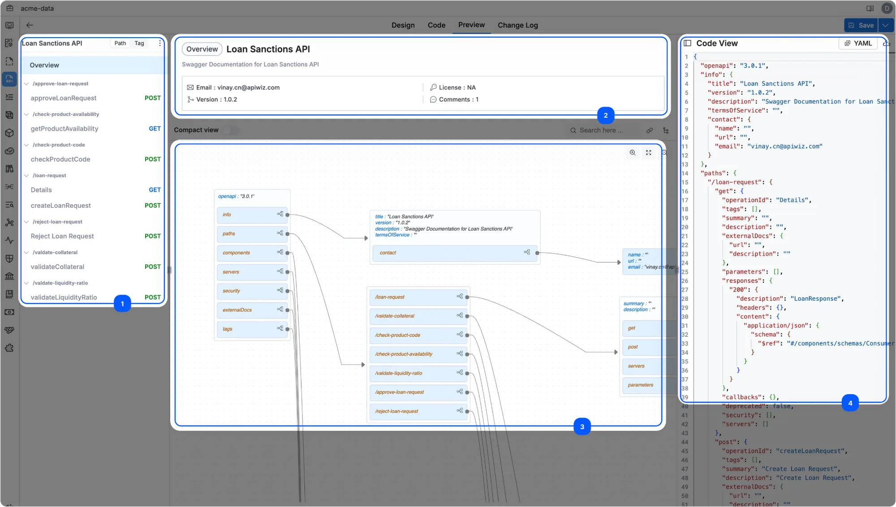
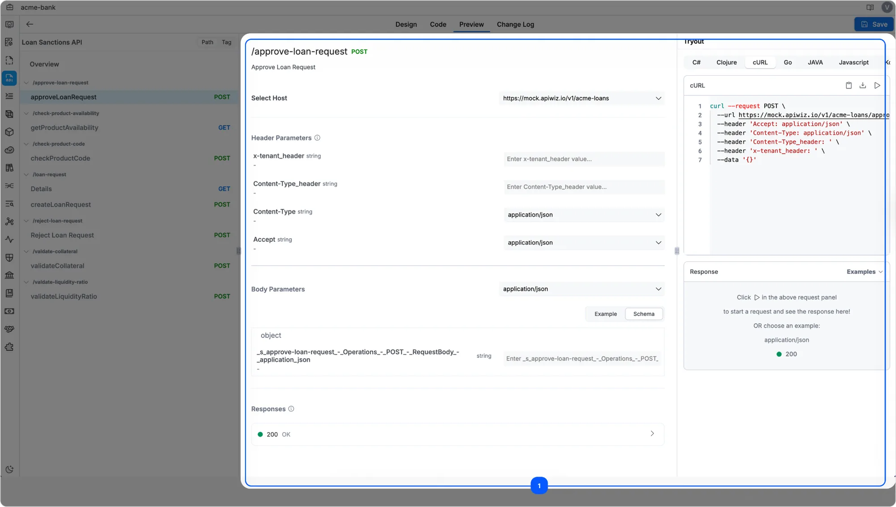
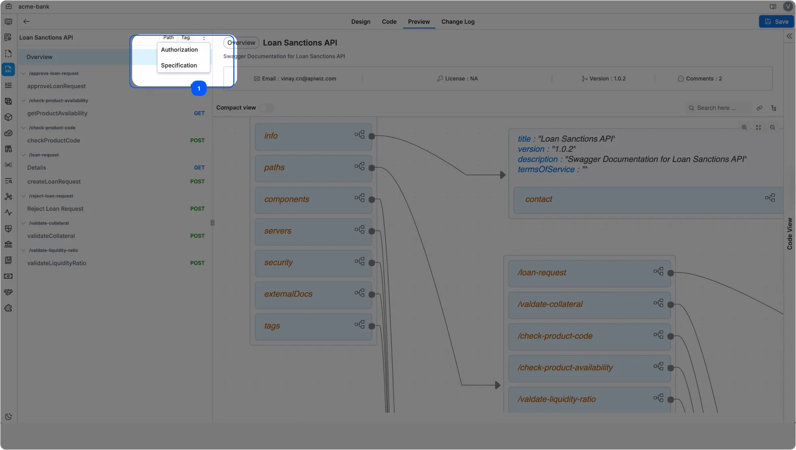

The **Preview** tab displays a visual, user-friendly representation of the OAS instead of raw JSON or YAML. Use the **Preview** tab to review the API structure, relationships, and capabilities before submitting the OAS for review.

# Path and tag view

The **Path** and **Tag** views appear in the left panel and display all available API endpoints and their operations for the selected OAS revision.

- **Path view**: Organizes APIs by resource paths. Each path expands to show its associated operations and HTTP methods, such as GET and POST.
- **Tag view**: Groups operations based on assigned tags. Operations without tags appear under **Untagged Operations**.

Use these views to browse, locate, and review API operations defined in the OAS.

## Overview of an OAS

The **Overview** section appears at the top of the OAS and displays the following high-level information:

- **OAS Name**: The name of the OAS. For example, Loan Sanctions API.
- **Description**: A brief summary of the API defined by the OAS.
- **Email**: The email address of the OAS owner or developer.
- **License**: The license information associated with the OAS.
- **Version**: The current version of the OAS.
- **Comments**: Hover over the comments bar and select **View** to open the comments panel in the right pane.

## Preview mode

The **Preview** mode provides a visual representation of the OAS schema and its structure. It displays key OpenAPI components such as **Info**, **Paths**, **Components**, **Servers**, and **Security**, and shows the relationships between paths, schemas, and their linked components.

The following options are available in Preview mode:

## Code view

Select the **Code View** option to view the raw OAS in YAML or JSON format. Use the toggle in the top-right corner to switch between YAML and JSON.

The code view automatically reflects changes made in the **Design** view and is read-only. You can download the specification as a YAML or JSON file.

## Try Out the OAS

The **Try Out** section allows you to interactively test API operations defined in the OAS before approving or publishing it.

To test an API operation, do the following:

1. In the **Preview** tab, select an API operation from the left panel. The operation details and **Try Out** section appear.
1. In **Select Host**, select a server host. This step is required to enable request execution.
1. Enter the required header parameters, such as x-tenant, Content-Type, and Accept.
1. Enter values for the request body parameters, or select an available example.
1. Select the **Run** \(**▶**\) button to execute the API call.

The right panel displays the generated request in multiple formats, such as cURL, Java, JavaScript, Go, C\#, and Clojure. The API response and status code appear below the request panel.

## Authorization

Authorization defines the security requirements for API operations and paths. It determines how requests are authenticated before they are processed. The configured authorization is applied globally across all operations in the API.

To configure authorization, do the following:

1. In the left panel, select the **More Options** menu \(**⋮**\).
  
1. Select **Authorization**. The **Authorization** form opens in the right pane and displays the security schemes defined in the OAS, such as API Key, HTTP, OAuth 2.0, and OpenID Connect.
  
1. Enter the required credentials based on the security scheme configured in the local components of the OAS.
  - **Bearer Token or API Key**: Paste the generated token in the field.
  - **Basic Authentication**: Enter the username and password.
1. Select **Authorize** to apply the credentials.

Once authorized, the credentials are used for all secured endpoints and authorized requests can be executed directly from the **Preview** interface.

## Specification

To view the raw OAS in YAML or JSON format, do the following:

1. In the left panel, select the **More Options** menu \(**⋮**\).
1. Select **Specification**. The **Code View** form opens in the right pane.