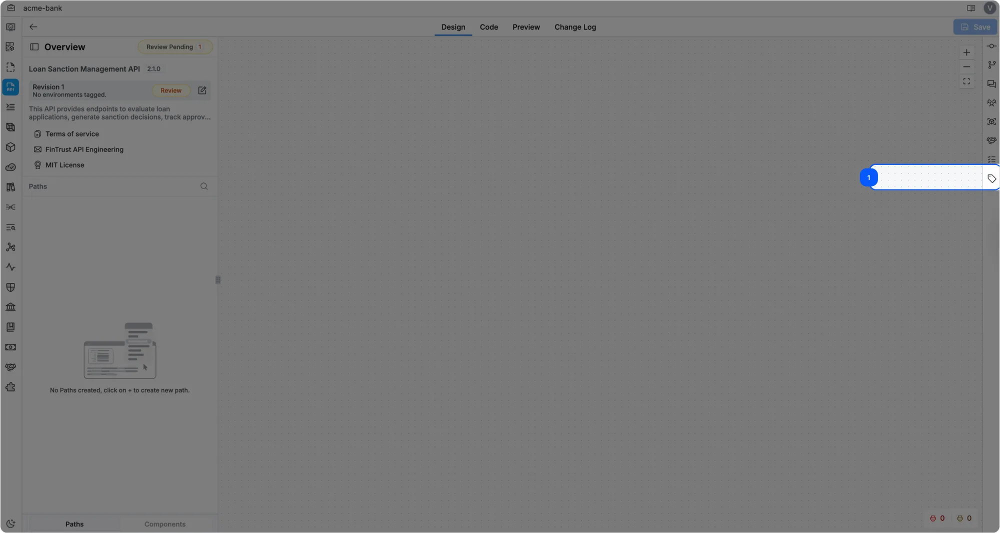
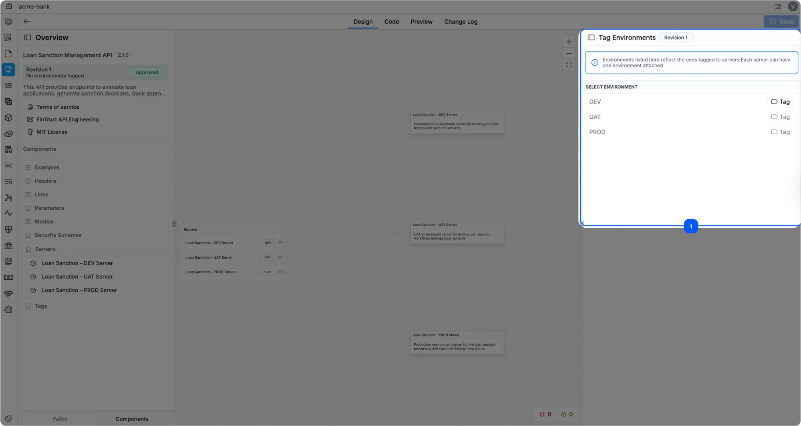
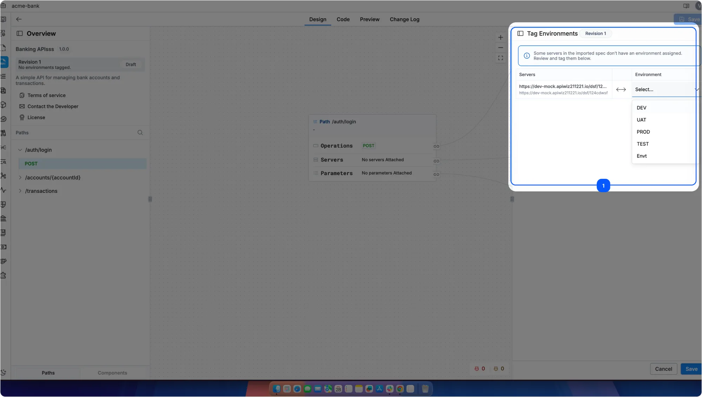

# What is an Environment

An environment represents a set of servers or domains configured in the **Connectors** module. Environment mapping segregates API traffic within the APIwiz platform based on the target server or domain, ensuring that incoming traffic is correctly associated with the appropriate API and environment.

When traffic reaches API Compliance, the platform generates a compliance report by comparing the actual runtime traffic against the OAS configured for the corresponding environment. This comparison helps identify deviations between the API design and its real-world behavior, enabling better governance and compliance validation.

Environments are predefined in the Environment Map under APIwiz Integration in the Connectors module. Once an environment name is created, it cannot be modified.

# Environment Tagging

Environment tagging links an approved OAS revision to one or more environments, enabling environment-specific routing and compliance validation. The **Tag Environment** option is available only when the OAS status is **Approved**.

A single revision can be tagged to multiple environments, eliminating the need to create duplicate revisions. When a new revision is published, the previous revision is automatically retired.

A priority system is available for environments, allowing you to drag and drop environments to set their priority order. A higher-priority environment cannot be tagged until all lower-priority environments have been tagged.

Ensure that all required environments and servers are defined during the initial design phase. Once the OAS is approved, new environments cannot be added.

## Environment tagging workflow

The environment tagging process is completed in the following two phases.

### Phase 1: Definition phase

Define all required environments and servers in the OAS before starting API design. It is recommended to configure all working environments, such as Sandbox, Dev, UAT, and Production. Attach the appropriate server URL for each environment.

Defining a server is equivalent to defining an environment. An environment is a collection of one or more servers.

### Phase 2: Tagging phase

To tag an environment, do the following:

1. After the OAS revision is approved, select the **Tag Environment** icon in the right panel.
  
1. The **Tag Environments** form opens and displays all environments associated with the servers defined in the OAS.
  
1. Select the environments you want to tag for the current revision.
1. Select **Save**.

Ensure that the approved OAS is tagged to all required environments before publishing. The OAS can be published only after environment tagging is complete.

### Behavior based on OAS status and tagging

The following table describes how transactions are handled based on the OAS status and tagging configuration.

To view transactions across all environments, go to the **Compliance** module and select **All Environments**. This displays transactions from all environments, including those tagged as **Unknown**.

### Scenarios for environment tagging

When you import an API specification using methods such as **Import from File**, **Import from SCM**, **Postman Collection**, **Tryout**, or **Live Traffic**, the system validates the host against configured environments.

- If the host already exists, the system automatically detects and defines the corresponding environment. After the OAS is approved, tag the OAS to the environment to complete the configuration.
- If the host is not configured for any environment in **Environment Mapping**, you can configure it directly from the **Tag Environment** section.

To configure an unmapped host before changing the OAS status, do the following:

1. Select **Tag Environment**. The **Tag Environments** form opens.
  
1. Select the required environment and select **Save**. The selected host is automatically added to the chosen environment.

Alternatively, you can add the host manually in **Environment Mapping** from the **Connectors** module.

# Environment, revision, and compliance workflow

This section explains how environments, OAS revisions, and API traffic work together in APIwiz to generate accurate compliance reports without impacting ongoing development.

## Initial setup

Consider an OAS named **Customers**. By default, a newly created OAS starts with Revision 1. Before designing APIs, define the environments that the API will belong to based on your enterprise setup. Common environments include:

- Sandbox
- Development \(Dev\)
- User Acceptance Testing \(UAT\)
- Production \(Prod\)

In APIwiz, defining a server is equivalent to defining an environment. Each server or domain configured represents a distinct environment.

## API design and development flow

To design and develop an API, do the following:

1. Configure all required servers and environments in the OAS before starting API design.
1. Once the environments are defined, design the APIs in the OAS.
1. After review, finalize and approve the API design.
1. Deploy the application code to the Dev environment.
1. After deployment, tag the OAS to the Dev environment in APIwiz.

## Traffic ingestion and compliance validation

When traffic reaches your application, the following occurs:

- Traffic is ingested into the APIwiz platform using APIwiz Traffic Hooks.
- APIwiz analyzes the incoming traffic to determine the OAS based on the API resource path and the environment based on the host or server mapping.
- APIwiz generates a compliance report by comparing the actual runtime traffic against the OAS design configured for the identified environment.

## Promotion across environments

As the application moves through environments, do the following:

- When code is promoted to UAT, tag the OAS to the **UAT** environment.
- When code is promoted to Production, tag the OAS to the **Prod** environment and publish the OAS.

Repeat this process consistently across all environments to ensure accurate compliance validation.

## Managing changes using OAS revisions

### Adding new APIs

When adding a new API to an existing OAS, do the following:

1. Create a new revision.
1. Follow the same design → change status → tag process.

### Creating a new version of an existing API

To introduce a new version of an API without affecting existing environments, do the following:

1. Create Revision 2 of the OAS.
1. Update the API design based on the new requirements.
1. Get the design approved.
1. Deploy the updated code to Dev.
1. Tag Revision 2 to the Dev environment.

At this stage, Dev traffic is validated against Revision 2, while UAT and Production traffic continue to be validated against Revision 1.

Once the updated code is promoted:

- Tag Revision 2 to UAT.
- Tag Revision 2 to Production and publish.

This approach allows teams to develop and validate newer API versions without impacting existing compliance reports.

### Rules for selecting the OAS for compliance reporting

When API traffic is ingested into APIwiz, the following rules are applied to identify the correct OAS and revision for compliance reporting.

You can view the list of OAS specifications and revisions considered for compliance reporting in the [Observability Catalog](https://docs.apiwiz.io/guides?guideId=6a3b5896196683f9c8784e55&groupId=API+Compliance&pageId=6a3ced02d0dd14afc2778f7e). This provides transparency into which OAS and revision are actively validating traffic for each environment.