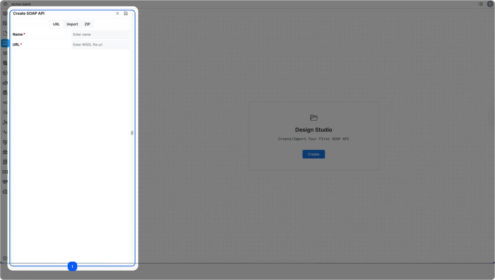
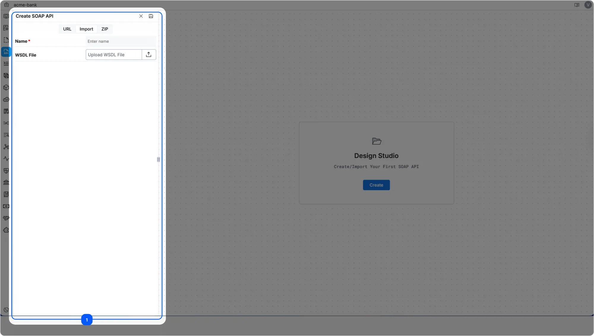

To create a SOAP API, select **➕** in the left navigation panel, or select **Create** in the main panel. The **Create SOAP API** panel opens. The following creation methods are available. Select the method that best fits your workflow.

### Before you begin

Before creating a SOAP API, ensure you have the following:

### Create a SOAP API using a URL

Use this method when you already have a WSDL file available through a URL.

To create a SOAP API using a URL, follow these steps:

1. In the **Create SOAP API** panel, select the **URL** tab.
  
1. In **Name**, enter a name for the SOAP API.
1. In **URL**, enter the WSDL file URL.
1. Submit the form to create the API.

The system retrieves the WSDL, parses the service definition, and generates the SOAP API structure, including the XML schema and operations.

### Create a SOAP API by importing a WSDL file

Use this method when you already have a WSDL file on your local system.

To import a WSDL file, follow these steps:

1. Select **➕** to open the **Create SOAP API** panel.
1. Select the **Import** tab.
  
1. In **Name**, enter a name for the SOAP API.
1. In **WSDL File**, select **Upload WSDL File** and select the file from your local system.
1. Submit the form to create the API.

After the file uploads, the system parses the WSDL and generates the SOAP API structure, including the XML schema, services, and operations.

### Create a SOAP API by importing a ZIP file

Use this method when the SOAP service definition includes multiple files, such as a WSDL with associated XSD or supporting schema files, packaged in a ZIP archive.

To import a ZIP file, follow these steps:

1. Select **➕** to open the **Create SOAP API** panel.
1. Select the **ZIP** tab.
  
1. In **Name**, enter a name for the SOAP API.
1. In **ZIP File**, select **Upload ZIP File** and select the file from your local system.
1. Submit the form to create the API.

After the file uploads, the system extracts the archive, processes the WSDL and related schema files, and generates the SOAP API structure, including the XML schema, services, and operations.

## Generating the SOAP API structure

After you create the SOAP API, the system redirects you to the SOAP API editor, where you can view the generated API structure.

The SOAP API editor provides a structured workspace to view, edit, and test SOAP services. The interface is organized into the following sections:

- [XML Structure](#xml-structure)
- [Bindings](#bindings)
- [Code Viewer](#code-viewer)
- [Request and Response panel](#request-and-response-panel)

### XML Structure

The **XML Structure** panel displays the hierarchical structure of the SOAP service.

At the top of the editor, you can do the following:

These controls help you manage revisions and track updates to the SOAP API.

In the **XML Structure** panel, you can do the following:

- Navigate through service definitions, schemas, elements, and the overall service structure.
- Select specific nodes to view related definitions and details.
- Review individual components to understand how the service is organized.

This panel helps you quickly locate schema elements and service components.

### Bindings

The **Bindings** panel lists the available SOAP bindings and their operations. In this panel, you can do the following:

- View the bindings defined in the WSDL.
- Expand a binding to view the operations it supports.
- Select an operation to review its request and response details.

This panel provides a clear view of the service capabilities and available methods.

### Code Viewer

The **Code Viewer** displays the WSDL or XML definition of the selected SOAP API. In this view, you can do the following:

- View the full service definition in XML format.
- Review schema definitions, messages, and operations.
- Understand how the SOAP service is implemented at the specification level.

This view is read-only and reflects the current service configuration.

### Request and Response panel

The **Request and Response** panel displays the request template and response details for the selected operation.

If no operation is selected, the panel remains empty.

To test an operation, follow these steps:

1. In the **Bindings** section, select an operation. The system displays a sample request template for the selected operation.
1. In the request body, enter the required input values. For example, replace the ? placeholder with a valid value.
1. Select **Run** to execute the request.

>

Before running the request, verify that the service endpoint \(address or location\) is configured correctly so the request can reach the service and return a valid response.

The **Response** section displays the output returned for the executed request.

For example, if the selected binding operation is NumberToWords and you enter 250 as the input value, the response section displays the result as two hundred and fifty.

This section helps you validate operations and verify service behavior.