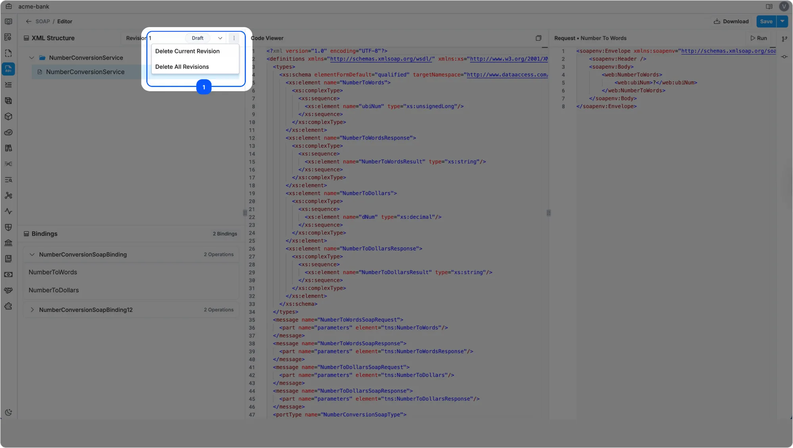
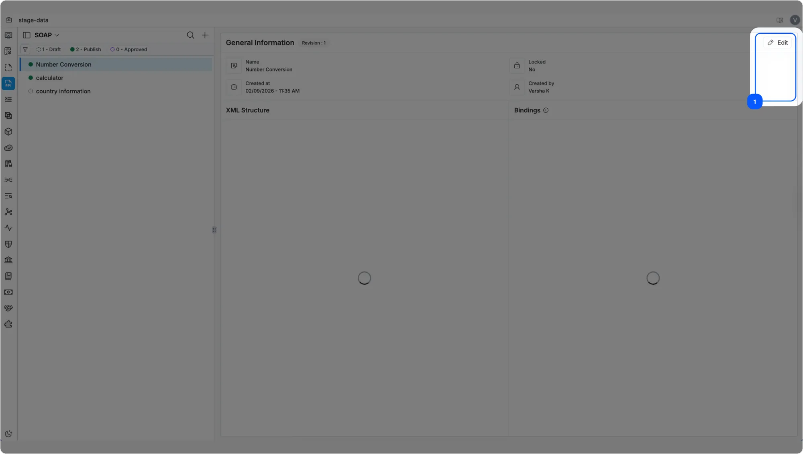
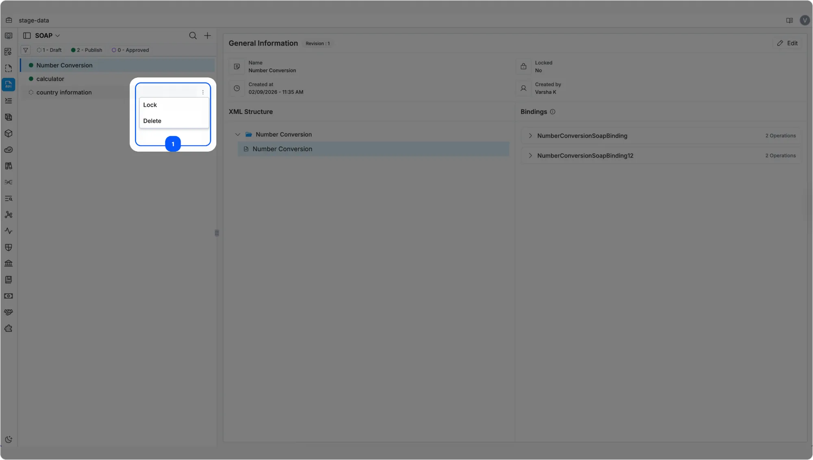

### Deleting revisions of a SOAP API

You can delete one or all revisions of a SOAP API using **More Options** in the **XML Structure** panel. Use this option to remove outdated or incorrect revisions from your API.

**Tip:** Verify that you no longer need a revision before you delete it.

To delete a revision of a SOAP API:

1. In the **XML Structure** panel, next to the revision selector, select **More Options** \(⋮\).
  
1. Select one of the following options:
  - **Delete Current Revision** — removes the revision that is currently selected.
  - **Delete All Revisions** — removes all revisions of the SOAP API.

The selected revision, or all revisions, are permanently removed from the SOAP API. If the deleted revision was published, it no longer appears in the **API Compliance** module.

### Modifying a SOAP API

You can modify an existing SOAP API by opening it in the editor and updating the specification.

**Prerequisites:**

- The SOAP API you want to modify exists in the **SOAP API List**.
- You have edit access to the SOAP API.

To modify a SOAP API:

1. In the **SOAP API List**, select the SOAP API you want to modify.
1. In the **General Information** panel, select **Edit**.
  

The SOAP API editor opens with the selected API loaded, where you can update the specification.

### Locking and deleting a SOAP API

You can lock or delete a SOAP API using **More Options** in the **SOAP API List**. Use these options to control access to the API definition or permanently remove it from the system.

#### Locking a SOAP API

Locking a SOAP API prevents further modifications to the API definition. Use this option to preserve the current state of the API and restrict editing and structural changes.

To lock a SOAP API:

1. In the **SOAP API List**, next to the SOAP API you want to lock, select **More Options** \(⋮\).
1. Select **Lock**.

The SOAP API is locked. Editing and structural changes are restricted until you unlock the API.

#### Unlocking a SOAP API

To make changes to a locked SOAP API, unlock it first.

To unlock a SOAP API:

1. In the **SOAP API List**, next to the locked SOAP API, select **More Options** \(⋮\).
1. Select **Unlock**.

The SOAP API is unlocked and available for editing.