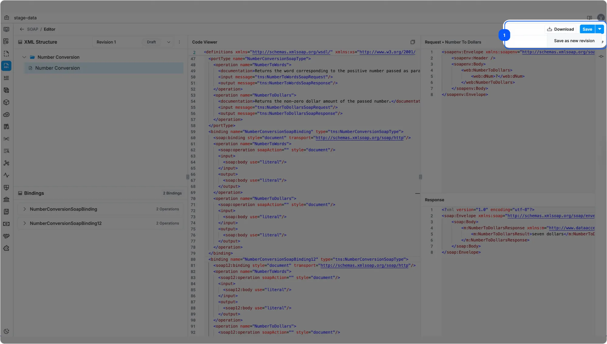

To save changes to the SOAP API, use the **Save** option in the top-right corner of the editor. You can save in the following two ways.

### Save

After making changes to the SOAP API, select **Save** to store the updates in the current revision.

### Save as new revision

To create a new revision, follow these steps:

1. Select the **Save** dropdown.
1. Select **Save as New Revision**.

The system creates a new revision and stores the updated SOAP API definition. Saving as a new revision helps maintain version history and lets you track changes made to the SOAP API over time.