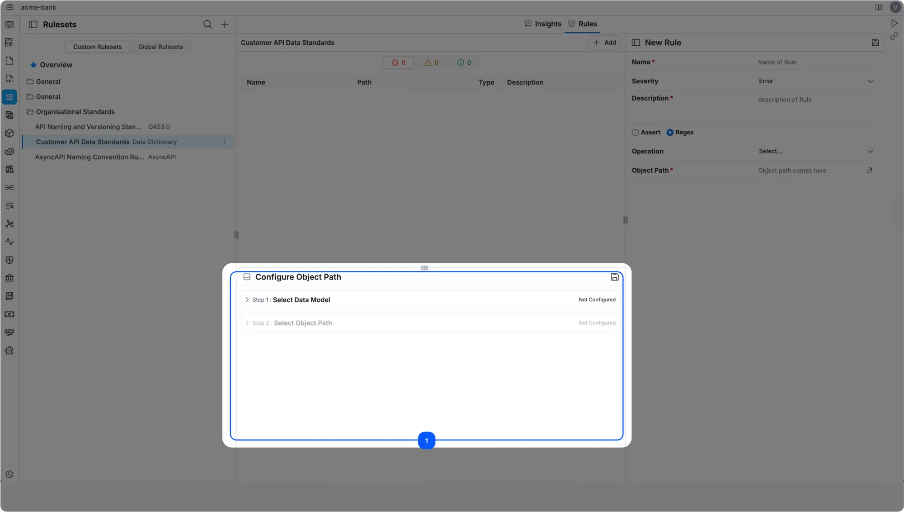
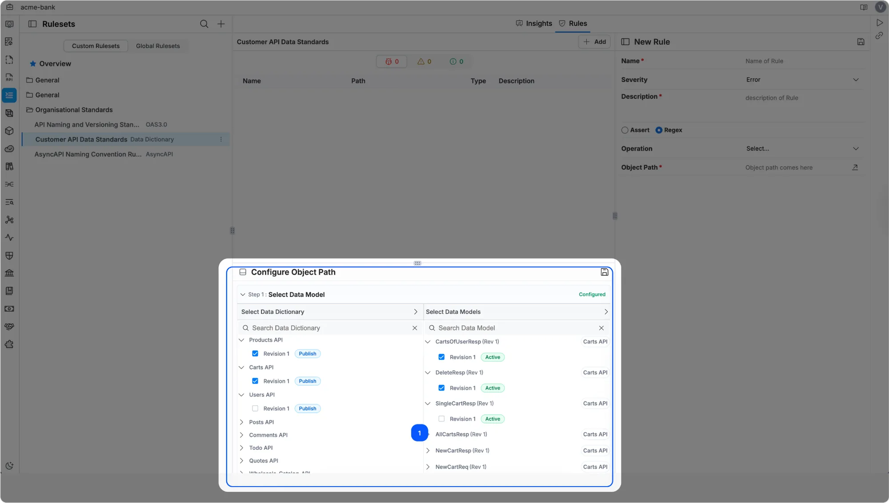
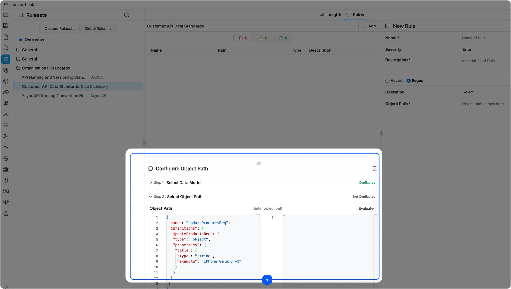
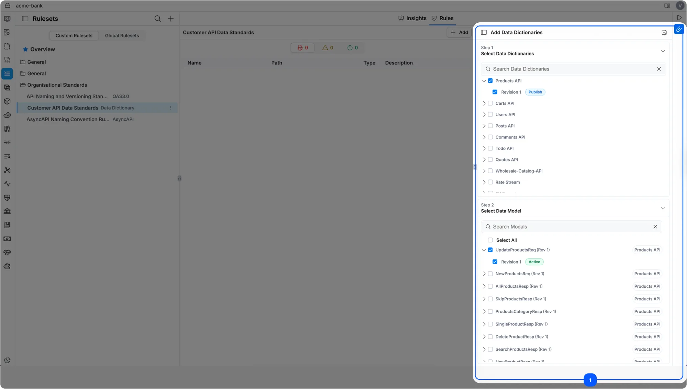
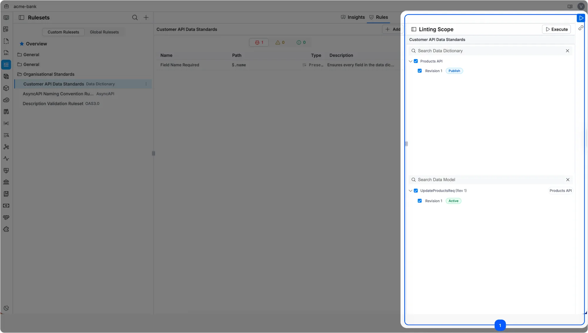

Create a Data Dictionary ruleset to define validation conditions for Data Dictionary models. The setup process follows the same pattern as creating an OAS ruleset, with a few Data Dictionary–specific steps for adding rules, configuring object paths, and linking data models.

**Prerequisites**

- You're familiar with the procedure for creating a new OAS ruleset.

To create a Data Dictionary ruleset, follow these steps:

1. Select **Create Ruleset**.
1. Follow the same steps described in [Creating a new OAS ruleset](#).
1. In **Ruleset Type**, select **Data Dictionary**.

The system creates a new Data Dictionary ruleset. You can now add rules to the ruleset.

## Add rules to a Data Dictionary ruleset

After you create a Data Dictionary ruleset, add rules to define the validation conditions for your Data Dictionary models.

**Prerequisites**

- You've created a Data Dictionary ruleset.

To add a rule, follow these steps:

1. Go to the **Rules** section.
1. Select **Add Rule**.
1. Configure the rule based on your validation requirements:

1. Follow the same steps described in [Creating a new rule for the OAS ruleset](#).

The system adds the rule to the Data Dictionary ruleset.

## Configure an object path in a Data Dictionary ruleset

When you create or edit a rule, define the object path to specify where the rule applies within the Data Dictionary schema. Use **Path Assistance** to select the data model and configure the path interactively, which helps ensure the path is accurate and correctly mapped to the data model.

**Prerequisites**

- You're creating or editing a rule in a Data Dictionary ruleset.

To configure an object path using Path Assistance, follow these steps:

1. Next to the **Object Path** field, select the **Path Assistance** \(↗\) icon. The **Configure Object Path** panel opens at the bottom of the screen.
  
1. Select the data model:
  - Select the required Data Dictionary.
  - Expand the dictionary to view available revisions.
  - Select the required revision to load its data models. After you select a revision, the step status changes to **Configured**.

  
1. Select the object path:
  - Browse the data model structure displayed in the panel.
  - Identify the field or element that the rule should apply to.
  - Enter or refine the path in the **Object Path** field.
  - Select **Evaluate** to verify that the path returns the expected result.

  
1. Select the **Save** icon in the **Configure Object Path** panel.

The system populates the selected path in the **Object Path** field of the rule configuration form.

## Link a Data Dictionary to a ruleset

For a Data Dictionary ruleset, you can associate one or more Data Dictionaries with the ruleset to define which data models the system validates during linting. When you link a Data Dictionary, the system automatically applies the ruleset and generates a linting report whenever the selected data models are created or modified.

**Prerequisites**

- You've created a rule in a Data Dictionary ruleset.

To link a Data Dictionary to a ruleset, follow these steps:

1. In the right panel, select the **Association** \(link\) icon. The **Add Data Dictionaries** window opens on the right side of the screen.
  
1. Browse the list of available Data Dictionaries in your workspace.
1. Expand a Data Dictionary to view its revisions.
1. Select the checkboxes for the Data Dictionaries or revisions you want to associate with the ruleset.
1. Under **Select Data Model**, select the required data models within the selected Data Dictionary.
1. In the top-right corner of the panel, select the **Save** icon.

A success message appears in the bottom-right corner of the screen, confirming the association. Going forward, whenever the selected Data Dictionary models are edited, the system automatically generates a linting report, based on the selected ruleset and the associated data models.

## Run linting on a linked Data Dictionary

After you link a Data Dictionary to a ruleset, run linting to evaluate the data models against the ruleset's rules.

**Prerequisites**

- You've linked a Data Dictionary to the ruleset.

To run linting, follow these steps:

1. Go to the **Rules** tab of the selected ruleset.
1. Select **Linting Scope**.
1. Choose the Data Dictionary and data model that you want to run linting on.
1. Select **Execute**.

The system evaluates the linked Data Dictionary against all rules in the ruleset.

## View insights after running linting

After linting completes, review the results in the **Insights** tab to analyze violations and validation trends.

**Prerequisites**

- You've run linting on a linked Data Dictionary.

To view insights, follow these steps:

1. Select the **Insights** tab.
1. Review the results, including:
  - Errors
  - Warnings
  - Informational messages

The **Insights** view displays the validation results for the linting run.

Follow the same steps described in [View insights after executing linting](https://#).

## Resolve Data Dictionary linting issues

If a linting run reports errors, warnings, or info messages, correct the underlying Data Dictionary and re-run linting to confirm the fix.

**Prerequisites**

- You've run linting on a Data Dictionary and the results show one or more issues.

To resolve linting issues, follow these steps:

1. Go to **Design Studio** \> **Components** \> **Data Dictionary**.
1. Open the affected Data Dictionary and correct the reported issues.
1. Go to **API Linting** \> **Rules**.
1. Select **Execute Linting** to re-run validation.
1. Open **Insights** to verify that the issues are resolved.

The **Insights** view reflects the updated results, with reduced or no violations

Follow the same steps described in [Resolving linting issues in OAS](https://#).