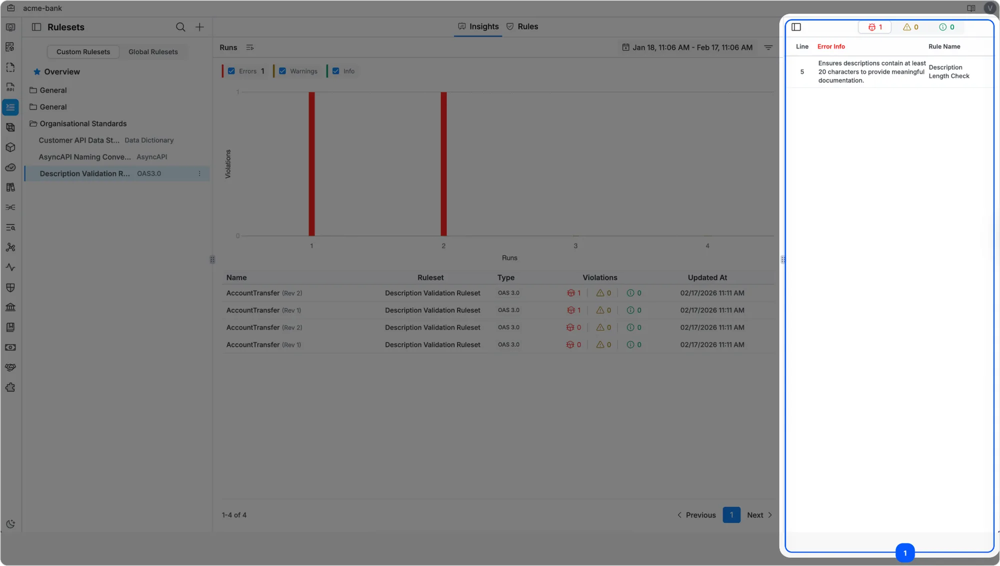
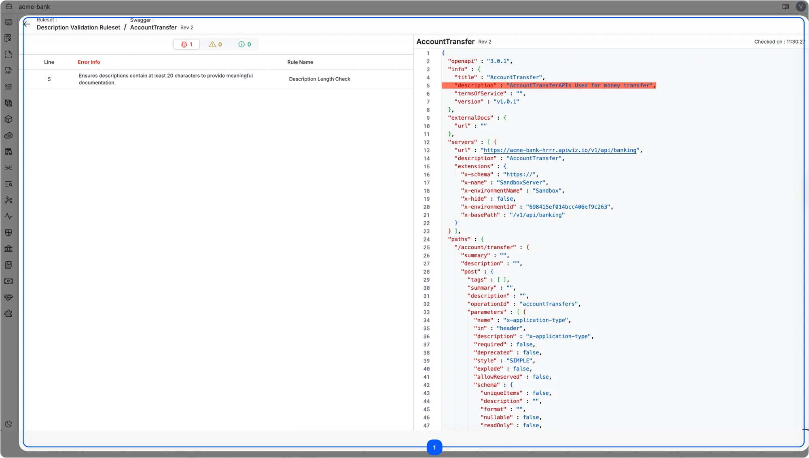
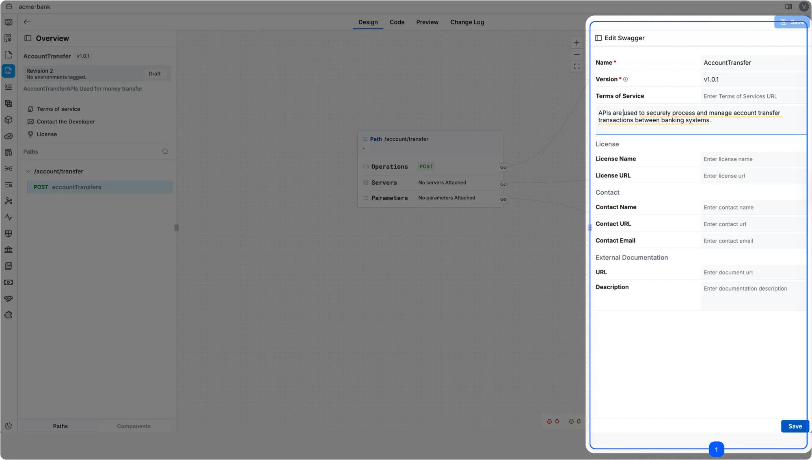

When you run API linting, the system checks your OpenAPI specification \(OAS\) against a set of validation rules. Use the Dashboard to review linting results, drill into the details of a specific issue, and resolve any errors, warnings, or info messages so your specification passes validation.

This article covers three tasks:

- Viewing linting results for a run
- Viewing a detailed report for a specific issue
- Resolving issues and re-running linting

### View linting results

Each linting run produces a list of issues, grouped by severity. Use this procedure to review them.

1. In the **Dashboard** table, select a record. A detail panel opens, showing the issues found during that run.
  
1. Select the **Errors**, **Warnings**, or **Info** tab to filter issues by category.

#### Result

Each entry in the list includes the following information:

Use this information to locate and resolve issues in your API specification.

### View a detailed linting report

For more context on a specific issue, open its detailed report. The report highlights the affected section directly in the specification.

1. In the Run Table or Issues list, point to the issue you want to review. An arrow icon \(→\) appears next to the issue.
1. Select the arrow icon. The **Linting Report** window opens.
  

The Linting Report displays the following information:

Use this view to identify and resolve the issue in context.

### Resolve issues and re-run linting

If a linting run reports errors, warnings, or info messages, correct the underlying specification and re-run validation to confirm the fix.

1. Go to **Design Studio** \> **OAS**.
1. Open the OpenAPI specification that contains the issue.
  
1. Correct the issue for each rule violation reported.
1. Approve and publish the updated specification.
1. Go to **API Linting** \> **Rules**.
1. Select **Execute Linting** to re-run validation.
1. Open the **Insights** tab to review the updated results.

The Insights view reflects the results of the new run.

If you resolved all issues, the new run shows no errors, warnings, or info messages. When you select that run, no violation report appears, this confirms that the specification passes all applied rules.