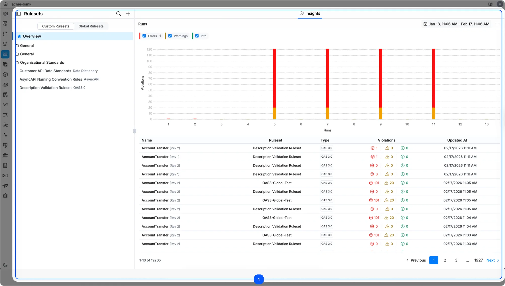

In addition to reviewing results for a single run, you can view aggregated linting results across all rulesets from the **Overview** section. Use this view to review validation results across multiple rulesets in one place, or narrow the view to a specific ruleset for detailed analytics.

### View aggregated insights

1. In the left navigation panel, select **Overview**.
  

The **Overview** section displays aggregated linting results across all rulesets, organized by category. For each category, the view combines:

- All rulesets under that category
- Linting results triggered by each ruleset

This gives you a single place to review validation results across multiple rulesets.

The **Insights** tab shows the results and analytics for linting runs associated with the selected ruleset, including:

These results are generated when the associated API specifications are validated.