APIwiz encrypts all sensitive data captured through APIwiz Traffic Hooks to ensure that it is securely stored and accessed only by authorized users. This mechanism applies at the platform level and is governed by role-based permissions.

### Key concepts

### Purpose

Encryption and decryption in APIwiz are used to:

- Protect sensitive data from unauthorized access
- Enforce role-based visibility of confidential information
- Ensure compliance with security and data protection standards

### How encryption works

#### Incoming data handling

All data captured by APIwiz Traffic Hooks is encrypted upon entering the platform, provided encryption is enabled.

#### Scope of encryption

Encryption applies only to data captured by Traffic Hooks. It does not affect your actual API traffic flow or backend operations.

Encryption is supported across the following modules within the defined encryption scope:

## Enable encryption

Encryption in APIwiz protects sensitive data captured during API traffic monitoring. When enabled, all request and response payloads captured through traffic hooks are encrypted before being stored, ensuring that sensitive information is accessible only to authorized users.

**Prerequisites**

To enable encryption in APIwiz, do the following:

1. Go to **API Compliance**.
1. In the right-side panel, select the **Encryption** icon.
  The **Encryption Values** configuration form opens.

  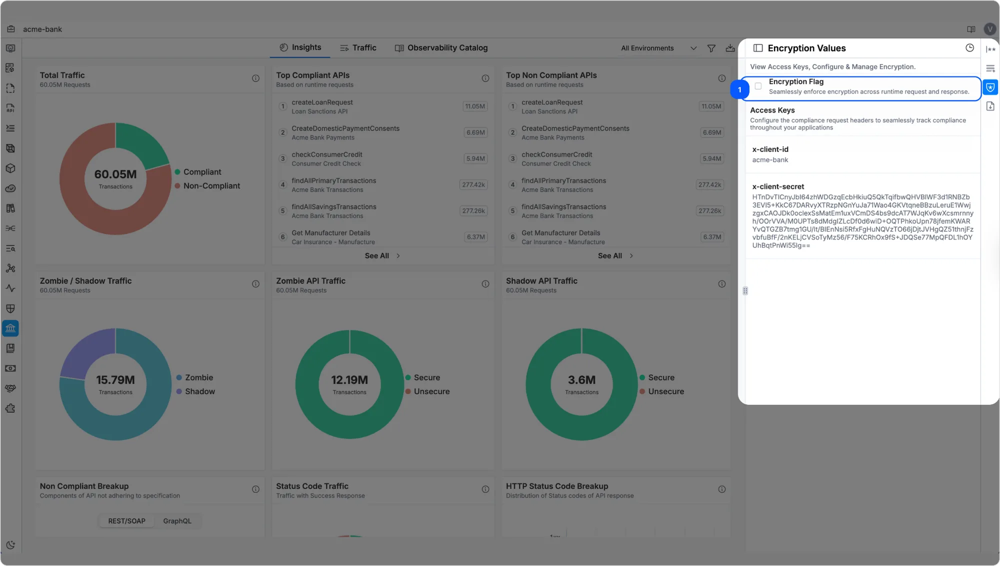
1. Under **Encryption Values**, turn on the **Encryption Flag**.
  Once enabled, all data captured using APIwiz Traffic Hooks is encrypted.
1. Enter the encryption key in the provided field.
  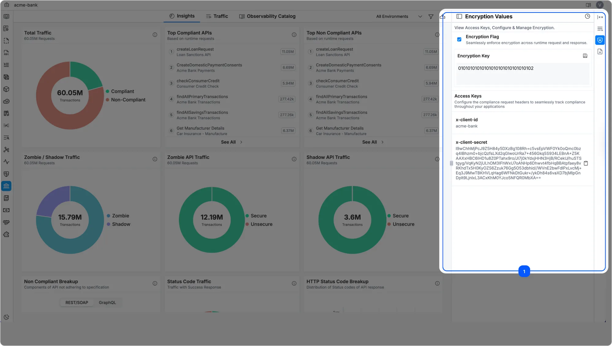
1. Select **Save**.

All data ingested after encryption is enabled is encrypted within the APIwiz platform. Data ingested before encryption was enabled remains unchanged and is not retroactively encrypted.

### Impact of changing the encryption key

When the encryption key is updated, the following applies:

### View encryption key history

Use the history feature to review all changes made to the encryption key for audit and operational transparency.

To view encryption key history, do the following:

Select the **Clock** \(History\) icon at the top-right corner of the **Encryption Values** form.

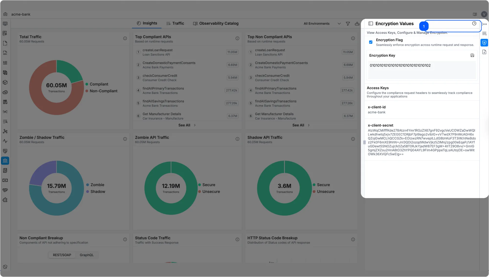

The **History** view opens and displays the following information:

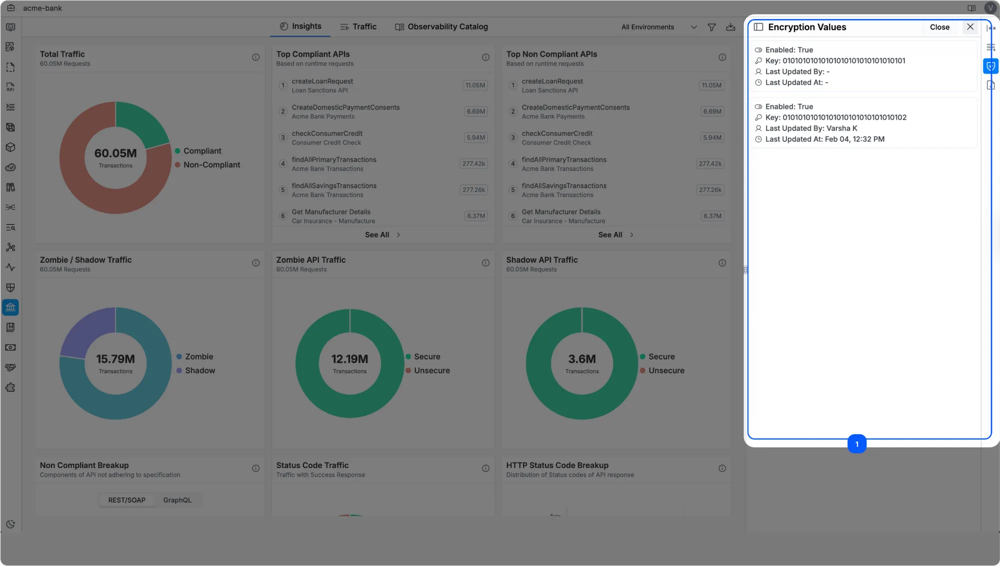

### System behavior after enabling encryption

## Disable encryption

When you disable encryption in APIwiz, captured API traffic data is no longer encrypted before being stored. Sensitive information such as request bodies, response bodies, and payload data is displayed and stored in its original form, allowing users to view transaction details directly without requiring decryption permissions.

To disable encryption, follow these steps:

1. Go to **API Compliance** and select the **Encryption** icon. The **Encryption Values** configuration form opens.
1. Turn off the **Encryption Flag**.

When the Encryption Flag is disabled, the platform no longer encrypts captured traffic data:

- Sensitive information is displayed in its original form.
- Payload data is stored and displayed as original data.
- Users can directly view request and response body details without requiring decryption [permissions](https://docs.apiwiz.io/guides?guideId=6a3b5896196683f9c8784e55&groupId=Related+information&pageId=6a3d35ddd0dd14afc277aad4#92c904fc-7cef-4866-8e80-91e194ff9213).

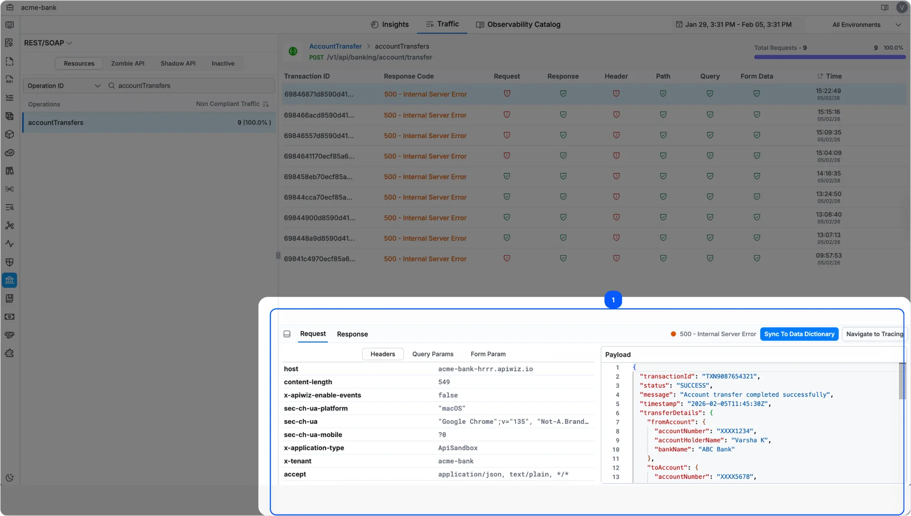

## How decryption works

### View encrypted data

When you open an event, log, or compliance record in API Compliance, API Logging, API Tracing, or API Security:

- Sensitive fields, such as request and response payloads, are displayed as encrypted values.
- The interface continues to show high-level metadata, including headers, query parameters, and HTTP status codes.
- Request and response bodies remain hidden unless decryption is permitted.

This ensures sensitive information is protected even when users have read-only or limited access.

### Configure decryption permissions

Decryption access is governed by Open Policy Agent \(OPA\) and enforced at the API level. Only users assigned to roles with the decryption permission can successfully decrypt payload data.

To configure decryption permissions, follow these steps:

1. Go to **Settings** \> **Roles**.
1. Select the role you want to grant the permission to.
1. Under **API Compliance permissions**, search for **Decrypt Compliance Report** and enable it.
  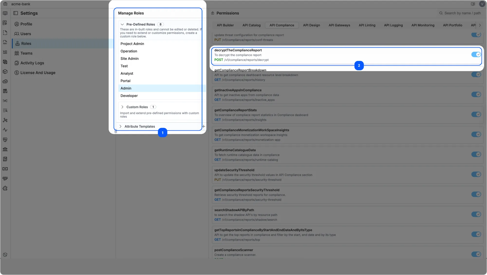
1. Select **Save**.

Users assigned to the updated role can now decrypt payload data.

### Unauthorized access behavior

If a user doesn't have decryption permission:

- The decryption request is rejected.
- The **Decrypt** button remains visible, but no action occurs and an unauthorized error is returned.
- Sensitive payload information remains encrypted.
- Only high-level metadata remains visible.

This behavior maintains transparency of available actions while preventing unauthorized access to sensitive data.

### Authorized access behavior

If a user has decryption permission:

- The encrypted payload is decrypted.
- Full request and response body details are displayed in their original format.

## Decrypt data in API Compliance

To decrypt data in API Compliance, follow these steps:

1. Go to **API Compliance**.
1. Select the required **Operation ID** where the traffic is generated.
1. Select the specific traffic record to view detailed transaction information. The platform displays the following captured compliance traffic details:
  - Request headers
  - Query parameters
  - Form parameters
  - Encrypted payload data
  - Response status and related metadata
1. Select **Decrypt**. The system performs [permission](https://docs.apiwiz.io/guides?guideId=6a3b5896196683f9c8784e55&groupId=Related+information&pageId=6a3d35ddd0dd14afc277aad4#92c904fc-7cef-4866-8e80-91e194ff9213) validation using Open Policy Agent \(OPA\).
  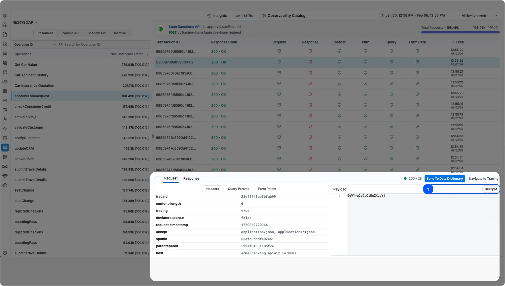

The encrypted payload is decrypted, and the full request and response body details are displayed in their original format.

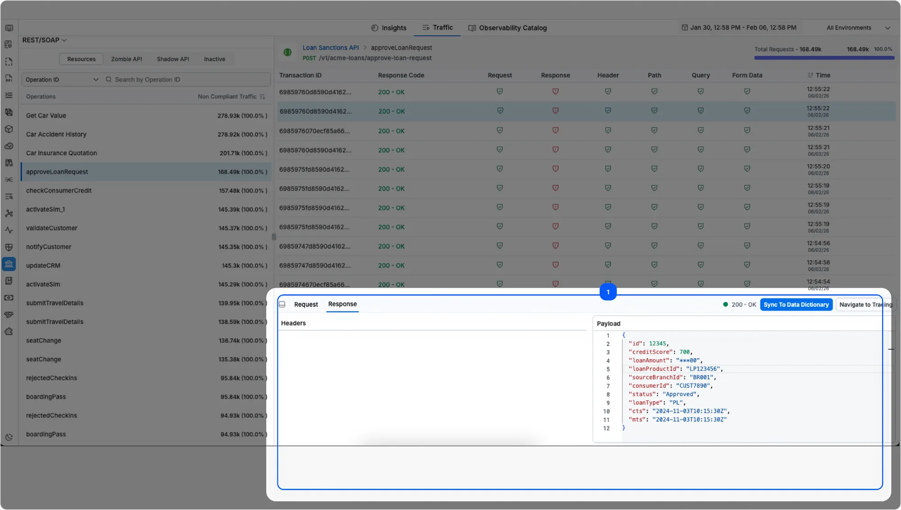

## Decrypt data in API Transaction Logs

To decrypt data in API Logging, follow these steps:

1. Go to **API Transaction Logs**.
1. Select the required log index where the traffic is generated.
1. Open the selected log event to view captured traffic details. The platform displays high-level metadata only, such as method, resource, and status.
1. Select **Decrypt**. The system performs [permission](https://docs.apiwiz.io/guides?guideId=6a3b5896196683f9c8784e55&groupId=Related+information&pageId=6a3d35ddd0dd14afc277aad4#92c904fc-7cef-4866-8e80-91e194ff9213) validation using Open Policy Agent \(OPA\).
  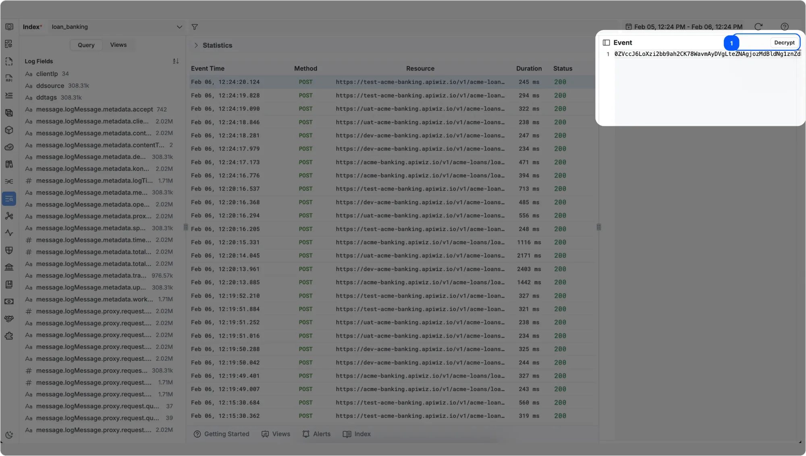

The encrypted payload is decrypted, and the full request and response body details are displayed in their original format.

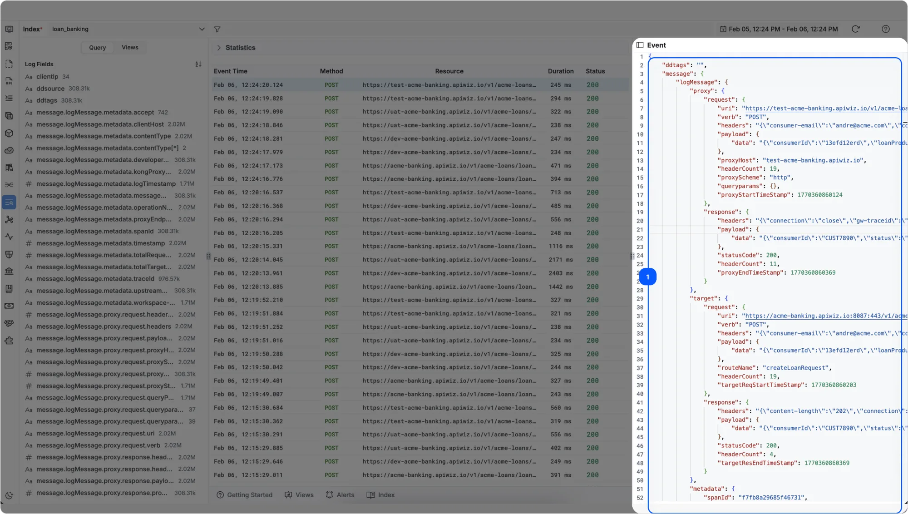

## Decrypt data in API Tracing

To decrypt data in API Tracing, follow these steps:

1. Go to **API Tracing**.
1. Select the required trace from the **Trace List**.
1. Open the selected trace to view the request flow and transaction details. The platform displays the following captured trace details:
  - Request details \(method, resource path, host name, and API specification details\)
  - Headers
  - Query parameters
  - Form parameters
  - Encrypted payload data
1. Select **Decrypt**. The system performs [permission](https://docs.apiwiz.io/guides?guideId=6a3b5896196683f9c8784e55&groupId=Related+information&pageId=6a3d35ddd0dd14afc277aad4#92c904fc-7cef-4866-8e80-91e194ff9213) validation using Open Policy Agent \(OPA\).
  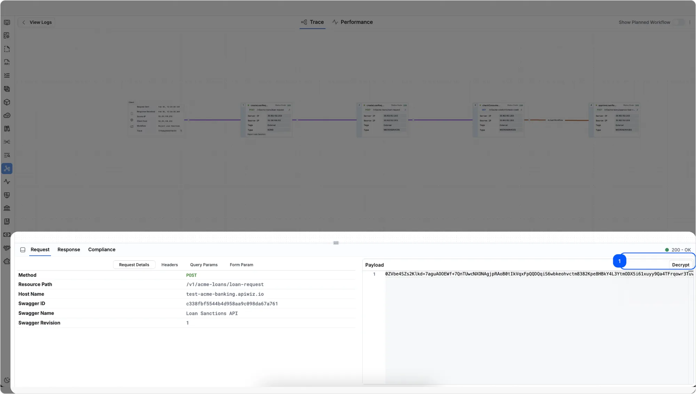

The encrypted payload is decrypted and the full request and response body details are displayed in their original format.

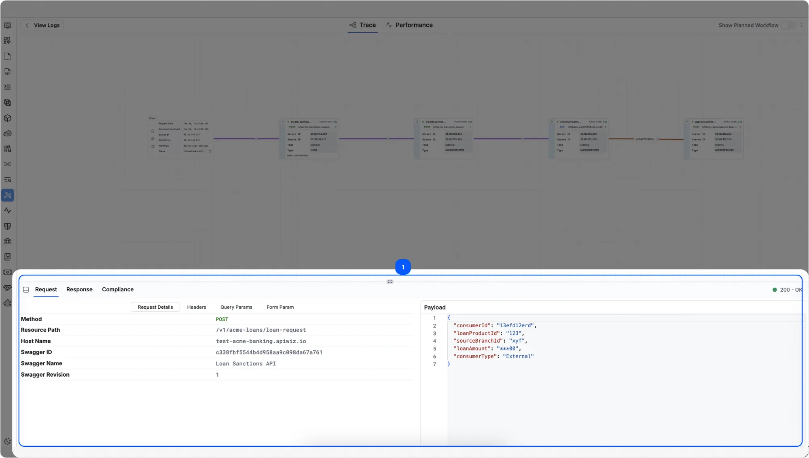

## Decrypt data in API Security

To decrypt data in API Security, follow these steps:

1. Go to **API Security**.
1. Select the required security log or execution flow where the traffic is generated.
1. Open the selected log record and switch to the **Inspect** view. The platform displays the following captured security traffic details:
  - Request details \(method, resource path, host name, and API specification details\)
  - Headers
  - Query parameters
  - Form parameters
  - Encrypted payload data
1. Select **Decrypt**. The system performs [permission](https://docs.apiwiz.io/guides?guideId=6a3b5896196683f9c8784e55&groupId=Related+information&pageId=6a3d35ddd0dd14afc277aad4#92c904fc-7cef-4866-8e80-91e194ff9213) validation using Open Policy Agent \(OPA\).
  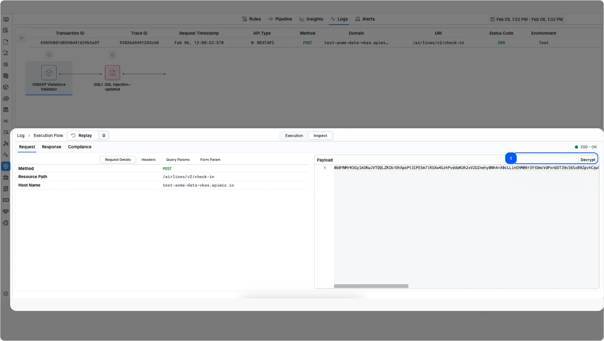

The encrypted payload is decrypted and the full request and response body details are displayed in their original format.

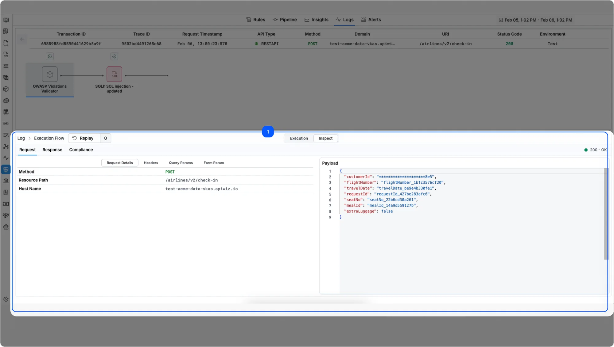

## Key notes

- Decryption doesn't modify stored encrypted data.
- The decrypted view is generated only for authorized users when the **Decrypt** option is triggered.
- Metadata such as headers and status codes remains visible to all permitted users, regardless of decryption access.

### Separation of permissions

Encryption configuration and data decryption are controlled independently. Each action requires explicit permission configured in the **Settings** page. This separation ensures tighter security and prevents unintended exposure of sensitive data.

## Summary

Encryption in APIwiz ensures that all data captured using traffic hooks is securely stored, while decryption provides controlled access based on user roles. By combining encryption flags, strict key management, audit history, and OPA-based permissions, the APIwiz platform delivers secure, auditable, and role-aware data protection.