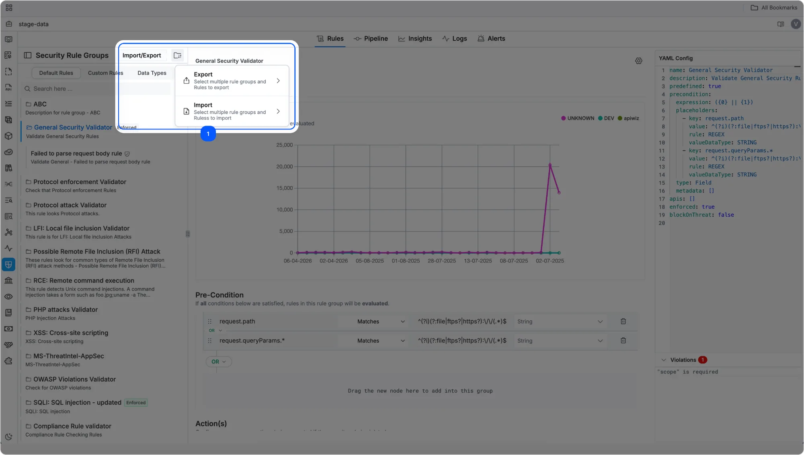
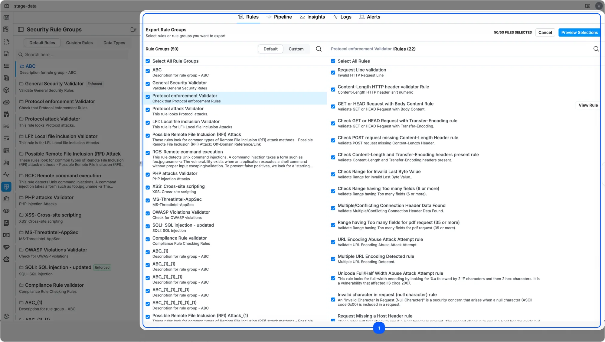
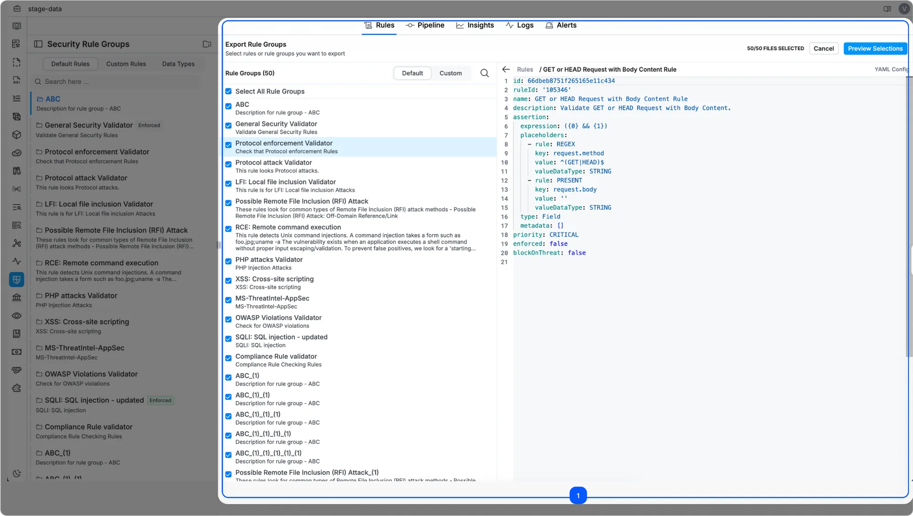
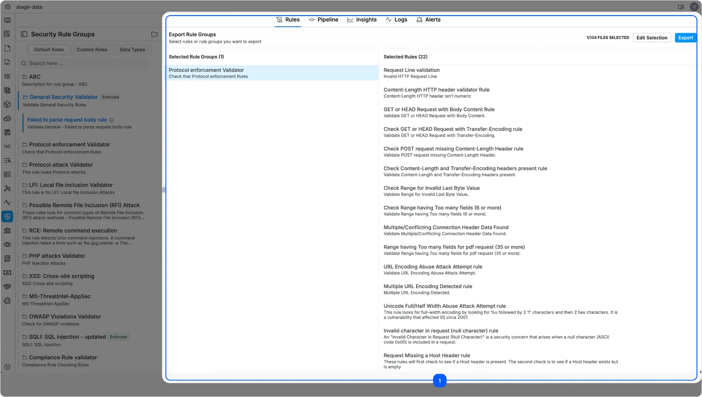
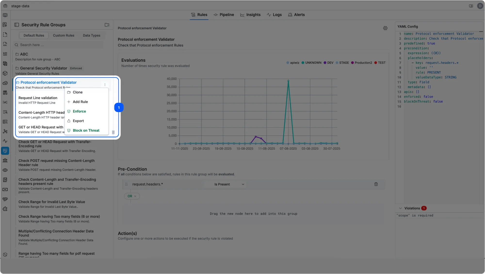
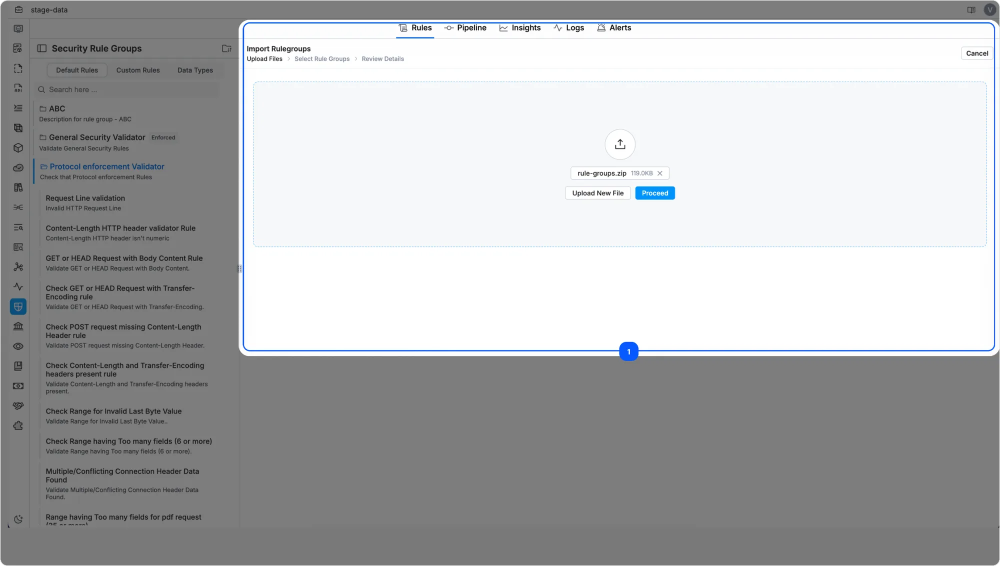
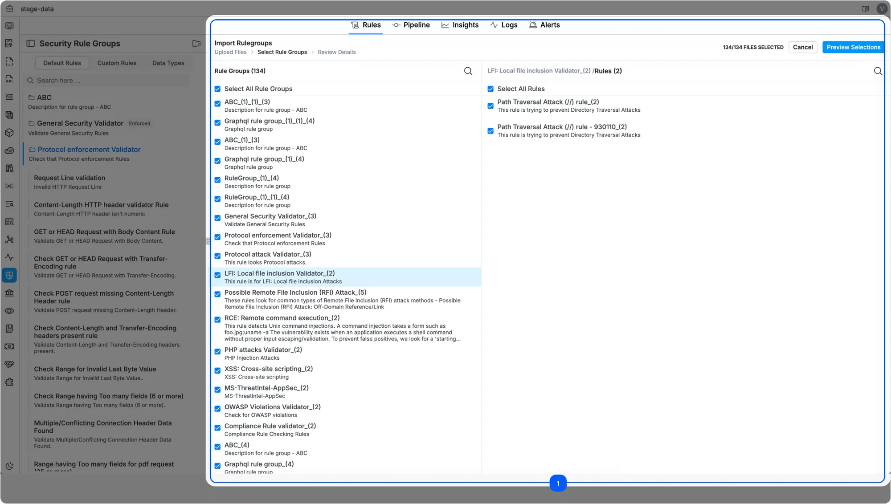

Use the **Import/Export** feature to move or share security rule groups between workspaces. This feature helps you reuse configurations and maintain consistent security settings across environments and deployments.

### Access the Import/Export dialog

To open the **Import/Export** dialog, do the following:

In the **Security Rule Groups** section in the left navigation pane, select **Import/Export**.

The dialog provides the following options:

## Exporting security rule groups

Use the **Export** option to save security rule groups and associated rules from the current workspace. Use this feature to reuse, back up, or transfer security configurations across environments.

### Export rule groups

To export security rule groups, do the following:

1. Open the **Import/Export** dialog.
1. Select **Export**.
  
1. Select the rule groups and rules to export using one of the following options:

1. To review a rule before exporting, hover over the rule and select **View Rule**. The **YAML Config** section displays the rule details in a read-only format.
  
1. After selecting the required rule groups and rules, select **Preview Selections** to review the selected configurations.
1. To modify your selections, select **Edit Selection**.
1. Select **Export**.
  
1. The platform downloads the selected rule groups and rules. The file format depends on the number of rule groups exported.

The exported **.yml** file uses YAML format, which provides a human-readable structure for configuration data.

### Export a specific rule group

To export a single rule group directly from the navigation pane, do the following:

1. In the left navigation pane, locate the required rule group.
1. Hover over the rule group.
1. Select the **More Options** \(⋮\) menu.
  
1. Select **Export**.

The platform downloads the selected rule group as a **.yml** file.

## Importing security rule groups

Use the **Import** option to add security rule groups and associated rules into the current workspace. Use this feature to reuse existing configurations, restore backed-up settings, and maintain consistent security policies across environments.

### Import rule groups

To import security rule groups, do the following:

1. Open the **Import/Export** dialog.
1. Select **Import**.
1. Select **Upload File** and upload the **.yml** or **.zip** file that contains the security rule groups and rules.
  
1. Select **Proceed**.
  
1. Select the rule groups and rules to import using one of the following options:

1. Select **Preview Selections** to review the configurations before import.

#### Handling duplicate entries

If duplicate rule groups or rules are detected, the platform highlights them during the preview.

1. To modify your selections, select **Edit Selection**.
1. Select **Import**.

The selected rule groups and rules are added to the current workspace.