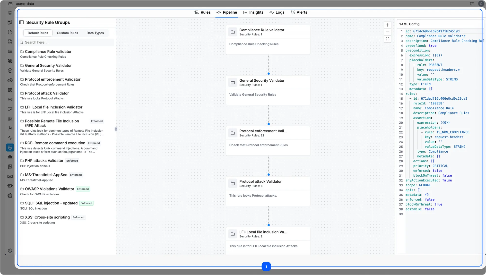

The **Pipeline** tab displays how security rule groups are arranged and executed in sequence for incoming API requests. Use this tab to understand rule execution order, inspect configurations, and review the overall security workflow.

**Prerequisites**

### Pipeline layout

The **Pipeline** tab contains three main sections.

#### Security Rule Groups pane

The left pane lists all available rule groups. Use this pane to:

- Search for a specific rule group.
- Browse group categories such as **Default Rules**, **Custom Rules**, and **Data Types**.

**Examples of available rule groups:**

- Compliance Rule Validator
- General Security Validator
- Protocol Enforcement Validator
- Protocol Attack Validator
- LFI Validator
- SQL Injection Validator
- XSS Validator

#### Pipeline canvas

The center canvas displays the execution flow of rule groups. Each rule group is represented as a card in the pipeline.

**Rule group card**

Each card includes the following information:

**Flow connections**

Lines between cards show the order in which requests are evaluated. Requests move from the top of the pipeline to the bottom through each connected rule group.

**Zoom controls**

Use the toolbar on the right side of the canvas to adjust the view.

#### YAML Config pane

Select a rule group card to view its configuration in the right pane. The pane displays the YAML definition for the selected rule group.

Configuration details include:

- ID
- Name
- Description
- Preconditions
- Rules
- Priority
- Scope
- Metadata
- Enforcement status
- Block on threat

Use this pane to review how the selected rule group is configured without modifying it.

### How rule evaluation works

When a request enters the system, the platform processes it through the pipeline in the following sequence:

1. The request enters the first rule group in the pipeline.
1. Preconditions are checked.
1. Rules within the group are evaluated.
1. Configured actions are applied if a rule is triggered.
1. The request continues to the next connected rule group.

This layered approach enforces multiple security checks in sequence across all configured rule groups.

### Benefits