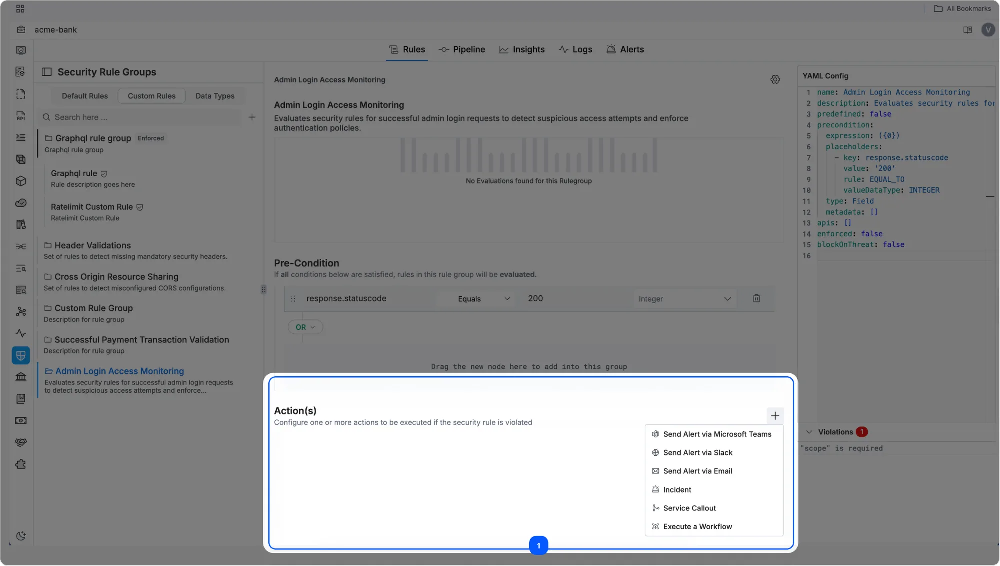
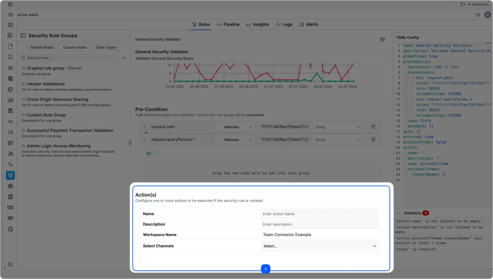
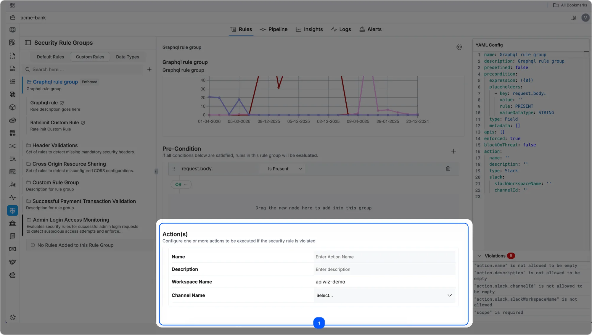
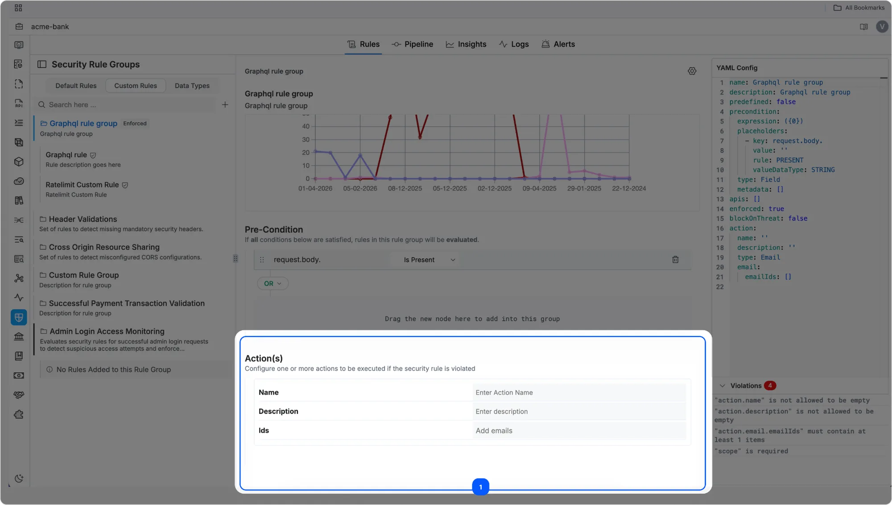
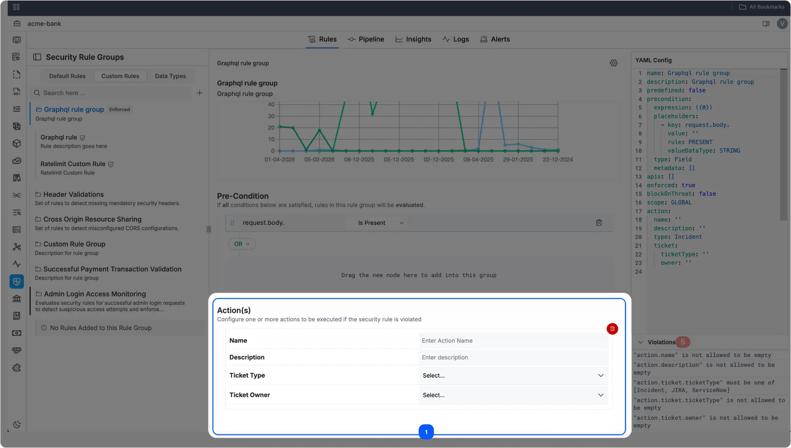
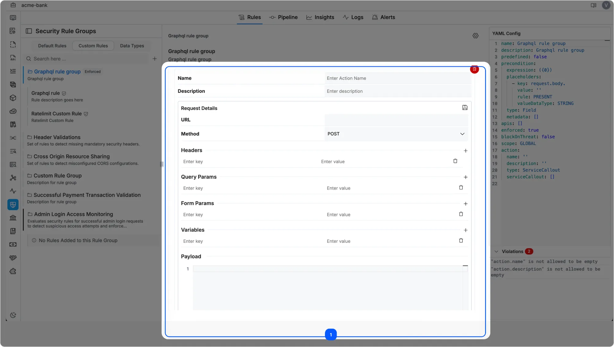
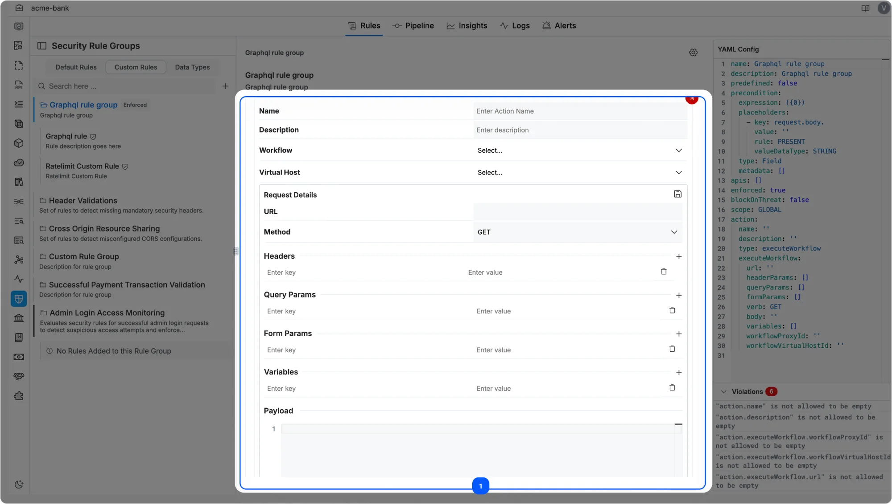

When a rule is violated, the system uses the configured actions to determine how to respond and how urgently to handle the event. Actions help security teams detect, communicate, investigate, and remediate threats quickly.

You can configure one or more actions for a single rule.

### Available actions

## Configure rule actions

To open the actions configuration, do the following:

1. Open the required rule group or rule.
1. Go to the **Action\(s\)** section.
1. Select the **\+** icon.
  
1. Select the required action type from the list.

### Send alert via Microsoft Teams

Use this action to send a real-time notification to a designated Microsoft Teams channel when a rule is violated. This helps security, DevOps, and compliance teams respond quickly through real-time collaboration.

**Prerequisites**

A Microsoft Teams connector must be configured in the platform before selecting this action.

To configure a Microsoft Teams alert, do the following:

1. In the **Action\(s\)** section, select **\+**.
1. Select **Send Alert via Microsoft Teams**.
1. A configuration panel opens.
  
1. Enter the following details:

1. Select **Save**.

When the rule is violated, the platform automatically sends an alert to the selected Microsoft Teams channels.

### Send alert via Slack

Use this action to send an alert message to a specified Slack channel when a rule is violated. This allows teams to discuss, investigate, and resolve incidents quickly within their existing workflows.

**Prerequisites**

A Slack workspace must be configured in the platform before selecting this action.

To configure a Slack alert, do the following:

1. In the **Action\(s\)** section, select **\+**.
1. Select **Send Alert via Slack**.
1. A configuration panel opens.
  
1. Enter the following details:

1. Select **Save**.

When the rule is violated, the platform automatically sends an alert to the selected Slack channel.

### Send alert via email

Use this action to send an email notification to configured recipients when a rule is violated. This is useful for alerting individuals or teams who do not use chat platforms and for maintaining an audit trail of security alerts.

To configure an email alert, do the following:

1. In the **Action\(s\)** section, select **\+**.
1. Select **Send Alert via Email**.
1. A configuration panel opens.
  
1. Enter the following details:

1. Select **Save**.

When the rule is violated, the platform automatically sends an email alert to the configured recipients.

### Incident

Use this action to create or log a formal incident when a rule is violated. This helps teams track, escalate, investigate, and resolve security events according to your organization's incident response procedures.

To configure an incident action, do the following:

1. In the **Action\(s\)** section, select **\+**.
1. Select **Incident**.
1. A configuration panel opens.
  
1. Enter the following details:

1. Select **Save**.

When the rule is violated, the platform automatically creates or logs an incident based on the selected configuration.

### Service callout

Use this action to send an outbound request to an external service or API when a rule is violated. This can trigger automated remediation steps, invoke custom scripts, or integrate with third-party security and monitoring tools.

To configure a service callout, do the following:

1. In the **Action\(s\)** section, select **\+**.
1. Select **Service Callout**.
1. A configuration panel opens.
  
1. Enter the following details:

1. Select **Save**.

When the rule is violated, the platform automatically sends the configured API request to the external service.

**Common use cases:**

- Create a security event in Splunk or Cisco
- Trigger a custom blocking script
- Send violation data to a centralized API
- Notify an internal monitoring or SOAR platform
- Integrate with enterprise logging systems

### Execute a workflow

Use this action to trigger a predefined workflow when a rule is violated. Workflows can contain multiple automated steps such as notifications, escalations, approvals, integrations, or remediation tasks.

**Prerequisites**

A workflow must be predefined in the platform before selecting this action.

To configure a workflow action, do the following:

1. In the **Action\(s\)** section, select **\+**.
1. Select **Execute a Workflow**.
  A configuration panel opens.

  
1. Enter the following details:

1. Select **Save**.

When the rule is violated, the platform automatically runs the selected workflow.

**Common use cases:**

- Send notifications to multiple teams
- Create incident tickets automatically
- Escalate critical alerts
- Run remediation scripts
- Trigger approval flows
- Integrate with external systems