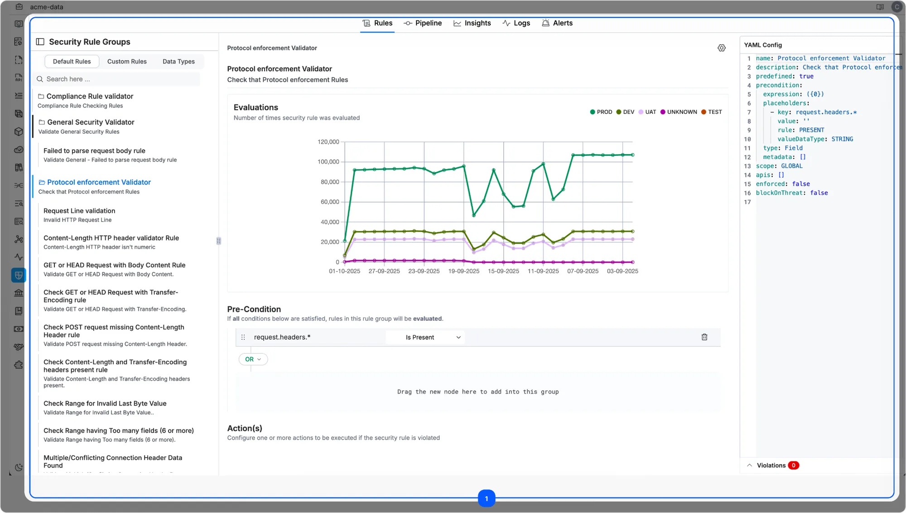
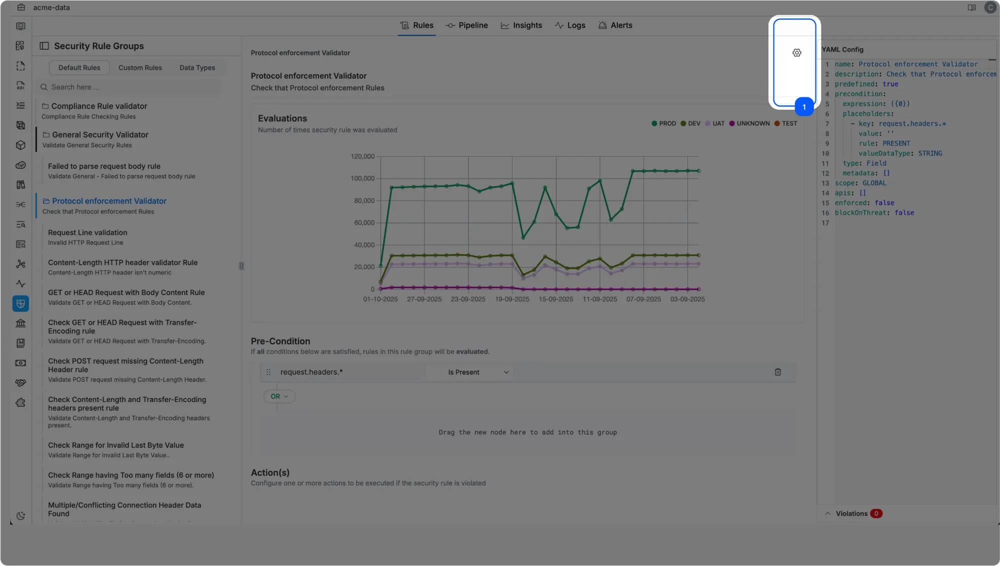
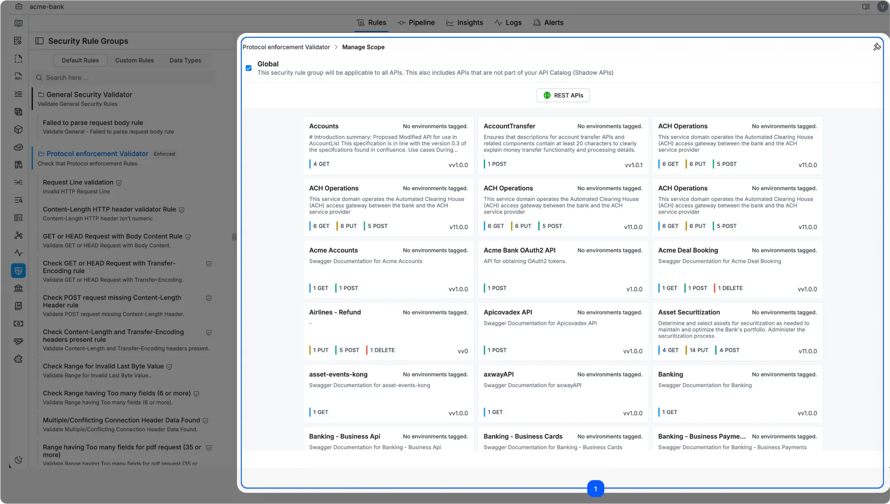
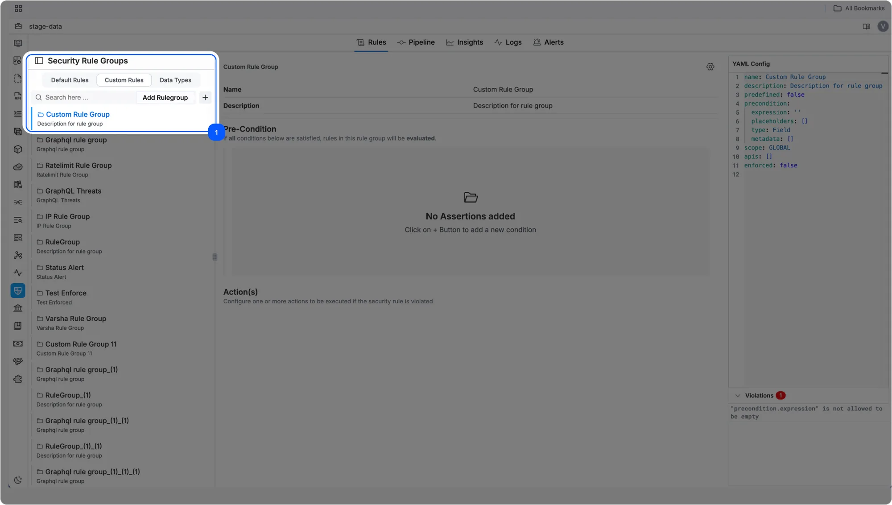
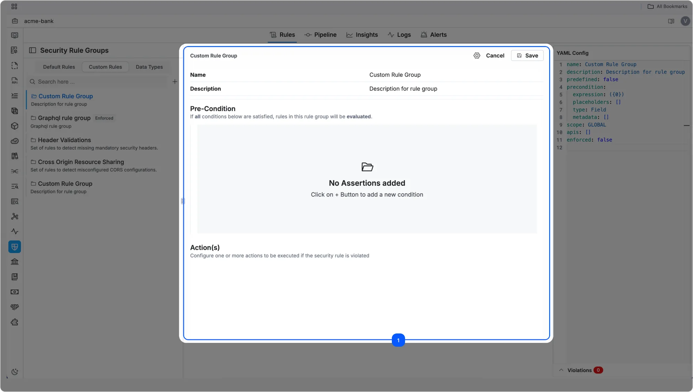
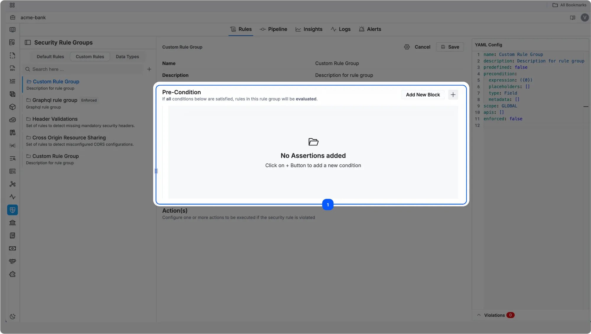
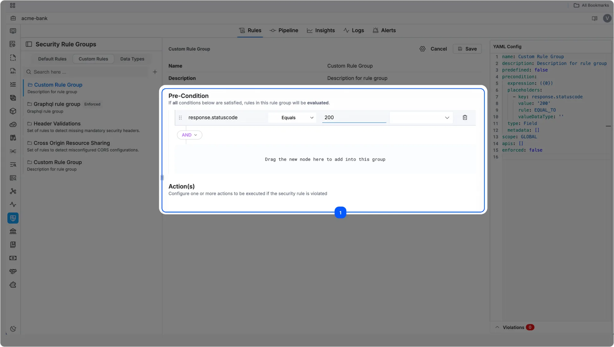

Security rule groups are containers that organize related security rules used in the security pipeline. Each rule group can contain one or more rules that inspect API traffic for threats, policy violations, or suspicious behavior.

For example, a rule group can include standard protections such as OWASP validations, SQL injection detection, or other custom security checks.

### How security rule groups work

Each rule group includes a **precondition** that determines whether incoming traffic meets the required criteria before the rules in that group are evaluated.

- If the precondition is met, the platform evaluates all rules in that group.
- If the precondition is not met, the platform skips that rule group.

Examples of preconditions include:

- Request headers are present
- Request payload exists
- Response status code is valid
- Query parameters are available

This logic optimizes processing and ensures rules run only when relevant.

### Types of security rule groups

The platform provides two types of security rule groups:

You can also clone an existing rule group. The duplicated copy is added to the **Custom Rules** section, where you can modify it independently.

### Prerequisites

Before security logs can be generated, observability must be enabled by attaching an API traffic hook. This allows the platform to capture raw request and response traffic for analysis. Without observability enabled, the security engine can't evaluate traffic or generate logs.

## Default rules

The **Default Rules** tab displays preconfigured, industry-standard security rule groups provided by the platform. Use these rules to enable immediate protection and detect common API security threats.

The platform includes rule groups such as:

- OWASP validations
- SQL injection detection
- Cross-site scripting \(XSS\) protection
- IP filtering rules
- Protocol attack validation

### View enforced default rule groups

When you enforce a rule group, all incoming traffic is evaluated against the rules configured in that group. Review default rule groups to understand how traffic is evaluated and which protections are enabled.

To view a default rule group, follow these steps:

1. Go to **Security Rule Groups**.
1. Select the **Default Rules** tab.
1. Browse the list of available predefined rule groups.
1. In the left panel, select the rule group you want to view.
  

The rule group details appear in the main workspace, including:

- Rule group name and description
- List of predefined child rules under the group
- Evaluation metrics showing how many times the rule was triggered
- Preconditions used before rule evaluation
- Actions configured when violations occur
- YAML configuration of the selected rule group
- Violation count for syntax or configuration issues

### Set the scope

Use the scope settings to define where the selected security rule group applies across your APIs.

To set the scope, follow these steps:

1. In the selected rule group workspace, select the **Settings** \(gear\) icon.
  
1. The **Manage Scope** window opens.
  
1. Select the **Global** checkbox to apply the security rule group to all APIs, including APIs not listed in the API catalog \(Shadow APIs\).
1. Review the available APIs displayed in the scope window.
1. Select the **Edit Condition** \(hammer\) icon in the top-right corner.

The system returns you to the main workspace. The selected rule group is now configured with global scope and evaluates traffic across all APIs.

## Custom rules

Use the **Custom Rules** tab to create and manage rule groups and security rules based on your organization's security policies. Create custom rules when you need protections beyond the default rule sets provided by the platform.

### Create a custom rule group

Create a custom rule group to define security validations specific to your organization's requirements.

To create a custom rule group, follow these steps:

1. Select the **Custom Rules** tab.
1. Next to the search bar, select the **Add** \(\+\) icon.
  
1. A new configuration window opens in the main panel.
  
1. Complete the following fields:

### Set preconditions for rule evaluation

Before the system evaluates any security rule, it checks the precondition configured for the parent rule group. A precondition defines the logic that determines whether incoming API traffic should be evaluated by the rules in that group.

- If the precondition returns **true**, the system evaluates the rule group.
- If the precondition returns **false**, the system skips the rule group.

#### Why preconditions matter

API requests can sometimes be incomplete, interrupted, or malformed during transmission. Running security validations on invalid traffic can lead to unnecessary processing and false positives. Preconditions help ensure that rules run only when traffic meets the required criteria.

#### Precondition contexts

Use preconditions to evaluate traffic based on the following request and response contexts:

#### Benefits of preconditions

Preconditions help you:

- Apply rules only when relevant.
- Reduce false positives.
- Improve rule evaluation performance.
- Lower unnecessary system overhead.
- Simplify rule management.

## Add a precondition

Add a precondition to define when the rule group should be evaluated. The system runs the rules inside the group only when the configured precondition is met.

To add a precondition, follow these steps:

1. In the custom rule group window, select **\+ Add New Block**.
  
1. The **Precondition** section opens.
  
1. Add one or more conditions to define the evaluation logic.
1. For each condition, complete the following fields:

1. To combine multiple conditions, use the following logical operators:
  - **AND**: All conditions must be true.
  - **OR**: Any condition can be true.
1. To create advanced logical expressions, drag additional condition nodes into the group to build nested conditions.
1. Select **Save**.

The precondition is configured and applied to the rule group. The system evaluates the rules in the group only when the precondition is met.