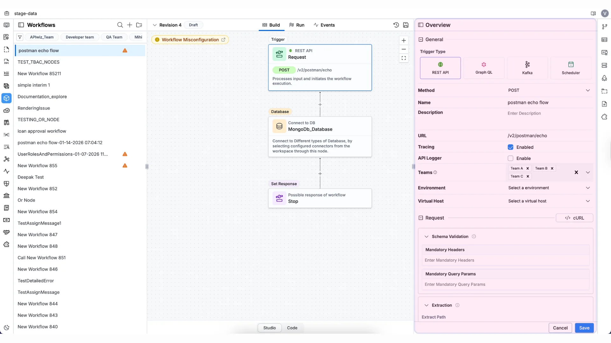
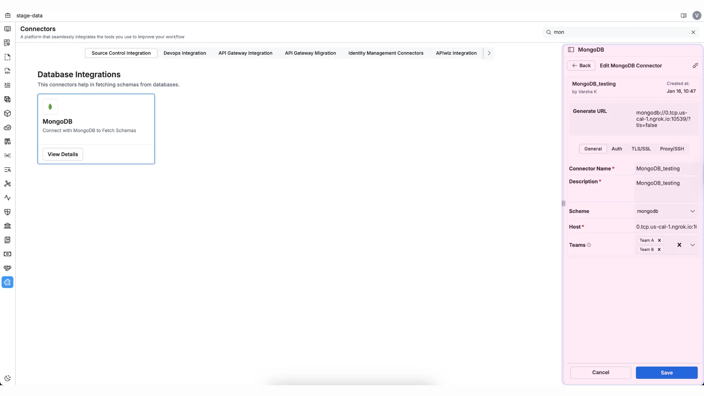
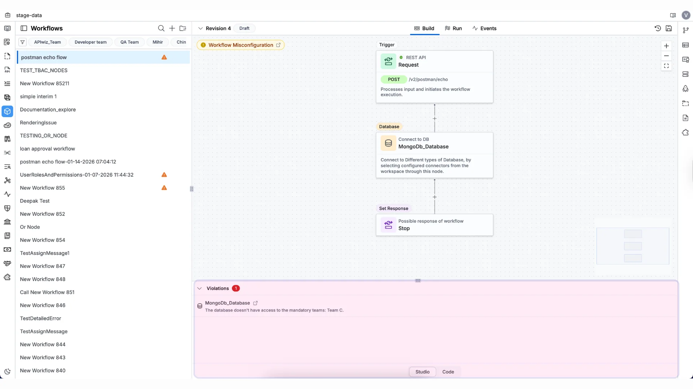
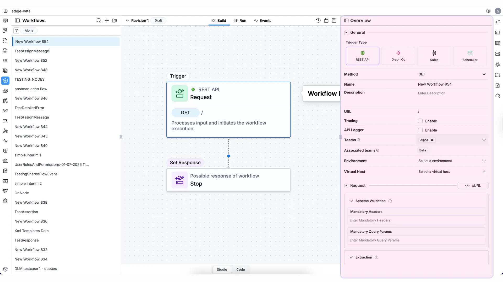

Team-Based Access Control \(TBAC\) is a security and governance feature in APIwiz that manages user access based on team membership. TBAC ensures that only authorized users can view, configure, and manage specific resources, enforcing ownership, accountability, and controlled collaboration across the platform.

TBAC is useful in organizations where multiple teams work on different APIs, workflows, and environments within the same APIwiz instance.

### Why TBAC matters

TBAC helps organizations:

- Enforce role-based ownership across APIs and workflows.
- Prevent unauthorized access or accidental changes.
- Maintain clear boundaries between teams.
- Support scalable collaboration without compromising security.

### How TBAC works in APIwiz

TBAC operates through the following stages:

1. **Create teams.** Admins or authorized users create teams from the **Settings** page. Each team typically represents a business unit, project group, or functional team, such as a Payments team, a Core Banking team, or a Partner Integrations team. For more information, see \[Creating teams and assigning users in Settings\].
1. **Assign users to teams.** Users are added to one or more teams based on their roles, responsibilities, and ownership. A user can belong to multiple teams if they work across multiple projects. This stage defines who can access what in the platform.
1. **Tag resources with teams.** When you create or configure resources such as workflows in the Workflow modules \(**API Builder**, **API Sandbox**, **API Testing**, **API Monitoring**\), environments, certificates, connectors, **API Logger**, or shared flows, you can tag them with one or more teams. Only users who are members of the tagged teams can view the resource, edit or configure it, and perform actions such as delete, deploy, or publish. Users outside the tagged teams can't see the resource.
1. **Enforce access control across the platform.** After a resource is team-tagged, APIwiz validates all actions on that resource against team membership. Users outside the team can't see or access the resource. Team ownership is enforced consistently across the **Design**, **Build**, **Test**, and **Deploy** stages of the resource's lifecycle.

### Key capabilities and benefits

- **Team-level visibility control**: users see only the resources owned by their teams.
- **Team-based configuration**: settings and integrations can vary per team.
- **Inheritance of team tags**: child resources inherit team tags from parent resources, such as workflows inheriting team tags from collections.
- **Cross-team governance**: supports multiple teams working in parallel without conflict.
- **Controlled access to resources**: ensures that only authorized team members can access sensitive APIs, workflows, and configurations.
- **Prevention of unauthorized changes**: eliminates the risk of accidental or unauthorized edits to critical resources.
- **Clear ownership and accountability**: every resource belongs to a team, making responsibility and support paths clear.
- **Improved security posture**: reduces exposure by limiting access to relevant teams.
- **Scalable collaboration**: enables multiple teams to work in the same platform without interfering with each other.

### Example: Team-based ownership of an API

An organization has three teams: Team A \(Payments\), Team B \(Customer Management\), and Team C \(Partner Integrations\). The Payments API is tagged to Team A.

As a result, only users from Team A can view, edit, deploy, or delete the Payments API. Users from Team B and Team C can't access it, ensuring strict ownership and isolation.

### When to use TBAC

Use TBAC when:

- Multiple teams share the same APIwiz instance.
- You want to enforce ownership boundaries.
- You need to restrict access to sensitive APIs or workflows.
- You want better governance and auditability.
- Multiple teams need to collaborate on a single workflow.

## Team-based access control \(TBAC\) in API Workflow modules

TBAC in the Workflow modules \(**API Builder**, **API Sandbox**, **API Testing**, and **API Monitoring**\) controls user access based on team membership. TBAC ensures that only authorized team members can view, configure, and manage workflows and related resources across the API lifecycle, enabling secure collaboration and clear ownership within and across teams.

### Workflow visibility based on teams

You can associate a workflow with one or more teams to control its visibility. When you create or edit a workflow, assigning teams to it restricts visibility to only the users who belong to the selected teams.

Workflow visibility works as follows:

- **Team-tagged workflows**: if a workflow is tagged to Team A and Team B, only users who are members of Team A or Team B can view and access the workflow.
- **Restricted visibility for other users**: users who don't belong to the tagged teams don't see the workflow in their workflow list.
- **Untagged workflows**: if no teams are assigned to a workflow, the workflow is visible to all users by default.
- **Admin access**: admin users can view and access all workflows, regardless of team tagging.

This model ensures that workflows are accessible only to the appropriate teams, improving security, ownership clarity, and controlled collaboration across the platform.

### Team-based collection visibility

In **API Sandbox** and **API Testing**, workflows are organized under collections. You can assign teams at the collection level to enforce access control for all workflows within the collection. Workflows inside a collection inherit the team tags applied to their parent collection.

- **Team-tagged collections** — if a collection is tagged to Team A and Team B, only users who are members of Team A or Team B can view and access the collection and the workflows within it.
- **Restricted visibility for other users** — users who don't belong to any of the tagged teams don't see the collection in their collection list and can't access the workflows inside it.
- **Untagged collections** — if no teams are assigned to a collection, the collection and its workflows are visible to all users by default.
- **Admin access** — admin users can view and access all collections and workflows, regardless of team tagging.

### Team dependency in nodes, connectors, and components

Team-based restrictions apply not only at the workflow level but also to specific nodes, connectors, and components within the workflow, including:

- Database connectors
- Redis connectors
- Kafka connectors
- Entitlement \(OPA\) connectors
- AWS Lambda and Azure functions \(serverless\)
- Certificates
- Environments
- Shared flows
- Workflows referenced under the Call-workflow node

For certain nodes, you must assign teams at the connector, certificate, environment, or workflow level before you can use them in a workflow. After you select teams in the workflow trigger node, all dependent nodes such as Database, Redis, Kafka, Entitlement \(OPA\), AWS Lambda, Azure Functions \(serverless\), and shared flow nodes must include all the teams tagged to the trigger node. These nodes can include additional teams, but the workflow's teams must be a subset of the connector's or component's teams.

This dependency validation ensures that:

- Only authorized teams can access specific backend resources.
- Workflows can't be configured with components that the team doesn't have access to.
- Access control is enforced consistently across all dependent components.

This model prevents misconfiguration, enforces secure resource usage, and maintains clear ownership boundaries between teams while designing and executing workflows.

#### Availability rules

The availability of a component in a workflow depends on team alignment between the workflow and its dependent components.

- **Matching or superset teams**: if the teams assigned to a component match or are a superset of the teams assigned to the workflow, the component is available for selection in the workflow configuration.
- **Non-matching teams**: if the component's teams aren't aligned with the workflow's teams, the component doesn't appear in the dropdown and can't be selected.

**Example:** A workflow is tagged to Team A and Team B.

- A database connector tagged to Team A, Team B, and Team C is a matched connector — it includes all teams assigned to the workflow, so it appears in the selection list.
- A database connector tagged only to Team A is a mismatched connector — it doesn't cover all workflow teams, so it doesn't appear in the selection list.

This design ensures strict access control across workflows and backend components, clear ownership of resources by responsible teams, and prevention of cross-team resource usage and misconfiguration.

## Workflow misconfiguration detection

Workflow Misconfiguration Detection identifies mismatches in team assignments between a workflow and its dependent components, such as Database, Redis, Kafka, OPA, Azure, and AWS connectors, and other backend resources. This validation ensures that all teams assigned to the workflow have the required access to the underlying components before the workflow is deployed or executed.

### How it works

During workflow design and configuration, APIwiz validates the teams assigned to the workflow trigger node against the teams assigned to all dependent components and connectors. If a required team is missing access to a dependent component, the system flags the workflow as misconfigured.

### Enforcement by module

This mechanism ensures consistent access control across workflows and backend systems, early detection of configuration issues, prevention of runtime failures due to missing permissions, and secure and reliable workflow execution.

### When misconfiguration detection runs

When you add a new team or update an existing team in the workflow trigger node, APIwiz validates whether all dependent components have access to the updated teams. For **API Testing** and **API Sandbox**, you can change teams only at the collection level.

If a connector doesn't align with the workflow's tagged teams, the workflow is flagged as misconfigured. You can view the violations by opening the **Violations** panel in the workflow.

**Example:** The workflow trigger node is tagged with Team A, Team B, and Team C as mandatory teams. 

The MongoDB connector is tagged with Team A and Team B, and doesn't include Team C. 

When you save the workflow, APIwiz validates the team alignment between the workflow and the MongoDB connector. Because Team C is mandatory in the workflow but isn't configured in the connector, the workflow is flagged as misconfigured.

The misconfiguration message:

- Indicates that Team C is missing access to the MongoDB connector.
- Identifies the MongoDB connector as the source of the issue.

This validation ensures strict enforcement of mandatory team access rules, prevention of unauthorized backend resource usage, and early detection of configuration issues before deployment or execution.

## Associated teams

The **Associated Teams** field displays the teams that are linked to a workflow or component but that the current user isn't a member of. This field appears wherever team tagging is enabled across the platform.

The **Associated Teams** field helps users:

- Identify which teams are involved in the workflow or component.
- Understand which teams they don't have access to.
- Gain visibility into cross-team ownership and dependencies.

### How Associated Teams works

If a user belongs to Team A, and a workflow is tagged with Team A and Team B, Team A appears under the user's **Teams** section, and Team B appears under **Associated Teams**, indicating the user isn't a member of Team B.

Users who aren't members of a team listed in **Associated Teams**:

- Can't edit configurations related to that team.
- Have read-only visibility for those team-specific settings.

This ensures clear visibility of team ownership, strict edit control based on team membership, and no accidental changes to other teams' configurations.

## Team-based access control \(TBAC\) in API Logging

When you tag a team to a log resource, only members of the tagged team can view the indexes.