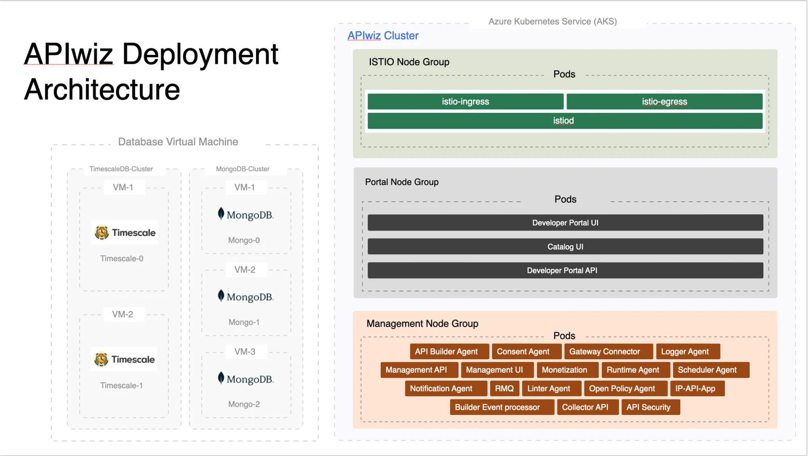

APIwiz specializes in low-code API operations \(API Ops\). The platform provides visual, low-code tools for creating, testing, publishing, and maintaining APIs throughout their lifecycle, without requiring extensive custom code.

This guide describes how to install the APIwiz platform on Kubernetes and virtual machine \(VM\) environments, covering database setup, Kubernetes deployment, and Developer Portal installation.

## Prerequisites

Before you begin, gather the following:

### License key and API keys

Contact the APIwiz DevOps team to request your license key and API keys. These keys are required to install and run your specific version of the platform; the software doesn't install or run correctly without them.

### Domain names, SSL certificates, and SMTP details

The APIwiz platform requires domain names and corresponding SSL certificates to secure communication between clients and the APIwiz application.

**Domains for the main APIwiz platform:**

**Domains for the Developer Portal:**

### Tools and packages

- Kubernetes cluster \(cloud or on-premises\)
- Container registry
- Istio \(optional\)
- Helm \(optional\)
- kubectl
- Virtual machines for databases
- Ansible \(if you're installing databases using Ansible\)

### Required databases

- **MongoDB \(version 7\):** Used for its scalability, performance, and flexible schema.
- **PostgreSQL \(version 16\), TimescaleDB \(version 2.18.0\), and btree\_gin \(version 1.3\):** Used together to manage and analyze time-series data at scale, combining PostgreSQL's foundation with TimescaleDB's time-series optimizations and btree\_gin's indexing for complex queries.

## Set up the databases: MongoDB and TimescaleDB \(PostgreSQL\)

### Disable SELinux

Disabling SELinux ensures the database programs have the permissions needed to run and access files without being blocked by the operating system's security settings.

### Install MongoDB

1. On each node where MongoDB will run, install the MongoDB package. Refer to the official documentation for your Linux distribution, since installation steps vary by distribution:RHEL/CentOSUbuntuDebianAmazon LinuxSUSE

### Configure the MongoDB cluster

After you install the MongoDB software on your servers, configure them to work together as a cluster \(replica set\).

### Generate the cluster key file

The MongoDB servers in the cluster need a secure way to verify they belong to the same authorized group. Do the following:

1. Log in to Node 1.
1. Run the following command to create a secret key file:
   ```text
   sudo mkdir -p /opt/apiwiz/secret && \
      sudo openssl rand -base64 756 > /opt/apiwiz/secret/mongo-cluster-keyfile
   ```
1. Copy the generated key file to Node 2 and Node 3.
1. On Node 1, Node 2, and Node 3, run the following command to secure the file permissions:
   ```text
   sudo chmod 400 /opt/apiwiz/secret/mongo-cluster-keyfile && \
      sudo chown mongodb:mongodb /opt/apiwiz/secret/mongo-cluster-keyfile
   ```

### Create database users on the MongoDB primary

1. Log in to Node 1.
1. Run the following command to create a template folder:
   ```text
   sudo mkdir -p /opt/apiwiz/templates
   ```
1. Add the following script to `/opt/apiwiz/templates/create_db_user.js`:

1. Run the following commands to replace the placeholder values with your MongoDB username and password:
   ```text
   sed -i "s/DB_USER/<MongoDBUserName>/g" /opt/apiwiz/templates/create_db_user.js
      sed -i "s/DB_PASS/<MongoDBPassword>/g" /opt/apiwiz/templates/create_db_user.js
   ```
1. Run the following command to execute the script:
   ```text
   mongosh admin /opt/apiwiz/templates/create_db_user.js
   ```

### Configure MongoDB on all three nodes

1. On Node 1, Node 2, and Node 3, run the following commands to update `/etc/mongod.conf`:
   ```text
   sed -i "/#security:/c security:" /etc/mongod.conf
      sed -i "/security/a  \ \ \ keyFile: /opt/apiwiz/secret/mongo-cluster-keyfile" /etc/mongod.conf
      sed -i "s/bindIp: 127.0.0.1/bindIp: 0.0.0.0/g" /etc/mongod.conf
      ## Enable replication ##
      sed -i "/#replication:/c replication:" /etc/mongod.conf
      sed -i '/replication/a  \ \ \ replSetName: "rs"' /etc/mongod.conf
   ```
1. Run the following command to restart the MongoDB service:
   ```text
   sudo service mongod restart
   ```

### Initialize replication

1. Log in to Node 1.
1. Run the following command to initiate the replica set:
   ```text
   mongosh -u <MongoDBUsername> -p <MongoDBpassword> --eval "rs.initiate()"
   ```
1. Run the following command to add the second MongoDB node to the replica set:
   ```text
   mongosh -u <MongoDBUsername> -p <MongoDBpassword> --eval "rs.add('<MONGOClientIP1>')"
   ```
1. Run the following command to add the third MongoDB node to the replica set:
   ```text
   mongosh -u <MongoDBUserName> -p <MongoDBPassword> --eval "rs.add('<MONGOClientIP2>')"
   ```
1. Run the following command to verify the replication status:
   ```text
   mongosh -u <MongoDBUserName> -p <MongoDBPassword> --eval "rs.status()"
   ```

### Create the first APIwiz workspace

This step creates your first Workspace and initial administrator user account.

1. On Node 1, add the following script to `/opt/apiwiz/templates/create_workspace.js`, replacing `WORKSPACE_NAME`, `LOGIN_ID`, `EMAIL_ID`, `LAST_NAME`, and `FIRST_NAME` with your values:

1. Run the following command to execute the script:
   ```text
   mongosh mongodb://<MongoDBUserName>: <MongoDBPassword>@127.0.0.1/apiwiz /opt/apiwiz/templates/create_workspace.js
   ```

### Import static data

1. Run the following command to create the MongoDB import folder:
   ```text
   mkdir -p /opt/apiwiz/mongo
   ```
1. Upload the `db-collections.zip` file to `/opt/apiwiz/mongo`.
1. Run the following command to restore the data:
   ```text
   mongorestore --host <pvtIP> -u <MongoDBUserName> -p <MongoDBPassword> --port 27017 --gzip /opt/apiwiz/mongo/db-collections
   ```

## Install MongoDB and TimescaleDB using an Ansible playbook \(alternative method\)

### Prerequisites

1. On the node that has SSH access to all database nodes, install the Ansible package. Refer to the official Ansible installation documentation.
1. Upload the `apiwiz-db-automation-ansible.zip` file, provided by APIwiz, to the same node where Ansible is installed. The SSH user must have root privileges on the target nodes.

### Configure firewall rules for a multi-node setup

In your cloud environment, configure the security group to allow the following ports for each MongoDB node:

Once you meet all prerequisites, proceed with the database installation steps below.

### Install MongoDB as a replica set using Ansible

MongoDB can run on a single node or on multiple nodes. To install MongoDB as a replica set, do the following:

1. Log in to the Ansible node.
1. Change to the MongoDB directory:
   ```text
   cd {{path}}/apiwiz-db-automation-ansible/mongodb
   ```
1. In the `group_vars/mongo-replicaset.yaml` file, provide the appropriate values for `<secure_username>` and `<secure_password>`:
   ```text
   vim group_vars/mongo-replicaset.yaml
   ```
1. In the `inventory/replicaset.ini` file, update the replica set nodes and SSH user:
   ```text
   node1 ansible_host=<IP1> ansible_user=<user>
      node2 ansible_host=<IP2> ansible_user=<user>
      node3 ansible_host=<IP3> ansible_user=<user>
   ```
1. Run the Ansible playbook:

### Install TimescaleDB as a master-replica setup using Ansible

1. Log in to the master node where the Ansible file is uploaded.
1. Change to the TimescaleDB directory:
   ```text
   cd path/apiwiz-db-automation-ansible/timescaledb
   ```
1. In the inventory file, provide the appropriate values for the PostgreSQL `<user>` and `<password>`:
   ```text
   vim inventory
      ---
      [master]
      master-node ansible_host=<IP1> ansible_user=<user>

      [replica]
      replica-node ansible_host=<IP2> ansible_user=<user>

      [all:vars]
      pg_version=16
      tsdb_version=2.18.0
      pg_password='<password>'
      pg_repuser=<user>
      repuser_password='<password>'
      pg_rep_slot=replica_1_slot
      pg_database=apiwiz
      allow_cidr=10.1.0.0/24
   ```
1. Complete the prerequisites referenced using this [documentation](https://sudheer-baraker.medium.com/ansible-passwordless-ssh-authentication-using-public-private-key-pairs-1bf91fff349e).
1. Run the Ansible playbook:
   ```text
   cd {{path}}/apiwiz-db-automation-ansible/timescaledb
      ansible-playbook -i inventory playbook.yml
   ```

## Deploy APIwiz on Kubernetes

Once you complete the database setup described above, deploy the APIwiz platform to your Kubernetes cluster. APIwiz supports self-hosted Kubernetes and managed Kubernetes services on any cloud, for example EKS, GKE, AKS, and OpenShift.



### Configuration fields for Kubernetes deployment

**Configuration file template:**

```
## CommonDomainName ex: domain.local, apiwiz.io, example.com. For a cloud setup, provide your purchased domain
DomainName=

## Helm values
NAMESPACE=
ContainerRegistryName=

## Application host ex: api, coreui-v2, api-catalog (CORE_API_HOST)
CORE_API_HOST=
BUILDER_HOST=
CONSENT_HOST=
CORE_UI_V2_HOST=
WorkSpaceName=

DEVPORTAL_API_HOST=
DEVPORTAL_HOST=
CATALOG_UI_HOST=

# License configuration
LICENSE_KEY=

# API keys
API_KEY=
API_UPDATE_KEY=

## AWS keys for APIwiz ECR and ip-api
AWS_ACCESS_KEY=
AWS_SECRET_KEY=

## ImagePullSecret name; leave empty if not pulling from APIwiz ECR
IMAGE_PULL_SECRET=

# MongoDB configuration, example: mongodb://username:password@<IP>:27017/<database_name>?authSource=admin
# Note: the password should not contain the '@' character
MONGODB_URI=
MONGODB_NAME=

# PostgreSQL Lite configuration, example: jdbc:postgresql://<IP>:5432/<database_name>
datasource.url=
datasource.password=

# Rate limiting (optional)
ratelimit.enabled=
## Provide the URL below only if ratelimit.enabled=true
hazelcast.uri=

# API Builder application type: "cloud" or "on-prem"
apibuilder.application.type=

## RabbitMQ
itorix.rabbitmq.port=
itorix.rabbitmq.username=
itorix.rabbitmq.password=

## Frontend configuration keys
# Catalog UI
REACT_APP_MOCK_API_BASE_URL= ## Create a proxy in API Builder with the URL provided here; get the tenant ID and paste it in the Catalog UI config as REACT_APP_TENANT_ID

# Core UI v2
REACT_BUILDER_CNAME= # Load balancer URL
```

**Configuration fields**

### Configure kubectl to connect to your Kubernetes cluster

1. Run the following command to check the current context:
   ```text
   kubectl config current-context
   ```
1. Run the following command to switch to your cluster's context:
   ```text
   kubectl config use-context my-cluster-name
   ```
1. Run the following command to set the cluster:
   ```text
   kubectl config set-cluster my-cluster-name
   ```

### Create the namespace

Run the following command to create a dedicated namespace for the APIwiz platform, replacing `<NAMESPACE>` with the value given in the Configfile:

Example:

### Deploy the APIwiz platform components

1. Run the following command to deploy an application component, replacing `<app-name>` with the component's name:
   ```text
   kubectl -n apiwiz-system apply -f <app-name>-deploy.yaml
   ```
1. Run the following command to deploy the OPA server:
   ```text
   kubectl -n apiwiz-system apply -f opa-server-deploy.yaml
   ```
1. Run the following command to deploy RabbitMQ:
   ```text
   kubectl -n apiwiz-system apply -f rabbitmq-deploy.yaml
   ```

## Install the APIwiz Developer Portal

**Requirement:** Ensure your **kubectl** command is configured to connect to your APIwiz Kubernetes cluster, as described above.

1. Run the following command to deploy the Developer Portal API:
   ```text
   kubectl -n apiwiz-system apply -f devportal-api-deploy.yaml
   ```
1. Run the following command to deploy the Developer Portal UI:
   ```text
   kubectl -n apiwiz-system apply -f devportal-ui-deploy.yaml
   ```
1. Run the following command to deploy the API Catalog UI:
   ```text
   kubectl -n apiwiz-system apply -f apiwiz-api-catalog-ui-deploy.yaml
   ```

## Reference: Developer Portal components

## Reference: APIwiz application list